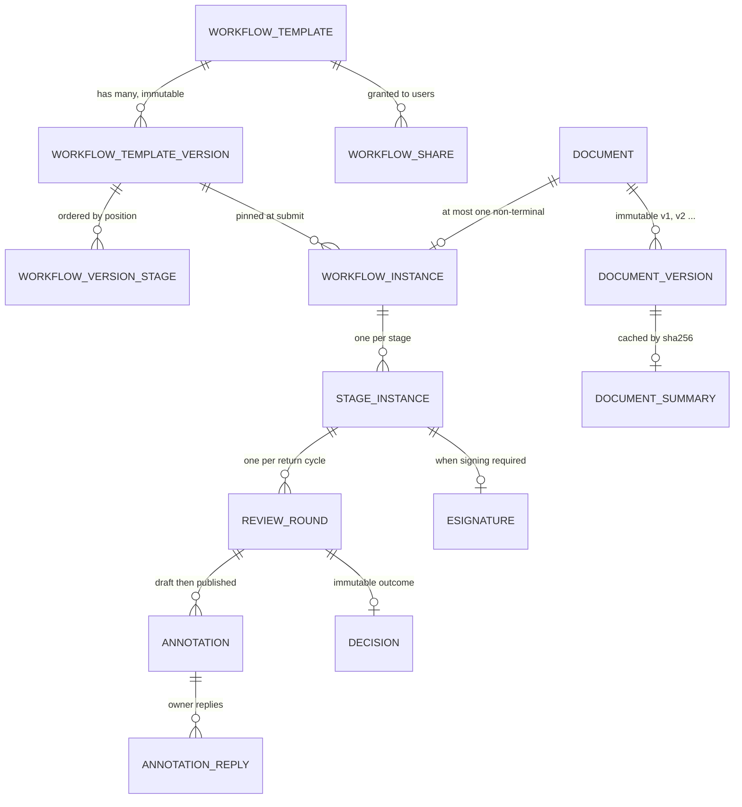
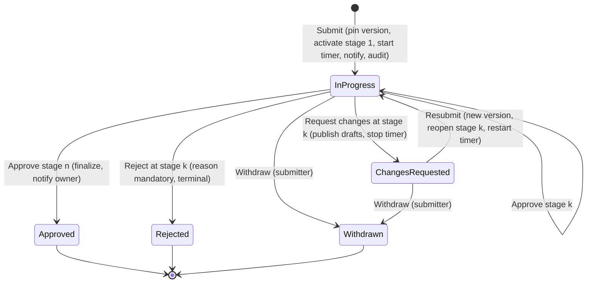

# DocFlow — Workflow Module Implementation Plan

> **Source** `module doc/DocFlow_Workflow_Module_Requirements.docx` v1.0, 28 October 2026 —
> read in full, line by line: 2,903 paragraphs, 738 table rows, 15 sections + Appendix A.
> Footnotes, endnotes and comments were extracted and **verified empty**. The file contains
> **no embedded images or drawings** — every "diagram" in the document is a table, and all of
> them are covered below.
>
> **Status of this document** Analysis and planning only. No source code, config or existing
> file was created, edited or deleted while producing it, and no git command was run.
>
> **This is the §3 Discovery Report.** The specification was written without access to the
> DocFlow codebase and makes that review a mandatory first deliverable:
>
> > "every statement here about 'existing' components, routes or services is a requirement to
> > verify, not a fact. Where discovery contradicts an assumption in this document, raise it
> > before implementation and update Section 15." — §3, NOTE box
>
> §2 and §8 of this plan are that verification.

**Contents**

| § | Title |
|---|---|
| 1 | Summary |
| 2 | Existing code audit — reuse / extend / new, and twelve defects |
| 3 | Requirements list — all 238, numbered, verbatim |
| 4 | Detailed workflow per feature |
| 5 | Implementation plan — phases and tasks |
| 6 | Testing plan |
| 7 | Traceability matrix — requirements, E1–E30, T1–T40 |
| 8 | Open questions, conflicts and assumptions |

---

## 1. Summary

### 1.1 What is being built

Two modules that operate as one system:

- **Module 1 — User Workflow Management** (§5): define a named, private-by-default, sequential
  approval workflow of 1–10 stages; share it with an individual colleague through chat; version,
  duplicate, archive and delete it; select it when uploading a document; submit, track progress,
  respond to change requests, upload revisions, resubmit, and withdraw.
- **Module 2 — Approver Workflow Management** (§6): receive an actionable notification; work in a
  dashboard of assignments with deadlines and urgency; open a review page with a PDF viewer, a
  grounded AI summary, and inline anchored highlights and comments; and end a round with
  **Approve** (with mandatory signing where the rules demand it), **Request Changes**, or
  **Reject** with a validated reason — every step atomic, idempotent, authorized server-side and
  audited.

### 1.2 Scale of the specification

| Measure | Count |
|---|---|
| Numbered requirements (`WF-*`, `AP-*`, `X-*`, `DM-*`, `BR-*`, `UX-*`) | **238** in 30 families |
| Gaps closed versus the original text (G1–G33) | 33 |
| Edge cases with a mandated expected behaviour (E1–E30) | 30 |
| Test scenarios with expected results (T1–T40) | 40 |
| Open product decisions (O-1…O-15) | 15, of which 4 blocking |
| State machines (§4.3 A–E) | 5 |
| Notification catalog (N1–N15) | 15 events with dedupe keys |
| Audit event catalog (§7.2) | 10 categories, ~45 event types |

### 1.3 The headline finding of discovery

**The codebase is substantially further along than the specification assumes.** A working
sequential workflow engine, a real cryptographic signing subsystem, an append-only audit log,
Office→PDF conversion, OCR, prompt-injection defence, an idempotent submit with server-side
preflight, and a submission wizard with workflow selection **already exist**.

Two consequences matter immediately:

1. **Two blocking open decisions are answered by the code itself.** O-1 (does a signing process
   exist, and does it bind to a document hash?) — **yes**: `Backend/app/core/signing.py` produces
   an RSA-PSS-SHA256 signature over a canonical payload binding approver, document-version hash,
   decision, step and timestamp. The §6.8 CRITICAL box — "do not ship a checkbox that merely says
   signed" — is already satisfied. O-15 (is email a channel today?) — **yes**.
   O-6 is **forced** rather than chosen: the chat has no custom card message type, so the
   deep-link text fallback is the only option.

2. **`BR-06` is already implemented correctly.** The specification singles out "a revised document
   returns to the stage that requested changes, not to Stage 1" as the critical principle the
   original text got right. `workflow_service.resume()` does exactly this — it creates a new
   `ApprovalStep` at the unchanged `current_stage_id`, leaves earlier approvals intact, and
   notifies only that stage's approver.

Across all 238 requirements: **22 are already satisfied (Reuse)**, **66 need an existing component
changed (Extend)**, and **150 are genuinely new**.

### 1.4 The other headline finding: twelve defects

Discovery also found **twelve defects and conflicts in the existing code**, two of which silently
break the specification's own core rules:

- **`DM-02` is violated today.** `workflow_service.advance_stage()` reads stages from the **live**
  template, not from the frozen snapshot, so editing a workflow *does* change in-flight runs from
  stage 2 onward.
- **The builder's edit mode silently discards stage edits.** The UI sends `stages` in its PATCH;
  the request schema has no `stages` field, so they are dropped. Its own banner — "Saving creates
  a new version of this workflow" — is untrue.

Fixing these two precedes every new feature in §5. The full list is §2.4.

### 1.5 Decisions taken before planning

| # | Question | Decision | Effect |
|---|---|---|---|
| D1 | "Submitter's manager" semantics (§15.1, G6, WF-STG-23/24) | **Add `users.manager_id`, fall back to the department head when NULL** | Migration + admin UI; the resolver has two paths, both audited and tested |
| D2 | Depth of §4 | **Full 11-part treatment for state-changing, business-rule and permission requirements; compact numbered steps for UI, visual, responsive and a11y** | ~60 get the full treatment with Mermaid; all 238 appear in §7 |
| D3 | PDF viewer dependency (AP-VWR-01) | **Plan on `pdfjs-dist`** | Explicit approval gate at the head of Phase 3 |
| D4 | Existing bulk approve vs §2.1 "out of scope" | **Keep it, but route it through the new server-side approval logic; it must refuse or skip any signing-required stage and apply the same authorization checks as single approve** | Task P2-14; bulk becomes a loop over the hardened single-decision service, never a parallel code path |

**On requirement IDs.** This plan does **not** renumber requirements. §1.2 of the specification is
explicit: *"Every requirement has a stable ID (for example WF-STG-04, AP-ANN-07). Use these IDs in
tickets, pull requests, test cases and audit comments."* Renumbering would break traceability
against QA's cases and Appendix A. §3 therefore carries **both** a sequential `REQ-nnn` (as
requested) **and** the specification's own stable ID, which is the one to use in tickets and tests.

### 1.6 Delivery shape

Five phases, mapped to the specification's own §14, because the code audit *is* Phase 0:

| Phase | Scope | Exit |
|---|---|---|
| **0** Discovery | This document; confirm O-2, O-4, O-7, O-9; approve the migration and `pdfjs-dist`; capture the regression baseline | Report approved, decisions recorded |
| **1** Workflow definitions | Immutable versions, shares, builder + preview, lifecycle, audit | A user can create, preview, save, edit, share and archive a workflow |
| **2** Submission and execution | Preflight, submit, run engine on the **pinned** version, stage instances, signing enforcement, notifications, dashboard, SLA, reassignment | A document is driven to Approved or Rejected by real approvers |
| **3** Review and revision | Viewer, annotations with autosave, Request Changes, owner feedback, revision, resubmission, carry-over | The full change-request loop works with comments |
| **4** Intelligence and hardening | AI summary with grounding, version diff, escalation, a11y, performance, security, observability, feature flag | Every §13.4 acceptance criterion met |

---

## 2. Existing code audit

Verified by reading the code, not by inference. File paths are relative to the repository root.

### 2.1 Reuse as-is

| Capability | Where | Serves |
|---|---|---|
| **Cryptographic signing** — RSA-PSS-SHA256 over a canonical payload binding approver + document-version hash + decision + step + timestamp; stored `signed_payload`/`payload_hash`/`signature_b64`/`key_id`; public-key endpoint; live re-verification with a cached result | `Backend/app/core/signing.py`; `ESignature` in `app/models/workflow.py`; `approval_service._sign_decision()`, `verify_step_signature()`; `GET /approvals/signing-key` | **Answers O-1.** AP-APR-03/05/06, BR-08, BR-09 |
| **Append-only audit log** — `instance_id` FK, actor role snapshot, before/after JSONB, indexes on instance / actor / resource; no update or delete path in code or API | `app/models/audit.py`; `_write_audit()` in `approval_service.py` and `workflow_service.py` | X-AUD-01/02/03, BR-10 |
| **Office→PDF conversion and OCR** — sandboxed `soffice` with a private `-env:UserInstallation` profile (added after a concurrency race), 25 MB cap, `MAX_OCR_PAGES = 15`, explicit failure reporting rather than silent empty content | `app/services/document_importer.py` (`convert_doc`, `convert_docx`, OCR path); `pytesseract`, `pdf2image`, `pdfplumber`, `pypdf`, `python-docx` all in `requirements.txt` | **§6.4.1 renditions and E14 need no new dependency** |
| **Prompt-injection defence** — `sanitize_for_prompt()` defangs instruction-like text and the prompt builder fences all retrieved content as untrusted reference data | `app/ai/ingestion.py` | AP-SUM-09, T36 |
| **PII redaction** across seven prompt sites | `app/services/pii_redactor.py` | AP-SUM-10 |
| **Per-page PDF text extraction** with explicit "needs OCR" reporting | `app/ai/ingestion.py::extract_text` | §6.4.4 step 1, AP-SUM-06, AP-RES-03 |
| **Idempotent submit + server-side preflight** — `Idempotency-Key` header with replay; `submit-check` whose rules the submit endpoint deliberately re-runs because the wizard's copy can be stale | `POST /documents/{id}/submit-check`; `document_service.submit_document()`; `app/services/document_validation.py` | WF-SUB-02/04 base, E10, T26 |
| **Submission wizard** with a searchable workflow combobox and a human-readable pre-submit review that resolves approver names without `admin:users` | `Frontend/src/pages/documents/SubmitWizard.tsx`; `GET /workflow-templates/{id}/review`; `TemplateService.get_review()` | WF-SEL-01/02/03/04/07, WF-SUB-01/05 base |
| **Own-workflow CRUD with real server-side validation** — list (mine / shared / search), create, full-detail read, duplicate, enable/disable, soft delete. Validation already rejects: no stages, duplicate or negative `sequence_order`, a stage with no approver rule, `min_approvals_required` greater than the rule count, unknown rule types, `specific_user` with no user, users who are not active members of the org, and trainees | `app/routers/workflow_templates_public.py`; `app/services/template_service.py` (`validate_definition`, `_reject_trainee_approvers`, `_assert_can_edit`, `_assert_can_view`) | WF-LIST-04/05, WF-LC-02, WF-STG-28, **WF-OWN-01/10** (404-not-403 already correct) |
| **Resubmit to the same stage** — new `ApprovalStep` at the unchanged `current_stage_id`; earlier approvals untouched; only that stage's approver notified | `workflow_service.resume()`; `POST /documents/{id}/revise-and-resume` | **BR-06 already correct**, WF-REV-07/12/14, T11, T12 |
| **Withdraw** | `workflow_service.cancel()`; "Cancel Workflow" in `DocumentDetailPage.tsx` | WF-WD-01/02 base |
| **Chat** — 1:1 `direct` and `workflow_context` conversations, participants, `attachment_ids`, WebSocket | `app/models/chat.py`; `app/services/chat_service.py`; `Frontend/src/components/ui/WorkflowChatPanel.tsx` | Sharing channel for WF-OWN-02/04. **No card message type → O-6's deep link is forced** |
| **Notifications** — Postgres is the source of truth, Redis carries only the push signal, per-org channel flags, email via Celery → SMTP (Mailpit in dev), WebSocket fan-out | `app/services/notification_service.py`; `app/models/notification.py`; `app/routers/ws_notifications.py` | **Answers O-15.** §7.1 delivery base |
| **Event fan-out** | `app/core/events.py` (EventBus) + `app/subscribers.py` | X-NOT-01 base — needs an outbox, §2.3 |
| **Background jobs** — Celery with `default`, `ai`, `email` queues and a beat schedule | `app/core/celery_app.py`; `app/workers/*` | **§15.1 assumption confirmed** |
| **Frontend dependencies already installed** — `@dnd-kit/core` 6.3.1 + `@dnd-kit/sortable` 10.0.0, `react-resizable-panels` 4.15.0, `sonner`, `framer-motion`/`motion`, `@tanstack/react-query`, `vaul`, `date-fns`, `@playwright/test` | `Frontend/package.json` | WF-STG-07 drag, AP-DET split panel, UX-INT-06 toasts, UX-VIS-04 motion, e2e. **Only `pdfjs-dist` is missing** |
| **Design system** — tokens plus `PageHeader`, `EmptyState`, `StatusBadge`, `Skeleton`, `IconChip`, `ConfirmDialog`, `SegmentedControl`, `GlassCard` | `Frontend/src/components/ui/*`; `src/index.css` | UX-VIS-01 ("do not introduce a second visual language") |
| **a11y lint in CI** — `jsx-a11y` configured in oxlint, fourteen real findings already fixed | `Frontend/.oxlintrc.json` | UX-A11Y-01 partial |

### 2.2 Extend

| Component | Current state | Extension required |
|---|---|---|
| `WorkflowTemplate` | `created_by` owner, `visibility` private/organization, `version` **int counter**, `is_active`, `department_id`, `doc_type_id` | Per-user shares; **immutable version rows**; `require_full_reapproval`; `status` archived distinct from `is_active`; `current_version_id` |
| `WorkflowStage` | `name`, `sequence_order`, `stage_type`, `min_approvals_required`, `sla_hours`, `requires_signature`, `reapproval_on_revision` | `department_id`; `due_within_value` + `due_within_unit` (the UI needs the unit, the engine needs hours); per-version position and name uniqueness |
| `StageApproverRule` | `specific_user`, `role_in_department`, `manager_of_requester`, `dynamic_by_amount_threshold` (unimplemented — correctly warns instead of silently falling back) | `manager_of_requester` resolver rewritten per **D1**. The v1 builder exposes only `specific_user` and `manager_of_requester` (§5.5 field B); `role_in_department` stays supported but is not offered |
| `WorkflowInstance` | `template_version_snapshot` JSONB written at submit, `current_stage_id` never reset on changes-requested (correct), `status` | `version_id` (the pinned version), `previous_run_id`, `row_version`, `idempotency_key`; **the snapshot must actually be read** (defect 1) |
| `ApprovalStep` | One row per approver per round; `due_at`, `round_number`; revoke / supersede columns with `is_counted` | A **stage-instance layer above it** — §4.3 D's eight statuses (Pending, Active, Awaiting Signature, Changes Requested, Approved, Rejected, Blocked, Superseded), resolved approver, `signing_required` + reason, timer pause, row version. None of this has a home today |
| SLA | `sla_tasks.check_sla_breaches` every 15 min: breach → escalate → notify approver + department head. `SLAEvent` append-only. `domain/sla.py::calculate_due_at` already supports business hours behind a flag | 75 % reminder; **pause while Changes Requested or Blocked**; overdue as a state distinct from escalation; escalate only 24 h after overdue; dedupe keys; 1-minute cadence |
| `Notification` | No `dedupe_key` | `dedupe_key` + unique index; the N1–N15 catalog |
| `Department` | `name`, `code`, `parent_id` (**hierarchical**), `head_user_id` | `requires_signature` boolean, Finance seeded true |
| `User` | `email`, `name`, `role`, `is_active`, `status`, `department_id` | `manager_id` (**D1**) |
| `WorkflowsPage.tsx` | Client-side filter over one list; tabs All/Active/Completed/Paused/Archived; decorative trend arrows; adapts templates into an unrelated display model | My Workflows / Shared with me with counts, Archived as a filter, server-side search + pagination, real row actions, all five states |
| `WorkflowBuilderModal.tsx` | Modal; name, description, visibility, stages, rules, `min_approvals`, raw `sla_hours`, signature toggle; backend validation surfaced verbatim (good) | Full-page builder + preview at `/workflows/new` and `/workflows/:id/edit`; real drag reorder; keyboard reorder; undo toast; department; due-within with unit; 10-stage cap; locked signing toggle; validation summary |
| `ApprovalsPage.tsx` | Flat pending queue, inline approve/reject/delegate, bulk approve, signature-on-422 retry (good), history panel | Four working tabs with counts, server-side filters/sort/pagination, urgency, summary strip, auto-refresh — plus a **details page that does not exist at all** |
| `DocumentDetailPage.tsx` | Status chips, revise-and-resume on save, Cancel Workflow, workflow chat panel | Approval progress timeline; feedback panel grouped by page; replies and mark-Addressed; read-only history tab; resubmit review step; rejected banner |
| `can_user_access_document` | Owner, `admin`/`hr`, **or any worker in the same department** | Too broad for §7.3 — defect 10 |
| `generate_presigned_download_url` | `expires_in_seconds = 3600`, `ResponseContentDisposition: attachment` | AP-VWR-04 needs ≤ 5 minutes and inline disposition — defect 11 |

### 2.3 Build new

Stage instances · immutable workflow versions · workflow shares · review rounds · a decisions
table · annotations with anchoring, draft status and autosave · annotation replies · document
summaries · an idempotency-key store · a transactional outbox · the PDF viewer · the AI summary
pipeline with grounding · the owner feedback panel · the owner progress timeline · admin
reassignment · version comparison · and the approval details page.

### 2.4 Twelve defects and conflicts found in the existing code

Reported, not fixed — §3.2 requires each to be raised and recorded before coding, and
`AUDIT/CLAUDE.md` rule 2 requires naming files before editing them.

| # | Finding | Evidence | Severity |
|---|---|---|---|
| **1** | **`DM-02` is violated today.** Stage advancement reads the **live** template, so editing a workflow changes in-flight runs from stage 2 onward. The snapshot is written at submit and then never read | `workflow_service.advance_stage()` calls `stage_repo.list_for_template(instance.template_id)`; `template_version_snapshot` has no reader | **Critical** — DM-02, BR-02, E6, T22 |
| **2** | **The builder's edit mode silently discards stage edits.** The UI PATCHes `stages`; the schema has no such field, so Pydantic drops it and only template-level columns are written. The modal's banner ("Saving creates a new version of this workflow. Documents already in flight keep running against the version they were submitted with") is **not true** — `version` is an int counter and there are no version rows | `WorkflowBuilderModal.tsx` `saveM` builds `stages` into the payload; `schemas/workflow_instances.py::WorkflowTemplateUpdate` is name / description / department_id / document_type_scope / is_active only | **Critical** — silent data loss; blocks WF-LC-01, WF-BLD-06, DM-01 |
| **3** | **No real manager.** `users` has `department_id` only; `manager_of_requester` resolves to `departments.head_user_id`, so a whole department shares one approver and a department head becomes their own manager | `app/models/user.py`; `workflow_service._apply_rule()` | **High** — resolved by **D1** |
| **4** | **No `departments.requires_signature`.** The Finance rule has nothing to key off, and WF-STG-20 forbids name matching. Departments are also hierarchical, so §15.1's inheritance question is live | `app/models/organization.py::Department` | **High** — blocks WF-STG-20/21, BR-08, E22, T14, T21 |
| **5** | **Rejection reason is optional.** `note` is nullable and has no validator — nothing enforces a reason, let alone ≥ 10 meaningful characters | `schemas/workflow_instances.py::DecisionRequest` | **High** — AP-REJ-02, T15, E23 |
| **6** | **The SLA timer never pauses** on Changes Requested, there is no 75 % reminder, and breach escalates immediately with no separate overdue state — so a returned document keeps accruing toward breach while the owner, not the approver, holds it | `workers/sla_tasks.py::_run_sla_check()`; `get_overdue_pending()` filters on `decision == pending` regardless of instance status | **High** — §6.10, AP-SLA-02/03/04, T34 |
| **7** | **Dead UI controls.** The builder renders `GripVertical` with no `DndContext` anywhere in the file. `ApprovalsPage`'s *Approved*, *Rejected* and *All* tabs are permanently empty because `GET /approvals` returns pending steps only | `WorkflowBuilderModal.tsx:341`; `approval_service.list_my_approvals()` → `get_pending_for_approver()` | **High** — a direct UX-INT-01 violation ("No decorative controls and no dead links"), AP-DSH-01 |
| **8** | **`delete` has no in-flight-run guard** | `template_service.delete()` → `soft_delete()` | Medium — WF-LC-04, WF-LIST-07, T23 |
| **9** | **Trainees can never be approvers**, enforced in three places by design | `SYSTEM_ROLES` in `domain/enums.py`; `workflow_service._exclude_trainees()`; `template_service._reject_trainee_approvers()` | Medium — **role conflict**, Q4 |
| **10** | **Document read access is department-wide for workers**, so a colleague who is not an approver can read a document under review. §7.3 says "Other user: ✗" | `document_service.can_user_access_document()` | Medium — AP-DET-03, T17, T39 |
| **11** | **Presigned URLs last 1 hour and force `attachment`** — too long for AP-VWR-04 (≤ 5 min) and unusable for an inline viewer | `core/storage.py::generate_presigned_download_url` | Medium — AP-VWR-04 |
| **12** | **525 lines of dead code** — `domain/workflow_engine.py` and `domain/approval_logic.py` are imported by nothing outside themselves; tables `workflow_step_instances` and `approval_decisions` are legacy. Already recorded in `AUDIT/docs/IMPLEMENTATION_STATUS.md` | `grep -rn workflow_engine Backend/app` returns only the defining file | Low — removal needs approval + a migration; **out of scope here** |

### 2.5 Existing features that go beyond the specification

To be **reconciled, never silently deleted** (§3.2 CRITICAL: "Do not delete or rename existing
items without written approval"):

| Feature | Where | Tension |
|---|---|---|
| `ApprovalRevocation` — revoke / recall with `applied` vs `requested` paths and admin resolution | `models/workflow.py`, `approval_service.revoke_decision()`, `resolve_recall()` | Not in the specification at all (Q7) |
| `Delegation` — step and scope delegation | `models/workflow.py`, `approval_service.delegate()` | §2.1 lists delegation as **out of scope**; v1 allows only admin reassignment (Q3) |
| `DocumentStatus` with ten values incl. `FINALIZED`, `REVOKED`, `READY`, `EXPIRED` | `models/document.py` | §4.3 B names six (Q5) |
| `WorkflowInstanceStatus.RECALL_REQUESTED`, `FINALIZED` | `domain/enums.py` | §4.3 C names six (Q5, Q7) |
| `parallel` / `conditional` stage types, `WorkflowStageCondition`, `min_approvals_required > 1` | `models/workflow.py` | §2.1 lists both as out of scope; BR-03 says exactly one stage Active |
| Bulk approve | `ApprovalsPage.tsx` | §2.1 out of scope — resolved by **D4** |

### 2.6 §15.1 assumptions — now verified

| Assumption the specification asked discovery to verify | Verdict |
|---|---|
| A user's manager is a reliable attribute in the org directory | **False** — department head only (defect 3; resolved by D1) |
| Departments are a single-level list with a primary department per user | **Partly** — one `department_id` per user, but departments are **hierarchical** via `parent_id` (Q6) |
| A notification system and audit log exist and can accept new event types | **True** — `notifications.type` and `audit_logs.action` are VARCHAR, so new values need no migration |
| The frontend has PDF viewing, or PDF.js may be added | **No viewer exists** — D3 / Q2 |
| Background jobs or queues exist for timers and summaries | **True** — Celery + beat, three queues |

---

## 3. Requirements list

All **238** numbered requirements, in document order, with the section they came from and their
**original wording**. `Pri` and `Src` are the specification's own Priority and Source columns
(Orig = in the original requirement text; Detail = stated there and made testable here; NEW = a
gap this specification fills). `Disposition` is the audit verdict from §2 — **Reuse** = already
satisfied, **Extend** = an existing component must change, **New** = nothing exists. `Ph` is the
delivery phase from §5.

Totals: **Reuse 22 · Extend 66 · New 150.**

> Use the **Spec ID**, not `REQ-nnn`, in tickets, pull requests, test names and audit comments
> (§1.2 of the specification). `REQ-nnn` exists only to give this list a stable reading order.

| REQ | Spec ID | § | Requirement (original wording) | Pri | Src | Class | Disposition | Ph |
|---|---|---|---|---|---|---|---|---|
| REQ-001 | `DM-01` | 4.4 | Every saved edit of a workflow creates a new immutable workflow_version. Existing versions are never modified. | Must | NEW | business rule | **New** | 1 |
| REQ-002 | `DM-02` | 4.4 | A workflow run is pinned to the workflow version selected at submission. Later edits, archive or delete do not change a run already started. | Must | NEW | business rule | **New** | 1 |
| REQ-003 | `DM-03` | 4.4 | The workflow list and upload selector always show the latest version. The approval details page shows the pinned version (and "Workflow was updated since this run started" if a newer version exists). | Should | NEW | business rule | **New** | 1 |
| REQ-004 | `DM-04` | 4.4 | The version number is shown in the builder header ("Version 3") and in the audit trail entries that reference the workflow. | Should | NEW | business rule | **New** | 1 |
| REQ-005 | `BR-01` | 4.5 | A document may have at most one active workflow run at a time. | Must | Detail | business rule | **Extend** | 1-2 |
| REQ-006 | `BR-02` | 4.5 | A run is pinned to one workflow version for its entire life. | Must | Detail | business rule | **Extend** | 1-2 |
| REQ-007 | `BR-03` | 4.5 | Stages execute strictly in sequence. Exactly one stage is Active at a time in v1. | Must | Detail | business rule | **New** | 1-2 |
| REQ-008 | `BR-04` | 4.5 | Only the resolved approver of the Active stage may approve, request changes on, or reject the document. Everyone else receives 403. | Must | Detail | business rule | **New** | 1-2 |
| REQ-009 | `BR-05` | 4.5 | The submitter can never be the approver of any stage of their own submission (self-approval is blocked at submission time and again at runtime). | Must | Detail | business rule | **New** | 1-2 |
| REQ-010 | `BR-06` | 4.5 | A change request at stage k returns the document to stage k, never to stage 1, unless the pinned workflow version has "Require full re-approval after changes" turned on. | Must | Detail | business rule | **Reuse** | 1-2 |
| REQ-011 | `BR-07` | 4.5 | Rejection is terminal for that run. (Default policy; Open Decision O-2.) The owner cannot resubmit the same run. The owner can use Submit as New, which creates a new run from Stage 1, linked to the rejected run for audit. | Must | Detail | business rule | **New** | 1-2 |
| REQ-012 | `BR-08` | 4.5 | If the stage department requires signing (for example Finance), or the resolved approver belongs to such a department, signing is mandatory and cannot be turned off, by the UI or by the API. | Must | Detail | business rule | **New** | 1-2 |
| REQ-013 | `BR-09` | 4.5 | A recorded decision (approval, change request, rejection) is immutable. Corrections are made by new records, never by editing. | Must | Detail | business rule | **Extend** | 1-2 |
| REQ-014 | `BR-10` | 4.5 | Every state change writes its audit event in the same database transaction as the change. | Must | Detail | business rule | **Extend** | 1-2 |
| REQ-015 | `BR-11` | 4.5 | Document versions are immutable. A new upload always creates a new version; nothing is overwritten. | Must | Detail | business rule | **Extend** | 1-2 |
| REQ-016 | `BR-12` | 4.5 | Every query and mutation is scoped to the caller’s organization. Cross-organization access is impossible, including by guessing IDs. | Must | Detail | business rule | **Extend** | 1-2 |
| REQ-017 | `BR-13` | 4.5 | The server clock is authoritative for deadlines, timestamps and ordering. | Must | Detail | business rule | **Extend** | 1-2 |
| REQ-018 | `BR-14` | 4.5 | Approved, Rejected and Withdrawn are final states. Any new attempt is a new run. | Must | Detail | business rule | **Extend** | 1-2 |
| REQ-019 | `BR-15` | 4.5 | While a run is In Progress or Changes Requested the document file cannot be edited, replaced or deleted except through the resubmission flow. | Must | Detail | business rule | **New** | 1-2 |
| REQ-020 | `WF-OWN-01` | 5.1 | A new workflow is private to its creator. No other user, including users in the same organization, can list, read or use it. | Must | Orig | permission | **Reuse** | 1 |
| REQ-021 | `WF-OWN-02` | 5.1 | The owner can share a workflow with one individual user in the same organization through the existing chat/messaging feature. A share is complete only when the backend has created the share record; sending a chat message alone grants nothing. | Must | Detail | permission | **New** | 1 |
| REQ-022 | `WF-OWN-03` | 5.1 | Sharing is initiated from (a) the workflow row/card menu "Share" and (b) the chat composer attachment menu "Share workflow" (if the chat supports attachments). Both open the same user picker and call the same endpoint. | Should | NEW | permission | **New** | 1 |
| REQ-023 | `WF-OWN-04` | 5.1 | The chat message created by sharing shows a workflow card (name, stage count, owner) with an "Open" action for the recipient. If the chat cannot render cards, send a text message with a deep link to /workflows/:id. | Should | NEW | permission | **New** | 1 |
| REQ-024 | `WF-OWN-05` | 5.1 | A recipient receives USE permission only: they may view the full configuration (stages, approvers, departments, deadlines, signing flags), select the workflow on upload, and Duplicate it into their own private copy. They cannot edit, archive, delete or re-share the original. | Must | NEW | permission | **New** | 1 |
| REQ-025 | `WF-OWN-06` | 5.1 | The owner can revoke a share at any time from a "Shared with" panel on the workflow. Revocation immediately removes the workflow from the recipient’s list and upload picker. Runs already started continue unaffected (DM-02). | Must | NEW | permission | **New** | 1 |
| REQ-026 | `WF-OWN-07` | 5.1 | Sharing is idempotent: sharing again with the same user returns the existing share and does not create a duplicate row or a second chat message. | Must | NEW | permission | **New** | 1 |
| REQ-027 | `WF-OWN-08` | 5.1 | Sharing with a user outside the organization, a deactivated user, or the owner themself is rejected by the server (422/403) with a clear message. | Must | NEW | permission | **New** | 1 |
| REQ-028 | `WF-OWN-09` | 5.1 | Shared workflows appear for the recipient under the "Shared with me" tab of /workflows, labelled with the owner’s name and avatar, and in the upload selector under a "Shared with me" group. | Must | NEW | permission | **New** | 1 |
| REQ-029 | `WF-OWN-10` | 5.1 | Every read and use endpoint verifies ownership or an active share. UI hiding is never relied upon. Requesting another user’s private workflow by ID returns 404 (not 403) to avoid revealing existence. | Must | Detail | permission | **Reuse** | 1 |
| REQ-030 | `WF-OWN-11` | 5.1 | Sharing and revoking write audit events (7.2) and notify the recipient (share) in-app (7.1). | Must | NEW | permission | **New** | 1 |
| REQ-031 | `WF-OWN-12` | 5.1 | Org Admins can see workflow metadata (name, owner, status, stage count, number of in-flight runs) and can archive any workflow, but cannot use or read private workflow configuration unless shared with them. | Should | NEW | permission | **New** | 1 |
| REQ-032 | `WF-LIST-01` | 5.2 | Page shows two tabs: My Workflows and Shared with me, each with a count badge. "Archived" is a filter within My Workflows. | Must | NEW | UI | **New** | 1 |
| REQ-033 | `WF-LIST-02` | 5.2 | Each workflow is shown as a card or table row with: name, short description (truncated with tooltip), number of stages, a compact stage-sequence preview (first 3 stage names then "+N"), owner (for shared), visibility chip (Private / Shared with N), status chip (Active / Archived), last updated, and an actions menu. | Must | Detail | UI | **New** | 1 |
| REQ-034 | `WF-LIST-03` | 5.2 | Row/card actions: View, Edit (owner), Duplicate, Share (owner), Archive / Restore (owner, admin), Delete (owner). Unavailable actions are hidden; the server still enforces them. | Must | NEW | UI | **New** | 1 |
| REQ-035 | `WF-LIST-04` | 5.2 | Search by name/description (debounced 300 ms), sort by name or last updated, server-side pagination following the existing convention (default 20 per page). | Must | NEW | UI | **Extend** | 1 |
| REQ-036 | `WF-LIST-05` | 5.2 | A prominent New Workflow button opens the creation experience (5.3). | Must | Orig | UI | **Extend** | 1 |
| REQ-037 | `WF-LIST-06` | 5.2 | States: loading skeletons; empty state for each tab with explanatory text and a primary action (My Workflows: "Create your first workflow"; Shared: "Workflows shared with you will appear here"); error state with Retry; permission-denied state. | Must | Detail | UI | **New** | 1 |
| REQ-038 | `WF-LIST-07` | 5.2 | Delete shows a confirmation dialog stating the consequences. Delete is disabled with an explanatory tooltip if the workflow has in-flight runs ("Archive it instead"). | Must | NEW | UI | **New** | 1 |
| REQ-039 | `WF-BLD-01` | 5.3 | Transition from the list to the builder uses a short (200–300 ms) fade/slide transition. All animations respect prefers-reduced-motion. | Must | Detail | UI | **Extend** | 1 |
| REQ-040 | `WF-BLD-02` | 5.3 | Builder and preview share a single in-memory form state. Moving Builder → Preview → Edit Workflow preserves every entered value, including stage order and expanded/collapsed state. | Must | Orig | UI | **Extend** | 1 |
| REQ-041 | `WF-BLD-03` | 5.3 | Leaving with unsaved changes (Cancel, browser back, in-app navigation, tab close) prompts: "Discard changes?" with Keep editing and Discard. No prompt when nothing has changed. | Must | Orig | UI | **Extend** | 1 |
| REQ-042 | `WF-BLD-04` | 5.3 | A new workflow starts with one empty stage already present so the user sees what to do. | Should | NEW | UI | **Extend** | 1 |
| REQ-043 | `WF-BLD-05` | 5.3 | Validation runs inline on blur and again on Preview and Create. The first invalid field is scrolled into view and focused; an error summary lists all problems. | Must | Detail | UI | **Extend** | 1 |
| REQ-044 | `WF-BLD-06` | 5.3 | Edit mode loads the latest version, shows "Version N", and saving creates version N+1 (DM-01). A banner states how many in-flight runs exist and that they are not affected. | Must | NEW | UI | **Extend** | 1 |
| REQ-045 | `WF-BLD-07` | 5.3 | Workflow-level setting: Require full re-approval after changes (toggle, default OFF) with helper text "When ON, a revised document restarts from Stage 1 instead of returning to the stage that requested changes." | Should | NEW | UI | **Extend** | 1 |
| REQ-046 | `WF-BLD-08` | 5.3 | Optional Duplicate entry: "Start from an existing workflow" in the builder header pre-fills the form from one the user can use. | Could | NEW | UI | **Extend** | 1 |
| REQ-047 | `WF-STG-01` | 5.4 | An Add Stage button appends a new stage card dynamically without page reload, with an enter animation, and moves focus to the new stage’s Stage Name field. | Must | Orig | business rule | **Extend** | 1 |
| REQ-048 | `WF-STG-02` | 5.4 | Stages are numbered sequentially from "Step 1". Numbers and execution order update instantly after add, delete or reorder. The persisted position is the single source of truth for order. | Must | Orig | business rule | **Extend** | 1 |
| REQ-049 | `WF-STG-03` | 5.4 | Maximum 10 stages. At the limit, Add Stage is disabled with tooltip "Maximum 10 stages." (Value is configurable on the server; confirm with Product, O-5.) | Must | Detail | business rule | **New** | 1 |
| REQ-050 | `WF-STG-04` | 5.4 | Each stage is a distinct card showing: drag handle, step number badge, stage name (or "Untitled stage"), a one-line summary when collapsed (approver · department · due · signing icon), expand/collapse chevron, and a delete icon at the top-right. | Must | Detail | business rule | **Extend** | 1 |
| REQ-051 | `WF-STG-05` | 5.4 | Delete icon (trash) at top-right of each card, with tooltip "Remove Stage" on hover and keyboard focus, and aria-label="Remove Stage N". | Must | Orig | business rule | **Extend** | 1 |
| REQ-052 | `WF-STG-06` | 5.4 | Deleting a stage that has any entered data does not use a blocking modal; it removes the card and shows an Undo toast for 6 seconds that restores the stage at its previous position with all data. Deleting an untouched empty stage needs no undo. The last remaining stage cannot be deleted (delete icon disabled with tooltip "A workflow needs at least one stage"). | Must | Detail | business rule | **New** | 1 |
| REQ-053 | `WF-STG-07` | 5.4 | Drag-and-drop reordering by the handle. While dragging: lifted shadow, placeholder gap, auto-scroll near edges. On drop: numbers update and the moved card briefly highlights. | Must | Orig | business rule | **New** | 1 |
| REQ-054 | `WF-STG-08` | 5.4 | Accessible alternative to drag-and-drop: each card has Move up / Move down buttons (icon buttons with tooltips and labels). The handle also supports keyboard reordering (Space to pick up, arrow keys to move, Space to drop, Esc to cancel) with aria-live announcements such as "Finance Review moved to position 2 of 4". | Must | Detail | business rule | **New** | 1 |
| REQ-055 | `WF-STG-09` | 5.4 | Cards can be expanded one at a time or all at once ("Expand all / Collapse all"). A card with validation errors always expands and shows its errors. | Should | NEW | business rule | **New** | 1 |
| REQ-056 | `WF-STG-10` | 5.4 | Duplicate stage action in the card overflow menu (copies all fields except name suffix " (copy)"). | Could | NEW | business rule | **New** | 1 |
| REQ-057 | `WF-STG-11` | 5.4 | A vertical connector (line with arrow) between collapsed cards communicates sequence even in the builder. | Should | Detail | business rule | **New** | 1 |
| REQ-058 | `WF-STG-12` | 5.4 | Warnings (non-blocking, amber): the same approver appears in consecutive stages; the creator themself is selected as an approver ("You cannot approve your own submissions, so this stage will block your own documents"). | Should | NEW | business rule | **New** | 1 |
| REQ-059 | `WF-STG-20` | 5.5 | Finance signing rule. Departments have a boolean attribute requires_signature (default true for the Finance department). Whenever a stage’s department has requires_signature = true, require_signing must be true. The UI locks the toggle; the server forces and validates the value regardless of what is sent. Identification must use this attribute or department ID, never a name string match. | Must | Detail | business rule | **New** | 1 |
| REQ-060 | `WF-STG-21` | 5.5 | Runtime signing enforcement. When a stage is activated, if the resolved approver’s primary department has requires_signature = true (for example a Manager-rule stage whose manager sits in Finance), signing is mandatory for that stage instance even if the stage definition says OFF. The stage instance stores signing_required = true and the reason. | Must | NEW | business rule | **New** | 1 |
| REQ-061 | `WF-STG-22` | 5.5 | Approver–department validation. For Specific User stages the selected user’s primary department must equal the stage department, unless cross-department approvers are allowed (O-7). Validated on the server at save time, and re-checked at activation (if the user moved departments, the stage is Blocked and an admin is notified). | Must | Detail | business rule | **New** | 1 |
| REQ-062 | `WF-STG-23` | 5.5 | Manager resolution. At submission the server checks that the submitter has an active manager (preflight, WF-SUB-02). At the moment a Manager-rule stage becomes Active, the server resolves and stores the manager’s user ID on the stage instance. That stored approver is used for notifications and permissions from then on, even if the org chart changes later. If the stage returns after a change request, the same stored approver is kept. | Must | NEW | business rule | **New** | 1 |
| REQ-063 | `WF-STG-24` | 5.5 | No manager. If a Manager-rule stage cannot resolve a manager at submission, submission is blocked with: "Your manager is not set, so this workflow cannot be used. Ask an admin to set your manager or choose another workflow." If it cannot resolve at activation time (manager removed mid-run), the stage becomes Blocked and an Org Admin is notified (6.10). | Must | NEW | business rule | **New** | 1 |
| REQ-064 | `WF-STG-25` | 5.5 | Self-approval prevention. Submission is blocked if the submitter is (or resolves to) the approver of any stage (BR-05), with message "You are the approver on Step N, so you cannot submit with this workflow." | Must | NEW | business rule | **New** | 1 |
| REQ-065 | `WF-STG-26` | 5.5 | Deactivated approver. A Specific User who is deactivated or deleted: saving a workflow with them is rejected; a run whose active approver becomes unavailable sets the stage to Blocked (6.10). | Must | NEW | business rule | **New** | 1 |
| REQ-066 | `WF-STG-27` | 5.5 | The same user may appear in more than one stage (allowed, with a builder warning on consecutive stages). | Must | NEW | business rule | **New** | 1 |
| REQ-067 | `WF-STG-28` | 5.5 | The server re-validates the whole definition on every save (counts, uniqueness, approver existence and organization, department validity, finance rule, due-within range). The client’s validation is a convenience only. | Must | Orig | business rule | **Reuse** | 1 |
| REQ-068 | `WF-STG-29` | 5.5 | All stages are sequential in v1. The data model leaves room for parallel stages later (stage has position; no parallel flag is exposed). | Must | Orig | business rule | **Reuse** | 1 |
| REQ-069 | `WF-PRV-01` | 5.6 | After Preview workflow, show a centered, well-proportioned vertical timeline (max width ~760 px) on a clean background with a subtle enter transition. | Must | Detail | UI | **New** | 1 |
| REQ-070 | `WF-PRV-02` | 5.6 | Header: workflow name, description, stage count, "Sequential approval", and "Full re-approval after changes: On/Off". | Must | Orig | UI | **New** | 1 |
| REQ-071 | `WF-PRV-03` | 5.6 | Each stage is a card connected by arrows/line, showing: step number, stage name, approver (avatar + name, or the rule "Submitter’s Manager (assigned when the document is submitted)"), department, deadline ("Due within 2 days"), and signing badge ("Signature required", with lock icon when mandatory). | Must | Orig | UI | **New** | 1 |
| REQ-072 | `WF-PRV-04` | 5.6 | The first stage is tagged Start and the last stage is tagged Final approval. A terminal node reads "Document approved". | Must | Orig | UI | **New** | 1 |
| REQ-073 | `WF-PRV-05` | 5.6 | Dynamic approvers are never shown as a fixed person. They display the assignment rule (see WF-PRV-03). | Must | Orig | UI | **New** | 1 |
| REQ-074 | `WF-PRV-06` | 5.6 | With many stages (more than 6) the preview uses compact cards and the page scrolls vertically; the action bar stays sticky so it never needs scrolling to reach. | Must | Detail | UI | **New** | 1 |
| REQ-075 | `WF-PRV-07` | 5.6 | Sticky actions at the bottom: Edit Workflow (secondary; returns to the builder with all values preserved), Create Workflow (primary), Cancel (tertiary; follows WF-BLD-03). | Must | Orig | UI | **New** | 1 |
| REQ-076 | `WF-PRV-08` | 5.6 | Create Workflow disables itself and shows a spinner while saving to prevent double submission. Success is shown only after the backend returns the saved record. Server validation errors map back to the relevant builder fields and take the user to the builder with errors visible. Network failure shows a Retry without clearing data. | Must | Orig | UI | **Extend** | 1 |
| REQ-077 | `WF-PRV-09` | 5.6 | The same preview component is reused on the workflow detail page and inside the upload selector (5.8) for consistency. | Should | NEW | UI | **New** | 1 |
| REQ-078 | `WF-LC-01` | 5.7 | Edit (owner only) opens the builder with the latest version. Save creates a new version (DM-01). In-flight runs are unaffected. | Must | NEW | functional | **New** | 1 |
| REQ-079 | `WF-LC-02` | 5.7 | Duplicate creates a new private workflow owned by the caller, named "Copy of …" (made unique), with all stages copied. Shared users may duplicate; stages that reference a specific approver are copied as-is. | Should | NEW | functional | **Reuse** | 1 |
| REQ-080 | `WF-LC-03` | 5.7 | Archive makes the workflow unavailable for new submissions and hides it from pickers. In-flight runs continue. Restore reverses it. | Must | NEW | functional | **Extend** | 1 |
| REQ-081 | `WF-LC-04` | 5.7 | Delete is a soft delete, allowed only when the workflow has no in-flight runs. Historical runs keep their pinned version for audit. Deleting a workflow also revokes its shares. | Must | NEW | functional | **New** | 1 |
| REQ-082 | `WF-LC-05` | 5.7 | The workflow detail view (read-only) is available to owner and grantees and shows the preview timeline, version history list (owner), and the "Shared with" panel (owner). | Should | NEW | functional | **New** | 1 |
| REQ-083 | `WF-LC-06` | 5.7 | All lifecycle actions write audit events and are idempotent. | Must | NEW | functional | **New** | 1 |
| REQ-084 | `WF-SEL-01` | 5.8 | The upload interface shows a visually distinct Approval workflow card with a select control titled "Choose an approval workflow". | Must | Orig | UI | **Extend** | 2 |
| REQ-085 | `WF-SEL-02` | 5.8 | The list contains only workflows the user may use: My workflows and Shared with me (two groups), Active status only. Archived workflows never appear. Includes a search box when there are more than 6. | Must | Orig | UI | **Extend** | 2 |
| REQ-086 | `WF-SEL-03` | 5.8 | Each option shows: name, short description, number of stages, compact approval sequence ("Manager → Finance → CFO"), approver names or rule, departments, total maximum duration (sum of due-within), and a "Signature required" icon if any stage needs one. | Must | Orig | UI | **Extend** | 2 |
| REQ-087 | `WF-SEL-04` | 5.8 | An option can be expanded (or previewed in a side drawer) to show the full vertical timeline (reuse WF-PRV-09) before selecting it. | Must | Orig | UI | **Extend** | 2 |
| REQ-088 | `WF-SEL-05` | 5.8 | For the current user, dynamic approvers are resolved for display: "Step 1: Your manager — Rahul Menon". The resolution is informational; the real resolution happens at activation (WF-STG-23). | Should | NEW | UI | **New** | 2 |
| REQ-089 | `WF-SEL-06` | 5.8 | A workflow that cannot be used by this user (no manager; user is an approver on it) appears disabled with a short reason; it is not hidden. | Must | NEW | UI | **New** | 2 |
| REQ-090 | `WF-SEL-07` | 5.8 | The selected workflow is shown in the upload summary (name, stages, first approver) and can be changed or removed any time before submission. | Must | Orig | UI | **Extend** | 2 |
| REQ-091 | `WF-SEL-08` | 5.8 | Empty state when the user has no usable workflows: explains and offers "Create a workflow" (opens /workflows/new in a way that returns the user to the upload without losing the selected file, or opens in a new tab). | Should | NEW | UI | **New** | 2 |
| REQ-092 | `WF-SEL-09` | 5.8 | The user’s last-used workflow may be preselected as a convenience (never auto-submitted). | Could | NEW | UI | **New** | 2 |
| REQ-093 | `WF-SEL-10` | 5.8 | The server validates the selected workflow is usable by the caller at submission time (ownership or active share, Active status, preflight rules). | Must | Orig | UI | **Reuse** | 2 |
| REQ-094 | `WF-SUB-01` | 5.9 | The primary action is Submit for approval (enabled only with a file and a workflow). A secondary action Save as draft keeps the document without starting approval. | Must | Detail | functional | **Reuse** | 2 |
| REQ-095 | `WF-SUB-02` | 5.9 | Preflight check (POST /workflows/:id/preflight) runs when a workflow is selected and again on submit. It returns the resolved approvers for the current user and any blockers (no manager, self-approval, unavailable approver, workflow archived or revoked). Blockers are displayed before the user can submit. | Must | NEW | functional | **Extend** | 2 |
| REQ-096 | `WF-SUB-03` | 5.9 | On submit, one atomic transaction performs: create the document version (if new); create the run pinned to the workflow version; create all stage instances; resolve and activate Stage 1; compute the due date; start the timer; set document status to In Review; write audit events; enqueue the notification to the first approver; enqueue AI summary generation. | Must | Orig | functional | **Extend** | 2 |
| REQ-097 | `WF-SUB-04` | 5.9 | The submission endpoint is idempotent (idempotency key) so a double click or retry cannot create two runs (BR-01). | Must | NEW | functional | **Reuse** | 2 |
| REQ-098 | `WF-SUB-05` | 5.9 | After success, show a confirmation: "Submitted to <Approver name> (Step 1: <Stage name>). Due by <date/time>." with links to the document and the progress view. Failure shows the reason and leaves the form intact. | Must | Detail | functional | **Extend** | 2 |
| REQ-099 | `WF-SUB-06` | 5.9 | Submitting a document that is already In Review, Approved, Rejected or Withdrawn through the same run is blocked. A document in Rejected or Withdrawn state can use Submit as New (creates a new run linked to the previous one). | Must | NEW | functional | **New** | 2 |
| REQ-100 | `WF-REV-01` | 5.10 | The document details page shows an Approval progress timeline: every stage with status (Pending, Active, Approved, Changes Requested, Rejected, Blocked), approver, decision time, document version approved, and due date for the active stage. | Must | NEW | functional | **New** | 3 |
| REQ-101 | `WF-REV-02` | 5.10 | While In Review the file cannot be edited, replaced or deleted (BR-15). Controls are replaced with the Withdraw action and an explanatory note. | Must | NEW | functional | **New** | 3 |
| REQ-102 | `WF-REV-03` | 5.10 | When an approver requests changes the owner receives a notification (7.1) and the document appears in their document list with the status Changes Requested (amber). The list can be filtered by this status and the row shows the approver’s name and the stage. | Must | Orig | functional | **Extend** | 3 |
| REQ-103 | `WF-REV-04` | 5.10 | Opening the document shows a Feedback panel: requesting approver (avatar, name, department), stage name, date, the approver’s overall note, and the list of comments grouped by page with the highlighted excerpt, comment text, and status (Open / Addressed / Resolved). Clicking a comment opens the viewer at that location with the highlight visible. | Must | Orig | functional | **New** | 3 |
| REQ-104 | `WF-REV-05` | 5.10 | The owner can reply to each comment and mark it Addressed after fixing. Replies and status changes are visible to the approver in the next round. | Should | NEW | functional | **New** | 3 |
| REQ-105 | `WF-REV-06` | 5.10 | The owner can see the full review history (all rounds, earlier versions and their comments) in a read-only history tab. | Must | Orig | functional | **Extend** | 3 |
| REQ-106 | `WF-REV-07` | 5.10 | The owner revises the document outside DocFlow (or using existing editing features if any) and uploads the replacement through Upload revised version. The upload creates a new document version (v2, v3, …). The previous versions, with their annotations, remain viewable and are never overwritten (BR-11). | Must | Orig | functional | **Reuse** | 3 |
| REQ-107 | `WF-REV-08` | 5.10 | Each revision records: version number, file hash (SHA-256), uploader, upload timestamp, the approver and stage that requested the change, the review round it answers, and the comment IDs that were open at that time. | Must | Orig | functional | **Extend** | 3 |
| REQ-108 | `WF-REV-09` | 5.10 | Accepted file types and size limits are the same as the original upload. The revised file may have a different format only if it can be converted to the review rendition (6.4). | Must | NEW | functional | **Extend** | 3 |
| REQ-109 | `WF-REV-10` | 5.10 | Before resubmitting, the owner sees a review step: the new version preview, the list of comments with their status, an optional Note to approver (max 1000 characters), and a required confirmation checkbox "I have addressed the requested changes." Button: Resubmit for approval. | Must | Orig | functional | **New** | 3 |
| REQ-110 | `WF-REV-11` | 5.10 | If the new file is byte-identical to the previous version (same hash), show a warning "This file is identical to the version you submitted. Resubmit anyway?" requiring an explicit confirmation. | Should | NEW | functional | **New** | 3 |
| REQ-111 | `WF-REV-12` | 5.10 | Routing: the system routes the document back to the stage that requested the changes (BR-06). Stages before it stay Approved and are not repeated; later stages stay Pending. Earlier approvals remain in the audit history together with the document version they applied to. | Must | Orig | functional | **Reuse** | 3 |
| REQ-112 | `WF-REV-13` | 5.10 | If the pinned workflow version has "Require full re-approval after changes" ON, the run resets to Stage 1: earlier stage instances become Superseded (kept for audit) and new ones are created. This happens only by that setting, never implicitly. | Should | Detail | functional | **New** | 3 |
| REQ-113 | `WF-REV-14` | 5.10 | Resubmission is a single atomic transaction: create version, open new review round on the same stage, restart the stage timer with the full due-within duration, set the document to In Review, audit, notify the approver (the same stored approver, WF-STG-23). It is idempotent. | Must | NEW | functional | **Reuse** | 3 |
| REQ-114 | `WF-REV-15` | 5.10 | If the approver of that stage is no longer available, the stage becomes Blocked and the Org Admin is notified instead (6.10). | Must | NEW | functional | **New** | 3 |
| REQ-115 | `WF-WD-01` | 5.11 | The owner can Withdraw a run in status In Progress or Changes Requested, with a confirmation dialog and an optional reason. | Must | NEW | functional | **Extend** | 2 |
| REQ-116 | `WF-WD-02` | 5.11 | Withdrawal moves the run to Withdrawn (terminal), stops the timer, removes the item from the approver’s actionable list (it appears in their Completed tab as "Withdrawn"), notifies the active approver, and writes an audit event. | Must | NEW | functional | **Extend** | 2 |
| REQ-117 | `WF-WD-03` | 5.11 | If an approver is mid-review when the owner withdraws, the approver’s next action fails with a clear message ("This document was withdrawn") and their draft comments are retained in the audit record. | Must | NEW | functional | **New** | 2 |
| REQ-118 | `AP-NOT-01` | 6.1 | On submission, only the approver of Stage 1 receives an actionable notification. Approvers of later stages receive nothing until their stage becomes Active. | Must | Orig | notification | **Reuse** | 2 |
| REQ-119 | `AP-NOT-02` | 6.1 | The notification contains: document name, submitter name, submitter department (if available), workflow name, stage name and number ("Step 2 of 4"), submission timestamp, due date, and a direct deep link to /approvals/:stageInstanceId. | Must | Orig | notification | **Extend** | 2 |
| REQ-120 | `AP-NOT-03` | 6.1 | When a stage is approved, the next stage’s approver is notified. When a document is resubmitted, the approver of the returned-to stage is notified with the label "Resubmitted" and the owner’s note, if any. | Must | Orig | notification | **Extend** | 2 |
| REQ-121 | `AP-NOT-04` | 6.1 | Notifications use the existing notification system (in-app, plus email if the system supports it) and obey existing user preferences, except that actionable approval requests cannot be fully muted (in-app is always delivered). | Must | Detail | notification | **Extend** | 2 |
| REQ-122 | `AP-NOT-05` | 6.1 | Opening the link when the user is no longer the active approver shows a clear read-only or "no longer actionable" state, never an error page. | Must | NEW | notification | **New** | 2 |
| REQ-123 | `AP-NOT-06` | 6.1 | Duplicate delivery is prevented by an idempotent key (7.1). A retry of a job must not send a second notification. | Must | Detail | notification | **New** | 2 |
| REQ-124 | `AP-DSH-01` | 6.2 | Tabs with count badges: To Review (active stage, my action needed; includes Pending Review and Resubmitted), Returned (I requested changes; waiting for owner), Completed (I approved, rejected, or the run was withdrawn/ended after my action), and All. | Must | NEW | UI | **New** | 2 |
| REQ-125 | `AP-DSH-02` | 6.2 | Each item shows: document name and file-type icon, submitter avatar + name, submitter department, workflow name, current stage ("Step 2 of 4: Finance Review"), submission date, due date and remaining time ("Due in 5h", "Overdue by 1d"), and status chip. | Must | Orig | UI | **New** | 2 |
| REQ-126 | `AP-DSH-03` | 6.2 | Status chips and colors: Pending Review (blue), Resubmitted (purple), Changes Requested (amber), Approved (green), Rejected (red), Withdrawn (grey), Blocked (grey with warning icon). Color is never the only signal; each chip also has text and an icon. | Must | Detail | UI | **New** | 2 |
| REQ-127 | `AP-DSH-04` | 6.2 | Urgency: Due soon (remaining time ≤ 25% of the stage window) shows an amber clock; Overdue shows a red clock and the row is tinted. Default sort in To Review: overdue first, then earliest due date. | Must | Detail | UI | **New** | 2 |
| REQ-128 | `AP-DSH-05` | 6.2 | Filters: status, workflow, department, submitter, due range (Overdue, Today, This week). Search by document name or submitter. Sort by due date, submission date, document name. All server-side. | Must | NEW | UI | **New** | 2 |
| REQ-129 | `AP-DSH-06` | 6.2 | Server-side pagination (default 20, existing convention). A summary strip at the top shows counts: To Review, Overdue, Due today, Resubmitted. | Must | NEW | UI | **New** | 2 |
| REQ-130 | `AP-DSH-07` | 6.2 | The list refreshes automatically (existing real-time mechanism if available, else polling every 60 seconds and on tab focus) and shows a non-intrusive "New items available" prompt instead of reordering under the user’s cursor. | Should | NEW | UI | **New** | 2 |
| REQ-131 | `AP-DSH-08` | 6.2 | Loading skeletons, empty states per tab ("You’re all caught up"), and an error state with Retry. A user who is not an approver anywhere sees an explanatory empty state, not an error. | Must | Orig | UI | **Extend** | 2 |
| REQ-132 | `AP-DSH-09` | 6.2 | Clicking a row (or pressing Enter) opens the approval details page (6.3). Rows are keyboard reachable and have visible focus. | Must | Detail | UI | **Extend** | 2 |
| REQ-133 | `AP-DET-01` | 6.3 | The Details tab shows the submitter (avatar, name, department, email), the workflow name and version, the stage list with statuses and approvers (current stage highlighted), and the document’s metadata (type, size, pages, upload date). | Must | Orig | permission | **New** | 2 |
| REQ-134 | `AP-DET-02` | 6.3 | Only the active approver sees the action bar enabled. Other viewers (past approvers, the owner when permitted) see the page read-only. | Must | Detail | permission | **New** | 2 |
| REQ-135 | `AP-DET-03` | 6.3 | Access control: the page is available only to users who are, or were, an approver on this run, the submitter, or an Org Admin (audit view). Others receive 404. | Must | NEW | permission | **New** | 2 |
| REQ-136 | `AP-DET-04` | 6.3 | When the run has moved on (withdrawn, rejected, stage changed), a banner explains it and disables actions. | Must | NEW | permission | **New** | 2 |
| REQ-137 | `AP-DET-05` | 6.3 | Responsive: on screens narrower than 1024 px the panels stack; the side panel becomes tabs below the viewer or a bottom sheet; the action bar stays pinned to the bottom. | Must | Orig | permission | **New** | 2 |
| REQ-138 | `AP-VWR-01` | 6.4.2 | Use the existing PDF library if one exists; otherwise PDF.js (pdfjs-dist) with a text layer for selection. Pages render lazily (virtualized) so a 300-page document opens quickly. | Must | Detail | UI | **New** | 3 |
| REQ-139 | `AP-VWR-02` | 6.4.2 | Controls: previous/next page, page number input ("3 / 24"), zoom in/out, zoom presets (50–300%, Fit width, Fit page), rotate view, full-screen, and thumbnails sidebar (Could). Keyboard: PageUp/PageDown, Ctrl +/−, Ctrl+F opens text search (Should). | Must | Orig | UI | **New** | 3 |
| REQ-140 | `AP-VWR-03` | 6.4.2 | Text selection works across lines and pages within the text layer, and original formatting and fonts are preserved. | Must | Orig | UI | **New** | 3 |
| REQ-141 | `AP-VWR-04` | 6.4.2 | The viewer fetches the file through an authorized endpoint (short-lived signed URL or authenticated stream). The URL expires within 5 minutes and is never logged or cached publicly. Download and print are available only if existing document permissions allow. | Must | NEW | UI | **New** | 3 |
| REQ-142 | `AP-VWR-05` | 6.4.2 | Loading shows a progress indicator; failure shows a clear error with Retry; the viewer never blocks the rest of the page. | Must | Detail | UI | **New** | 3 |
| REQ-143 | `AP-VWR-06` | 6.4.2 | The user can switch between document versions (v1, v2 …) from the header. Switching preserves the page position where possible. | Must | NEW | UI | **New** | 3 |
| REQ-144 | `AP-SUM-01` | 6.4.3 | The Summary tab shows an AI-generated summary generated from the actual document text. No placeholder, sample or cached data from another document is ever shown. | Must | Orig | integration | **New** | 4 |
| REQ-145 | `AP-SUM-02` | 6.4.3 | Structure of the summary: Purpose (2–3 sentences); Key points (3–8 bullets); Figures, dates and obligations (table: item, value, page); Potential inconsistencies or missing information (bullets); Sections that may need closer review (title, page, reason). | Must | Orig | integration | **New** | 4 |
| REQ-146 | `AP-SUM-03` | 6.4.3 | Every item that refers to the document carries a page reference that is clickable and scrolls the viewer to that page. | Must | NEW | integration | **New** | 4 |
| REQ-147 | `AP-SUM-04` | 6.4.3 | Prominent label: "AI-generated summary. May contain errors. Verify against the document." with an AI icon and distinct styling (tinted background, dashed border) so it is never mistaken for document content or for a human decision. Human decisions and comments use different styling. | Must | Orig | integration | **New** | 4 |
| REQ-148 | `AP-SUM-05` | 6.4.3 | Generation is asynchronous: triggered at submission and at each new version, so it is usually ready when the approver opens the page. States: Generating (skeleton + "Usually under a minute"), Ready (with generated-at time and model/version in a tooltip), Failed (message + Retry), Unavailable (service off or document not supported). In every state the viewer continues to work. | Must | Detail | integration | **New** | 4 |
| REQ-149 | `AP-SUM-06` | 6.4.3 | Grounding check: after generation the server verifies that every cited page exists and that every quoted figure/date appears in the extracted text of that page; items that fail are dropped or marked "unverified". Quotes are limited to short excerpts. | Should | NEW | integration | **New** | 4 |
| REQ-150 | `AP-SUM-07` | 6.4.3 | The summary is stored per document version hash (cached; identical content is not re-summarized). Regenerate is available to the active approver, rate limited (for example 3 per document per hour). | Must | NEW | integration | **New** | 4 |
| REQ-151 | `AP-SUM-08` | 6.4.3 | Large documents: documents beyond the model’s context are summarized hierarchically (chunk, then combine). Above 300 pages, summarize the first 300 and show "Summary covers pages 1–300 of N." | Should | NEW | integration | **New** | 4 |
| REQ-152 | `AP-SUM-09` | 6.4.3 | Security: document text is untrusted data. Prompts must clearly separate instructions from document content and ignore instructions found inside documents (prompt-injection defence). Output is schema-validated JSON and rendered as plain text (no HTML). | Must | NEW | integration | **Reuse** | 4 |
| REQ-153 | `AP-SUM-10` | 6.4.3 | Privacy: only an approved provider (O-4) is used, under terms that prohibit training on customer data; an organization-level switch can disable AI summaries. Document text is never written to application logs. | Must | NEW | integration | **Reuse** | 4 |
| REQ-154 | `AP-SUM-11` | 6.4.3 | Panel is resizable (drag handle, min 280 px, max 50%), collapsible to an icon rail, and its state persists per user. | Must | Orig | integration | **New** | 4 |
| REQ-155 | `AP-SUM-12` | 6.4.3 | The summary is visible only to users with approver access to this stage instance (and Org Admin audit view). It is not shown to the document owner. | Should | NEW | integration | **New** | 4 |
| REQ-156 | `AP-SUM-13` | 6.4.3 | Optional feedback "Was this helpful?" (thumbs) for quality monitoring. | Could | NEW | integration | **New** | 4 |
| REQ-157 | `AP-ANN-01` | 6.5.1 | The approver can select text and a floating toolbar appears next to the selection with: Highlight (choose color), Comment (Add Comment), and Copy. Selecting a text range and pressing Ctrl+Alt+M (shortcut, configurable) also opens the comment editor. | Must | Orig | functional | **New** | 3 |
| REQ-158 | `AP-ANN-02` | 6.5.1 | For documents or pages without a text layer (scans, images) a Rectangle tool lets the approver draw an area; the same comment flow applies. | Must | Detail | functional | **New** | 3 |
| REQ-159 | `AP-ANN-03` | 6.5.1 | Highlight colors: yellow (default, general), red (error), green (OK/clarify), blue (question). Color has a text label in the editor and in the list; color is not the only signal. | Should | Orig | functional | **New** | 3 |
| REQ-160 | `AP-ANN-04` | 6.5.1 | Visual states are clearly different: active selection (browser selection color), saved highlight (translucent fill), highlight with comment (fill + small numbered marker in the margin), focused/active comment (stronger fill + outline), resolved (faded with check), from earlier version (dashed outline). | Must | Orig | functional | **New** | 3 |
| REQ-161 | `AP-ANN-05` | 6.5.1 | The comment editor is a compact popover anchored to the selection: multi-line text (1–2000 characters, counter), highlight color, optional category (Error, Missing information, Clarification, Formatting, Other), Save and Cancel. Save with Ctrl+Enter; Esc cancels. | Must | Detail | functional | **New** | 3 |
| REQ-162 | `AP-ANN-06` | 6.5.1 | The approver can add many annotations across pages without losing earlier ones. After saving one, the popover closes and the approver continues reading. | Must | Orig | functional | **New** | 3 |
| REQ-163 | `AP-ANN-07` | 6.5.1 | Each comment stores: text, category, author identity (ID, name, avatar, department), created/updated timestamps, page number, anchor data (below), selected text, color, status, review round, document version. | Must | Orig | functional | **New** | 3 |
| REQ-164 | `AP-ANN-08` | 6.5.1 | The Comments tab lists all comments grouped by page (collapsible), each with excerpt, text, author, time, status. Clicking a comment scrolls the viewer to the exact location and pulses the highlight; clicking a highlight in the viewer focuses the matching comment in the list. Filters: Open, Resolved, This round, Earlier rounds, My comments. | Must | Orig | functional | **New** | 3 |
| REQ-165 | `AP-ANN-09` | 6.5.1 | The approver can edit or delete their own draft comments until the review is submitted, and change a highlight’s color. After submission, annotations are immutable (BR-09); later changes are replies or status changes. | Must | NEW | functional | **New** | 3 |
| REQ-166 | `AP-ANN-10` | 6.5.1 | The UI stays usable with hundreds of comments: virtualized comment list, margin markers that cluster when dense (with "+3" bubbles), and page-level counters. | Must | Orig | functional | **New** | 3 |
| REQ-167 | `AP-ANN-11` | 6.5.1 | Comment text is rendered as plain text (no HTML/Markdown injection). Mentions and attachments are out of scope. | Must | NEW | functional | **New** | 3 |
| REQ-168 | `AP-ANN-20` | 6.5.2 | Draft annotations are saved to the server automatically (debounced 1 second) as draft, visible only to their author. Refreshing, closing the tab, or a failed submission never loses them. A "Saved just now" indicator (or "Saving…" / "Could not save, retrying") is shown. | Must | NEW | functional | **New** | 3 |
| REQ-169 | `AP-ANN-21` | 6.5.2 | If autosave fails (offline), the UI keeps changes in memory (and in browser storage if the platform permits), shows a persistent warning, and retries with back-off. It must warn before leaving with unsaved annotations. | Must | NEW | functional | **New** | 3 |
| REQ-170 | `AP-ANN-22` | 6.5.2 | Carry-over to new versions: when a revised version arrives, earlier annotations remain visible as "from v1". The system attempts to re-anchor each by searching for selected_text with prefix/suffix on the same page then nearby pages. If found, it is drawn on the new version (dashed); if not found, it is listed with the badge "Location changed" and opens the old version when clicked. | Should | NEW | functional | **New** | 3 |
| REQ-171 | `AP-ANN-23` | 6.5.2 | In the next round the approver can Resolve or Reopen each earlier comment. Resolve all is available. Unresolved comments are flagged when approving (6.8). | Must | NEW | functional | **New** | 3 |
| REQ-172 | `AP-CHG-01` | 6.6 | The Request Changes button opens a modal summarizing: document name, stage, number of comments by category, a required-or-optional Overall note field (max 2000 characters), and Cancel / Send back to owner. | Must | Orig | functional | **New** | 3 |
| REQ-173 | `AP-CHG-02` | 6.6 | Validation: at least one comment or a non-empty overall note is required. Every comment must have non-empty text. Errors are shown inline ("Add a comment or an overall note before sending."). | Must | Orig | functional | **New** | 3 |
| REQ-174 | `AP-CHG-03` | 6.6 | On confirm, the server performs one atomic transaction: publish all draft annotations (draft → open); record the decision (approver identity, stage, round, timestamp, overall note); set stage instance and run to Changes Requested; set document status to Changes Requested; stop the stage timer; write audit events; enqueue the owner notification. | Must | Orig | functional | **Extend** | 3 |
| REQ-175 | `AP-CHG-04` | 6.6 | The endpoint is idempotent and guards against stale state (e.g. the owner withdrew in the meantime): a conflict returns 409 with an explanation, and all drafts remain intact and visible so the approver can retry. | Must | NEW | functional | **New** | 3 |
| REQ-176 | `AP-CHG-05` | 6.6 | Failure never discards comments. The modal shows the error, keeps its content, and offers Retry. | Must | Orig | functional | **New** | 3 |
| REQ-177 | `AP-CHG-06` | 6.6 | Success: toast "Changes requested. <Owner> has been notified." and the user is returned to the dashboard (Returned tab). The page becomes read-only for this round. | Must | Detail | functional | **New** | 3 |
| REQ-178 | `AP-CHG-07` | 6.6 | Request Changes is visually and verbally distinct from Reject: amber color, different icon, text "Send back for corrections (the document can be resubmitted)". | Must | Orig | functional | **New** | 3 |
| REQ-179 | `AP-RES-01` | 6.7 | A resubmission appears in the approver’s To Review tab with the Resubmitted chip and a notification. The round number is shown ("Round 2"). | Must | Orig | functional | **Extend** | 3 |
| REQ-180 | `AP-RES-02` | 6.7 | Opening it shows the latest version by default and includes: a banner with who requested the changes and when; who uploaded the revision and when; the owner’s note to approver; the previous comments with their statuses and the owner’s replies; and the stage at which it was returned. | Must | Orig | functional | **Extend** | 3 |
| REQ-181 | `AP-RES-03` | 6.7 | Version comparison (Should): a "Compare with v1" mode shows a page-aware text diff (additions green, deletions red, with change counter and next/previous change navigation) based on the extracted text of both versions. A "Changed pages" list lets the approver jump to affected pages. If the text cannot be extracted, show "Visual comparison unavailable" and fall back to switching between versions. A pixel-level visual diff is a Could. | Should | Orig | functional | **New** | 3 |
| REQ-182 | `AP-RES-04` | 6.7 | The approver can then: Approve the stage; Request further changes (a new round; the same process repeats); or Reject with a mandatory reason. | Must | Orig | functional | **Reuse** | 3 |
| REQ-183 | `AP-RES-05` | 6.7 | If the workflow proceeds, it moves to the next configured stage; if there are no further stages the run completes under the existing finalization rules (document locked as Approved, finalized/signed PDF produced if the platform does this, owner notified). | Must | Orig | functional | **Reuse** | 3 |
| REQ-184 | `AP-APR-01` | 6.8 | Approve opens a confirmation dialog with an optional approval comment (max 1000 characters). If the approver still has open comments from earlier rounds, the dialog warns "N comments are still open. Approve anyway?" and requires confirmation. | Must | NEW | functional | **New** | 2 |
| REQ-185 | `AP-APR-02` | 6.8 | If signing is not required: the server records the decision, completes the stage, and activates the next stage (or completes the run) in one transaction. | Must | Orig | functional | **Reuse** | 2 |
| REQ-186 | `AP-APR-03` | 6.8 | If signing is required (WF-STG-20/21): after confirmation the UI starts the existing signing process. The stage is set to Awaiting Signature. The stage is not approved until the server has verified a valid signature record from this approver for this stage instance and this document version hash. | Must | Orig | functional | **Extend** | 2 |
| REQ-187 | `AP-APR-04` | 6.8 | If the approver cancels signing or it fails, the stage returns to Active, no approval is recorded, drafts are untouched, and the UI explains what happened. No notification to the owner is sent. | Must | NEW | functional | **New** | 2 |
| REQ-188 | `AP-APR-05` | 6.8 | The approve endpoint rejects (422) any approval of a signing-required stage without a verified signature, regardless of what the client sends. A signature can only be produced by the stage’s approver (BR-04). | Must | Orig | functional | **Reuse** | 2 |
| REQ-189 | `AP-APR-06` | 6.8 | The decision record stores: approver, stage instance, round, document version ID and hash, optional comment, signature reference, timestamp. The audit history shows "Approved v2 at Step 3". | Must | NEW | functional | **Extend** | 2 |
| REQ-190 | `AP-APR-07` | 6.8 | After approval, the owner is notified of progress ("Step 2 approved, now with <next approver>"). Optional in-app only for intermediate stages; email for final approval. | Should | NEW | functional | **New** | 2 |
| REQ-191 | `AP-REJ-01` | 6.9 | The Reject button opens a confirmation modal containing: document name; current stage ("Step 3: Finance Review"); a warning that rejection ends this approval run; a mandatory textarea Reason for Rejection; Cancel; Confirm Rejection (destructive style). | Must | Orig | validation | **New** | 2 |
| REQ-192 | `AP-REJ-02` | 6.9 | Validation: the reason is trimmed; at least 10 meaningful characters, at most 2000, and it cannot be only repeated characters or whitespace. Confirm Rejection stays disabled until valid. The server validates independently and returns 422 if invalid. | Must | Detail | validation | **New** | 2 |
| REQ-193 | `AP-REJ-03` | 6.9 | On confirm, one transaction: save the reason; record approver identity and timestamp; set stage instance = Rejected; run = Rejected; document status = Rejected; stop timers; write audit event; enqueue notification to the owner. | Must | Orig | validation | **Extend** | 2 |
| REQ-194 | `AP-REJ-04` | 6.9 | The owner sees a red Rejected banner on the document details page with the rejecting approver, stage, time and reason, plus the Submit as New action (BR-07). The rejected run remains read-only and fully visible in history. | Must | Orig | validation | **New** | 2 |
| REQ-195 | `AP-REJ-05` | 6.9 | Rejection is clearly different from a change request (red vs amber; "Rejected" vs "Changes Requested"; no resubmission to the same run). | Must | Orig | validation | **Extend** | 2 |
| REQ-196 | `AP-REJ-06` | 6.9 | Draft comments the approver made but did not submit are kept in the audit record (as drafts) and become visible to the owner together with the rejection only if the approver chose "Share my draft comments with the owner" (checkbox in the modal, default ON). | Could | NEW | validation | **New** | 2 |
| REQ-197 | `AP-SLA-01` | 6.10 | Integrate with the existing SLA tracking (3.1). If none exists, implement a lightweight scheduled job that evaluates timers every minute. | Must | Orig | functional | **Extend** | 2 |
| REQ-198 | `AP-SLA-02` | 6.10 | Reminders: to the approver when 75% of the window has elapsed and again at the due time (marking Overdue). Each reminder is de-duplicated (7.1). | Must | NEW | functional | **New** | 2 |
| REQ-199 | `AP-SLA-03` | 6.10 | Overdue: the run is flagged Overdue (visible to approver, submitter, and in dashboards); the submitter is notified once. The system never auto-approves or auto-rejects. | Must | NEW | functional | **New** | 2 |
| REQ-200 | `AP-SLA-04` | 6.10 | Escalation (Should): 24 hours after overdue, notify the approver’s manager (if any) and the Org Admin once. Configurable on/off. | Should | NEW | functional | **New** | 2 |
| REQ-201 | `AP-SLA-05` | 6.10 | Blocked stages (approver deactivated, no manager, department mismatch): set the stage to Blocked, pause the timer, notify the submitter and all Org Admins, and show a "Blocked: needs reassignment" chip. | Must | NEW | functional | **New** | 2 |
| REQ-202 | `AP-SLA-06` | 6.10 | Admin reassignment: an Org Admin can reassign the active stage of a run to another valid active user (same org, not the submitter) with a mandatory reason. The old and new approver are notified; audit records old, new and reason; the stage timer restarts. This is the only supported way to change the approver of an active stage in v1. | Must | NEW | functional | **New** | 2 |
| REQ-203 | `AP-SLA-07` | 6.10 | The stage definition’s deadline is enforced by the backend; the UI never computes due dates on its own. | Must | Orig | functional | **Extend** | 2 |
| REQ-204 | `X-NOT-01` | 7.1 | Notifications are created inside the same transaction as the state change (transactional outbox) and delivered asynchronously, so a rolled-back change never notifies. | Must | NEW | notification | **New** | 2 |
| REQ-205 | `X-NOT-02` | 7.1 | Only the approver who is actionable now receives an actionable notification. Past and future approvers receive none for that run. | Must | Orig | notification | **Reuse** | 2 |
| REQ-206 | `X-NOT-03` | 7.1 | Email (if the platform supports it) uses a template with the same content and deep link; sensitive content (rejection reasons, comments) is excerpted, not fully included, if the existing policy requires it. | Should | NEW | notification | **Extend** | 2 |
| REQ-207 | `X-NOT-04` | 7.1 | In-app notifications are marked read when the target page is opened. | Should | NEW | notification | **Extend** | 2 |
| REQ-208 | `X-AUD-01` | 7.2 | Every event in the catalog is written in the same transaction as the change it describes (BR-10). | Must | Orig | audit | **Extend** | 1-4 |
| REQ-209 | `X-AUD-02` | 7.2 | The document History tab and the approval Details tab render a human-readable timeline from audit events (for example "Anita Rao requested changes at Step 3 (Finance Review) on v1, 4 comments"). | Must | Orig | audit | **Extend** | 1-4 |
| REQ-210 | `X-AUD-03` | 7.2 | Audit data is retained under the existing retention policy; run-related events must be retained at least as long as the document itself. | Must | NEW | audit | **New** | 1-4 |
| REQ-211 | `X-AUD-04` | 7.2 | Org Admins can filter and export (CSV) the audit trail for a run or document. | Should | NEW | audit | **New** | 1-4 |
| REQ-212 | `X-INT-01` | 7.4 | Every state-changing endpoint on a run (submit, approve, request changes, reject, resubmit, withdraw, reassign) takes an `Idempotency-Key` header. A repeated request with the same key returns the original result without repeating effects. | Must | NEW | non-functional | **Extend** | 2 |
| REQ-213 | `X-INT-02` | 7.4 | Runs and stage instances carry a version (row version). Updates use optimistic locking; a stale update returns 409 Conflict with the current state. The UI shows "This document changed. Reload to continue" and keeps drafts. | Must | NEW | non-functional | **New** | 2 |
| REQ-214 | `X-INT-03` | 7.4 | Decision endpoints re-check, inside the transaction and with a row lock, that the run is In Progress, the stage is Active, and the caller is the stored approver. Two simultaneous decisions result in exactly one success. | Must | NEW | non-functional | **New** | 2 |
| REQ-215 | `X-INT-04` | 7.4 | Buttons that trigger decisions disable immediately on click and show progress. The UI never relies on this for correctness. | Must | Detail | non-functional | **Reuse** | 2 |
| REQ-216 | `X-INT-05` | 7.4 | Saving a workflow with its stages is one transaction (all or nothing). Reordering is saved by sending the full ordered list; the server rewrites position values atomically. | Must | Orig | non-functional | **Reuse** | 2 |
| REQ-217 | `X-INT-06` | 7.4 | Database constraints back up the code: unique (workflow_version_id, position); unique (run_id, stage_position); partial unique index allowing only one non-terminal run per document; foreign keys; check constraints on enums and ranges. | Must | NEW | non-functional | **New** | 2 |
| REQ-218 | `X-INT-07` | 7.4 | Background jobs (timers, notifications, summaries) are idempotent and safe to retry. | Must | NEW | non-functional | **New** | 2 |
| REQ-219 | `UX-VIS-01` | 10.1 | Premium, modern enterprise SaaS look that is visually consistent with the existing DocFlow design system: reuse its tokens (colors, typography scale, spacing, radii, shadows, icons). Do not introduce a second visual language. | Must | Orig | UI | **Extend** | all |
| REQ-220 | `UX-VIS-02` | 10.1 | Clear typography, balanced spacing, consistent border radii, one icon set. Avoid heavy gradients, decoration and crowded layouts. | Must | Orig | UI | **Extend** | all |
| REQ-221 | `UX-VIS-03` | 10.1 | Color communicates status consistently across the module: blue = pending/info, purple = resubmitted, amber = changes requested/warning, green = approved/success, red = rejected/error/destructive, grey = neutral/withdrawn. Colors meet contrast requirements (UX-A11Y-02). | Must | Orig | UI | **Extend** | all |
| REQ-222 | `UX-VIS-04` | 10.1 | Subtle motion (150–300 ms, ease-out) for: opening the builder, adding a stage, reordering, opening the preview, opening modals and drawers, panel resizing. Respect prefers-reduced-motion by disabling non-essential motion. | Must | Orig | UI | **Extend** | all |
| REQ-223 | `UX-VIS-05` | 10.1 | The workflow preview and document viewer use the available screen space effectively (no large unused margins on wide screens; content max-widths where reading comfort matters). | Must | Orig | UI | **Extend** | all |
| REQ-224 | `UX-INT-01` | 10.3 | Every visible button, icon, tooltip, dropdown, form control and modal action has real functionality. No decorative controls and no dead links. | Must | Orig | UI | **New** | all |
| REQ-225 | `UX-INT-02` | 10.3 | Validation messages are specific and actionable ("Enter a due time between 1 hour and 30 days"), appear next to the field, and are also announced to assistive technology. | Must | Orig | UI | **Extend** | all |
| REQ-226 | `UX-INT-03` | 10.3 | Primary actions show a progress state and are disabled while pending. Destructive actions use confirmation or undo. | Must | Orig | UI | **Extend** | all |
| REQ-227 | `UX-INT-04` | 10.3 | Unsaved changes are never lost silently (builder, comments, resubmission note). | Must | Orig | UI | **New** | all |
| REQ-228 | `UX-INT-05` | 10.3 | Tooltips appear on hover and keyboard focus, dismiss with Esc, and never contain essential information that is not available elsewhere. | Must | Orig | UI | **New** | all |
| REQ-229 | `UX-INT-06` | 10.3 | Success and error feedback uses the existing toast/banner patterns. Success is shown only after backend confirmation. | Must | Orig | UI | **Extend** | all |
| REQ-230 | `UX-INT-07` | 10.3 | Optimistic UI is allowed only for low-risk actions (expanding cards, marking notifications read). Decisions and saves always wait for the server. | Must | NEW | UI | **New** | all |
| REQ-231 | `UX-RSP-01` | 10.4 | No horizontal page scroll at any width from 320 px. Primary actions are always visible without scrolling (sticky bars). | Must | Orig | UI | **New** | 2-3 |
| REQ-232 | `UX-RSP-02` | 10.4 | Touch targets are at least 44 x 44 px on touch devices. Drag-and-drop on touch uses a long-press, with the Move up/down buttons as the primary alternative. | Must | NEW | UI | **New** | 2-3 |
| REQ-233 | `UX-A11Y-01` | 10.5 | Meet WCAG 2.1 AA for all new screens. Automated checks (axe) run in CI; manual keyboard and screen-reader checks (NVDA/VoiceOver) for the builder, modals and viewer are part of acceptance. | Must | NEW | UI | **Extend** | 4 |
| REQ-234 | `UX-A11Y-02` | 10.5 | Text contrast at least 4.5:1 (3:1 for large text and UI components). Visible focus indicators on all interactive elements. | Must | NEW | UI | **New** | 4 |
| REQ-235 | `UX-A11Y-03` | 10.5 | Full keyboard operation: tab order follows visual order; modals trap focus and return it on close; Esc closes; the stage list and comment list are operable without a mouse. | Must | Orig | UI | **New** | 4 |
| REQ-236 | `UX-A11Y-04` | 10.5 | Drag-and-drop has an accessible alternative (WF-STG-08). State changes (stage moved, comment saved, summary ready) are announced with aria-live regions. | Must | Orig | UI | **New** | 4 |
| REQ-237 | `UX-A11Y-05` | 10.5 | Form controls have programmatically associated labels, error messages via aria-describedby, and required fields marked with aria-required. Icons used alone have accessible names. | Must | NEW | UI | **New** | 4 |
| REQ-238 | `UX-A11Y-06` | 10.5 | The PDF viewer exposes page navigation and comment list as accessible controls; highlighted regions have text equivalents in the Comments panel. | Should | NEW | UI | **New** | 4 |

---

## 4. Detailed workflow per feature

Per **D2**: full treatment (trigger · actors and permission · preconditions · numbered flow ·
validations · state transitions · data read/written · side effects · success · errors and edge
cases · existing code vs new code) for state-changing, business-rule and permission requirements;
compact numbered steps for UI, visual, responsive and accessibility requirements (§4.14).

### 4.0 Domain model and the five state machines



§4.1 of the specification in one line each: a Workflow has many immutable Versions, each with
ordered Stages · submitting a Document Version against a Workflow Version creates one Instance and
one Stage Instance per stage · exactly one Stage Instance is Active (BR-03) · the approver reviews
in Rounds, adding Annotations · a Round ends in one immutable Decision · on Request Changes the
owner uploads a new Document Version and the **same** Stage Instance opens a new Round.

**A. Workflow definition status** (§4.3 A) — `(none) →Create→ Active`;
`Active →Edit→ Active` (new immutable version, in-flight runs unaffected, BR-02);
`Active ⇄ Archived` (Archive by owner or Org Admin — unavailable for new submissions, hidden from
pickers, in-flight runs continue, shares retained but hidden; Restore reverses);
`Active|Archived →Delete→ Deleted (soft)` **only if no in-flight runs**, historic runs keep their
pinned version.

**B. Document approval status** (§4.3 B) — Draft · In Review · Changes Requested · Approved ·
Rejected (terminal) · Withdrawn (terminal). **Reconciliation required:** DocFlow has ten values.
Mapping: `DRAFT`→Draft, `PENDING`→In Review, `SENT_BACK`→Changes Requested, `APPROVED`→Approved,
`REJECTED`→Rejected, `CANCELLED`→Withdrawn. `READY`, `SUBMITTED`, `ARCHIVED`, `EXPIRED`,
`REVOKED`, `FINALIZED` have no counterpart → **Q5**.

**C. Workflow instance (run) status** (§4.3 C)



Every transition's side effects happen **in one transaction** (§4.3 C's own "all in one
transaction" column, BR-10).

**D. Stage instance status** (§4.3 D) — the layer DocFlow does not have today:

```mermaid
stateDiagram-v2
    [*] --> Pending : created at submit
    Pending --> Active : stage reached; approver resolved; timer starts
    Active --> AwaitingSignature : Approve on a signing stage
    AwaitingSignature --> Approved : signature verified (approver + stage + version hash)
    AwaitingSignature --> Active : signing cancelled or failed (AP-APR-04)
    Active --> Approved : Approve, no signing required
    Active --> ChangesRequested : Request changes; timer stopped
    Active --> Rejected : Reject; terminal
    Active --> Blocked : approver unavailable / no manager / dept mismatch; timer paused
    Blocked --> Active : admin reassign; full new window
    ChangesRequested --> Active : owner resubmits; new round; full new window
    Approved --> Superseded : only on "full re-approval" reset
    Approved --> [*]
    Rejected --> [*]
```



**E. Approver-facing labels** (§4.3 E) — derived, never stored: *Pending Review* (Active, round 1,
no action yet) · *Resubmitted* / *Ready for Review* (Active, round > 1) · *Changes Requested*
(this approver returned it — the **Returned** tab) · *Approved* / *Rejected* (this approver's
decision — the **Completed** tab).

**Key identifiers** (§4.2) — UUIDs throughout, matching the existing ID type. Every row carries
`org_id` (DocFlow's name for `organization_id`) and every query filters by it (BR-12).

### 4.1 Data model changes

New tables, mapped from §8 onto DocFlow's real naming. All inherit `BaseModel`
(`id`, `created_at`, `updated_at`, `deleted_at`).

| Table | Key fields | Constraints and notes |
|---|---|---|
| `workflow_template_versions` | `template_id`, `version_number`, `name`, `description`, `require_full_reapproval`, `created_by`, `stages_snapshot` JSONB | **Immutable.** Unique `(template_id, version_number)` |
| `workflow_version_stages` | `version_id`, `position`, `name`, `approver_type`, `approver_user_id`, `department_id`, `due_within_value`, `due_within_unit`, `due_within_hours`, `require_signing` | Unique `(version_id, position)` and `(version_id, lower(name))`; check `due_within_hours` between 1 and 720; `approver_user_id` required **iff** `specific_user` (X-INT-06) |
| `workflow_shares` | `template_id`, `grantee_user_id`, `permission` (`USE`), `granted_by`, `granted_at`, `revoked_by`, `revoked_at`, `chat_message_id` | Partial unique `(template_id, grantee_user_id) WHERE revoked_at IS NULL`; index `(grantee_user_id) WHERE revoked_at IS NULL` |
| `stage_instances` | `instance_id`, `position`, `stage_name` snapshot, `approver_type`, `resolved_approver_id`, `department_id`, `signing_required`, `signing_reason`, `status`, `due_at`, `activated_at`, `timer_paused_at`, `round_count`, `row_version` | Unique `(instance_id, position)`; index `(resolved_approver_id, status, due_at)` for the dashboard (§8 NOTE) |
| `review_rounds` | `stage_instance_id`, `round_number`, `document_version_id`, `opened_at`, `closed_at`, `outcome` | Unique `(stage_instance_id, round_number)` |
| `decisions` | `review_round_id`, `decision_type`, `decided_by`, `decided_at`, `overall_note`, `reason`, `document_version_id`, `document_sha256`, `signature_id` | **Immutable**; `reason` required when `decision_type = rejected` |
| `annotations` | `review_round_id`, `document_version_id`, `author_id`, `anchor_type`, `page_number`, `rects` JSONB, `selected_text`, `text_prefix`, `text_suffix`, `color`, `category`, `status`, `comment_text`, `published_at` | Index `(document_version_id, page_number)`; `draft` rows readable by their author only |
| `annotation_replies` | `annotation_id`, `author_id`, `text` | Append-only |
| `document_summaries` | `document_version_id`, `sha256`, `status`, `content` JSONB, `model`, `generated_at`, `error_code` | Unique `(sha256)` — gives AP-SUM-07 caching for free |
| `idempotency_keys` | `key`, `user_id`, `endpoint`, `request_hash`, `response_snapshot` | Unique `(key, user_id, endpoint)`; 24 h TTL sweep. Replaces the Redis-only replay so a cache flush cannot double-submit |
| `outbox_events` | `topic`, `payload` JSONB, `dedupe_key`, `available_at`, `delivered_at`, `attempts` | Unique `dedupe_key` (X-NOT-01) |

Altered columns:

- `users.manager_id` → `users.id`, nullable, indexed (**D1**)
- `departments.requires_signature` boolean default false; **Finance seeded true** (§8, WF-STG-20)
- `workflow_templates`: `+ current_version_id`, `+ status` (`active`/`archived`), `+ require_full_reapproval`. **Keep `is_active` and `version` and backfill them** — do not drop (§3.2 CRITICAL, backward compatibility)
- `workflow_instances`: `+ version_id`, `+ previous_run_id`, `+ row_version`, `+ idempotency_key`; **partial unique index enforcing one non-terminal run per document** (BR-01, X-INT-06)
- `document_versions`: `+ rendition_file_id`, `+ reason` (`initial`/`revision`), `+ responds_to_round_id`. `checksum` already holds the SHA-256 that WF-REV-08 and WF-REV-11 need
- `notifications.dedupe_key` + unique index
- `approval_steps.stage_instance_id` → `stage_instances.id`, nullable, backfilled

**Backfill — one migration, reversible, additive.** For every existing template, create version 1
from its current stages and point `current_version_id` at it. For every existing instance, create
`stage_instances` from `template_version_snapshot` and link the existing `approval_steps`. Existing
rows must read exactly as they do today.

Minimum indexes from §8's NOTE: `stage_instances (resolved_approver_id, status, due_at)` ·
`workflow_instances (submitter_id, status)` · `workflow_shares (grantee_user_id) WHERE revoked_at IS NULL` ·
`annotations (document_version_id, page_number)` · `notifications (user_id, read_at)`.

> **Approval gate** — `AUDIT/CLAUDE.md` rule 3: this migration needs explicit sign-off before
> Phase 1 begins.

### 4.2 Share a workflow — `WF-OWN-02…11`, `N14`

- **Trigger** The owner chooses *Share* on a workflow row or card (WF-OWN-03a), or *Share workflow* in the chat composer (WF-OWN-03b).
- **Actors and permission** Workflow **owner only**. The server checks `template.created_by == caller.id`. Grantee, Submitter, Approver, Past approver, Org Admin and Other user are all **✗** for this action (§7.3).
- **Preconditions** Template exists and is not soft-deleted; caller is the owner; recipient is an **active** member of the **same organization** and is not the owner.
- **Flow**
  1. A dialog opens with the org-scoped user search — **reuse** the approver picker and `useMembers` — and the fixed read-only explanation from §5.1 step 1: *"They will be able to use this workflow for their documents. They cannot edit it."*
  2. The owner selects one user and clicks *Share* → `POST /workflow-templates/{id}/shares { userId }`.
  3. The server, in **one transaction**: validates; takes a row lock on the template; inserts a share, or returns the existing active one (WF-OWN-07 — idempotent, no duplicate row and **no second chat message**); writes `workflow.shared`; and enqueues the chat message and N14 into `outbox_events`.
  4. The outbox worker sends the chat message via `chat_service` as a **deep-link text message** (no card type exists — O-6 is forced) and creates N14 with dedupe key `workflow + recipient + "shared"`.
  5. The UI shows success **only after** the 201 (UX-INT-06, WF-OWN-02 — "a share is complete only when the backend has created the share record; sending a chat message alone grants nothing"). The *Shared with* panel lists the recipient with a *Revoke* action.
- **Validations** Cross-organization, deactivated, or the owner themself → **422/403** with a clear message (WF-OWN-08). Not the owner → 403. Unknown or private template → **404, never 403**, so existence is not revealed (WF-OWN-10, E28).
- **State transitions** None on the template. `visibility` becomes **derived** — "Shared" iff at least one active share exists — and is never typed in by a user (§5.1).
- **Data** Read `workflow_templates`, `organization_members`, `users`. Write `workflow_shares`, `audit_logs`, `outbox_events`, then `chat_messages` and `notifications`.
- **Side effects** Exactly one chat message, one notification and one audit event, even on retry (WF-OWN-11, AP-NOT-06).
- **Success** The recipient sees it under *Shared with me* with the owner's name and avatar, and in the upload selector under a *Shared with me* group (WF-OWN-09).
- **Errors and edges** Chat send fails → the share stands and the outbox retries with back-off; a messaging failure must never roll back the grant (§11 Reliability). Sharing again → 200 with the existing row. Recipient later leaves the org or is deactivated → the share becomes inactive and is excluded from pickers, audit retained (E20).
- **Revoke** `DELETE /workflow-templates/{id}/shares/{userId}` sets `revoked_at`; the workflow leaves the recipient's list and picker **immediately**; **runs already started continue unaffected** (WF-OWN-06, DM-02, E6). Audit `workflow.share_revoked`.
- **Code** Extend `services/template_service.py`, `routers/workflow_templates_public.py`, `repositories/workflow_repo.py`. New `WorkflowShare` model. **Reuse** `chat_service`, `notification_service`, the member search.

### 4.3 Save a workflow as a new immutable version — `DM-01…04`, `WF-LC-01`, `WF-BLD-06`, `X-INT-05`

> **Fixes defects 1 and 2 — the two Critical findings.**

- **Trigger** Owner clicks *Create Workflow* in the preview step, or *Save* when editing.
- **Actors and permission** Owner only for edit (`_assert_can_edit` already enforces this); any authenticated member may create. Org Admin is **✗** for edit (§7.3, O-10).
- **Preconditions** For edit: template exists, caller is the owner, the definition passes validation.
- **Flow**
  1. `/workflows/:id/edit` loads the **latest** version plus `in_flight_run_count`, which feeds the WF-BLD-06 banner: *"Version N"* and how many in-flight runs exist and that they are not affected.
  2. Builder → Preview → *Create / Save*. `PUT /workflow-templates/{id}` carries the **full ordered stage list** — reordering is saved by sending the whole list, never by patching positions (X-INT-05).
  3. The server, in **one transaction**: re-validates the entire definition; inserts `workflow_template_versions` row `N+1` with its `workflow_version_stages`; repoints `current_version_id`; **never modifies an existing version row** (DM-01); audits `workflow.version_created` with the version number (DM-04).
  4. Positions are rewritten atomically from the submitted order — the **persisted `position` is the single source of truth** for execution order (WF-STG-02).
- **Validations re-run server-side on every save** (WF-STG-28 — "the client's validation is a convenience only"): 1–10 stages (WF-STG-03, O-5) · name 3–100 chars, unique case-insensitively among the owner's non-deleted workflows · description ≤ 500 (O-3) · stage name 2–80, unique within the workflow case-insensitively · `due_within` between 1 hour and 30 days, whole numbers · approver exists, is active, is in this org, is not a trainee · approver's primary department equals the stage department unless O-7 is relaxed (WF-STG-22) · **Finance forcing** (WF-STG-20). **Reuse and extend** `template_service.validate_definition()`, which already covers several of these.
- **State transitions** Template stays `Active`. A new version row appears. **In-flight runs do not move** (DM-02, BR-02).
- **Data** Read `workflow_templates`, `workflow_instances` (for the in-flight count), `departments`, `organization_members`. Write `workflow_template_versions`, `workflow_version_stages`, `workflow_templates.current_version_id`, `audit_logs`.
- **Side effects** Audit only. No notification (nobody is waiting on a definition edit).
- **Success** Toast, then return to `/workflows` with the new workflow briefly highlighted (§5.3 step 3).
- **Errors and edges** Server validation errors **map back to the specific builder field** and focus the first invalid one, with an error summary listing every problem (WF-BLD-05, WF-PRV-08). Network failure stays on the preview with an error banner and *Retry*, **losing nothing** (E27). *Create* disables itself and shows a spinner to prevent double submission (WF-PRV-08, E10).
- **Why in-flight runs are now safe** `advance_stage()` is rewritten to read `instance.version_id` → `workflow_version_stages` instead of the live template (defect 1). T22 proves it.
- **Code** `template_service.update()` rewritten; `WorkflowTemplateUpdate` gains `stages` (defect 2); `workflow_service.advance_stage()` rewritten (defect 1); `WorkflowBuilderModal` promoted to a page.

### 4.4 The Finance signing rule, at definition time and at runtime — `WF-STG-20/21`, `BR-08`, `E22`, `T14`, `T21`

- **Trigger (definition)** Any workflow save that sets or changes a stage's department.
- **Trigger (runtime)** A stage becoming Active and resolving its approver.
- **Definition-time flow**
  1. For each stage, look up `departments.requires_signature` for the stage department.
  2. If true, the server **forces** `require_signing = true` **regardless of the request body**, then validates the stored value (WF-STG-20, E22, T14).
  3. The UI locks the toggle ON with a lock icon and the tooltip *"Signing is mandatory for Finance approvals."*
  4. Identification uses **the boolean attribute or the department ID — never a name string match** (WF-STG-20, explicit).
- **Runtime flow**
  1. On activation, resolve the approver and read **their** primary department.
  2. If that department has `requires_signature`, set `stage_instance.signing_required = true` with a `signing_reason`, **even if the stage definition said OFF** — this is the Manager-rule-resolves-into-Finance case (WF-STG-21, T21).
  3. Audit `stage.signing_required`.
- **Approve gate** `POST /stage-instances/{id}/approve` returns **422** for a signing-required stage with no verified signature, **whatever the client sends** (AP-APR-05, E25, T30). The signature must be produced by the stage's **stored** approver (BR-04) and bound to that stage instance **and** that document-version hash — `core/signing.py` already binds approver, document hash, decision, step and instance together, so this is enforcement wiring, not new cryptography.
- **Side effects** Audit `stage.signature_started`, `stage.signature_recorded` or `stage.signature_failed`.
- **Errors and edges** Tampered request with `requireSigning = false` → server overrides or rejects; the stored value is true (E22). Approver moves into Finance mid-run → caught at the next activation, not retroactively. Sub-department inheritance is **Q6**.
- **Code** New `departments.requires_signature` + seed; extend `template_service.validate_definition()` and the activation path in `workflow_service`; **reuse** `core/signing.py` and `ESignature` wholesale.

### 4.5 Submit a document for approval — `WF-SUB-01…06`, `BR-01/05`, `WF-STG-23/24/25`

```mermaid
sequenceDiagram
    participant O as Owner
    participant API as POST /documents/{id}/submit
    participant DB as Postgres (one transaction)
    participant OB as Outbox worker
    O->>API: Idempotency-Key, { workflowId }
    API->>DB: replay of this key? -> return the original response
    API->>DB: lock document row; re-run preflight
    Note over API,DB: no manager / self-approval / archived / share revoked /<br/>inactive approver / dept mismatch -> 422 with blockers
    API->>DB: pin version_id; create run; create ALL stage_instances
    API->>DB: resolve + activate stage 1; due_at = activated_at + due_within; round 1
    API->>DB: document.status = PENDING (In Review)
    API->>DB: audit run.submitted, stage.activated, stage.approver_resolved
    API->>DB: enqueue N1 + AI summary job into outbox_events
    API-->>O: 201 "Submitted to <Approver> (Step 1: <Stage>). Due by <date/time>."
    OB->>OB: deliver N1 exactly once (dedupe run+stage+round+"activated")
```

- **Actors and permission** Document owner / submitter only, with `documents:submit`. Workflow owner, Grantee, Approver and Org Admin are **✗** for submit (§7.3).
- **Preconditions** A file exists; a workflow is selected; the caller may use that workflow (ownership or an active share); the workflow is **Active**, not archived; the document is in Draft.
- **Preflight (WF-SUB-02)** `POST /workflow-templates/{id}/preflight` runs when the workflow is selected **and again inside the submit transaction**, because the first answer can go stale — a workflow can be deactivated, archived or un-shared in between. Blockers returned, each with the specification's own message:
  - no manager → *"Your manager is not set, so this workflow cannot be used. Ask an admin to set your manager or choose another workflow."* (WF-STG-24, E1, T19)
  - submitter is or resolves to an approver on any stage → *"You are the approver on Step N, so you cannot submit with this workflow."* (WF-STG-25, BR-05, E2, T20)
  - approver deactivated or deleted (WF-STG-26) · department mismatch (WF-STG-22, E4) · workflow archived or share revoked
- **Manager resolution (D1)** `users.manager_id`, else `departments.head_user_id`. Checked at submit for **all** Manager stages (preflight), then **resolved and stored on the stage instance at the moment that stage becomes Active**; the stored approver is authoritative for notifications and permissions from then on, even if the org chart changes (WF-STG-23, E5). The same stored approver is kept when the stage reopens after a change request.
- **Validations** One atomic transaction performs every step in WF-SUB-03 or none of them. A document already In Review, Approved, Rejected or Withdrawn through the same run cannot be resubmitted (WF-SUB-06, BR-14); Rejected or Withdrawn documents use **Submit as New** instead.
- **Idempotency** `Idempotency-Key` → an `idempotency_keys` row (not Redis alone, so a cache flush cannot double-submit), **plus** the partial unique index giving one non-terminal run per document (BR-01, X-INT-06). Double click or retry → exactly one run (WF-SUB-04, E10, T26).
- **Data** Read `documents`, `document_versions`, `workflow_templates`, `workflow_template_versions`, `workflow_version_stages`, `users`, `departments`, `workflow_shares`. Write `workflow_instances`, `stage_instances`, `review_rounds`, `documents.status`, `audit_logs`, `outbox_events`, `idempotency_keys`.
- **Side effects** N1 to the **stage-1 approver only** — approvers of later stages receive nothing (AP-NOT-01, X-NOT-02, T6). AI summary generation enqueued (AP-SUM-05).
- **Success** *"Submitted to &lt;Approver name&gt; (Step 1: &lt;Stage name&gt;). Due by &lt;date/time&gt;."* with links to the document and the progress view (WF-SUB-05).
- **Errors and edges** Failure shows the reason and **leaves the form intact** (WF-SUB-05). Any blocker → 422 with field codes the UI maps to the selector.
- **Code** **Reuse and extend** `document_service.submit_document()`, `submit-check`, `document_validation.py`, `workflow_service.start_workflow()`.

### 4.6 Approve a stage, with signing — `AP-APR-01…07`, `X-INT-03`, `N2/N3/N6`

- **Trigger** Active approver clicks *Approve*.
- **Actors and permission** **Only** the stage instance's stored `resolved_approver_id` while the stage is Active (BR-04, AP-DET-02). Everyone else → 403. Authorization is evaluated **against server-stored state, never against values supplied by the client** (§7.3 CRITICAL).
- **Preconditions** Run In Progress; stage Active; caller is the stored approver.
- **Flow**
  1. A confirmation dialog opens with an optional approval comment (≤ 1000 chars). If this approver still has **open** comments from earlier rounds, it warns *"N comments are still open. Approve anyway?"* and requires explicit confirmation (AP-APR-01).
  2. **Signing not required** → the server records the decision, completes the stage, and activates the next stage (or completes the run) in one transaction (AP-APR-02).
  3. **Signing required** → the stage moves to **Awaiting Signature** and the existing signing ceremony runs. The stage is **not approved** until the server has verified a valid signature record from this approver, for this stage instance, against this document-version hash (AP-APR-03).
  4. Server-side, in one transaction **with a row lock**, re-check: run is In Progress, stage is Active, caller is the stored approver (X-INT-03).
  5. Record the decision: approver, stage instance, round, document version ID **and hash**, optional comment, signature reference, timestamp (AP-APR-06). **Immutable** — corrections are new records, never edits (BR-09).
  6. Last stage → run **Approved**, document finalized under the existing rules, N6 by email (AP-APR-07). Otherwise activate stage `k+1`, resolve its approver, compute and store its `due_at`, send N2 to the next approver and N3 to the owner.
- **State transitions** Stage `Active → Approved`, or `Active → Awaiting Signature → Approved`. Run `In Progress → In Progress` or `→ Approved`.
- **Data** Read `stage_instances`, `review_rounds`, `annotations` (open count), `esignatures`. Write `decisions`, `stage_instances`, `workflow_instances`, `documents.status`, `audit_logs`, `outbox_events`.
- **Side effects** Audit `stage.approved` + `decision.approved`; audit history reads *"Approved v2 at Step 3"* (AP-APR-06).
- **Errors and edges**
  - Signing cancelled or failed → stage returns to **Active**, **no approval recorded**, drafts untouched, the UI explains what happened, and **no notification goes to the owner** (AP-APR-04, T29).
  - Two tabs approve simultaneously → exactly one 200, the other 409 (X-INT-03, E9, T25). One decision, one notification.
  - Approve a signing stage via a modified API request with no signature → 422, stage unchanged (AP-APR-05, E25, T30).
  - Buttons disable immediately on click and show progress, but **the UI is never relied on for correctness** (X-INT-04).
- **Bulk approve (D4)** The existing *Approve Selected* is kept, and becomes a **loop over this same hardened service call**. Any stage whose `signing_required` is true is **skipped and reported**, never auto-signed; every authorization check and row lock applies identically; the result reports per-item success / skip / failure instead of one blanket toast.
- **Code** Extend `approval_service.decide()` and `_handle_approved()`; rewrite `workflow_service.advance_stage()` (defect 1); **reuse** `core/signing.py`, `ESignature`, and the existing 422-then-sign retry already built into `ApprovalsPage`.

### 4.7 Request changes — `AP-CHG-01…07`, `BR-06`, `N4`

- **Trigger** Active approver clicks *Request Changes*.
- **Actors and permission** Active approver only (§7.3).
- **Preconditions** Run In Progress; stage Active; caller is the stored approver.
- **Flow**
  1. A modal summarizes: document name, stage, the number of comments by category, an **Overall note** field (≤ 2000), and *Cancel* / *Send back to owner* (AP-CHG-01).
  2. **Validation** at least one comment **or** a non-empty overall note; every comment must have non-empty text; inline error *"Add a comment or an overall note before sending."* (AP-CHG-02, G16).
  3. On confirm, **one atomic transaction**: publish all draft annotations `draft → open`; record the decision (approver identity, stage, round, timestamp, overall note); set stage instance **and** run to Changes Requested; set the document to Changes Requested; **stop the stage timer**; write `review.comments_published` and `decision.changes_requested`; enqueue N4 (AP-CHG-03).
- **State transitions** Stage `Active → Changes Requested`; run `In Progress → Changes Requested`; document `In Review → Changes Requested`; timer stopped (§6.10 — "the approver is not responsible for owner delay").
- **Data** Write `annotations.status`/`published_at`, `decisions`, `stage_instances`, `workflow_instances`, `documents.status`, `audit_logs`, `outbox_events`.
- **Side effects** N4 to the submitter with approver, stage, comment count and an excerpt of the overall note; deep link `/documents/:id#feedback`.
- **Success** Toast *"Changes requested. &lt;Owner&gt; has been notified."*; the user returns to the dashboard's **Returned** tab; the page becomes read-only for this round (AP-CHG-06).
- **Errors and edges**
  - **Stale state** — the owner withdrew meanwhile → **409** with an explanation, and **every draft stays intact and visible** so the approver can retry (AP-CHG-04, E8, T32, WF-WD-03).
  - **Any failure never discards comments** — the modal keeps its content, shows the error, and offers *Retry* (AP-CHG-05, E11, T27). The specification treats losing comments as explicitly forbidden.
  - Idempotent: a retry publishes once and notifies once.
- **Visually distinct from Reject** amber, a different icon, and the words *"Send back for corrections (the document can be resubmitted)"* (AP-CHG-07, AP-REJ-05).
- **Code** Extend `approval_service._handle_changes_requested()` — which already sets the status correctly and opens the workflow-context conversation — and add annotation publication plus the timer stop.

### 4.8 Revise and resubmit — `WF-REV-01…15`, `BR-06`, `N5`

- **Trigger** Owner uploads a revision and confirms resubmission.
- **Actors and permission** Submitter / document owner only (§7.3, `(S)`).
- **Preconditions** Document is Changes Requested; the run is resumable.
- **Flow**
  1. The owner opens the document and sees a **Feedback panel**: requesting approver (avatar, name, department), stage name, date, overall note, and comments **grouped by page** with the highlighted excerpt, comment text and status (Open / Addressed / Resolved). Clicking a comment opens the viewer at that location with the highlight visible (WF-REV-04).
  2. The owner may reply to each comment and mark it **Addressed**; replies and status changes are visible to the approver in the next round (WF-REV-05, N15).
  3. The owner revises the file outside DocFlow and uploads it via *Upload revised version* → a **new** `document_version` (v2, v3 …). Previous versions **and their annotations** remain viewable and are never overwritten (WF-REV-07, BR-11).
  4. Each revision records version number, **SHA-256**, uploader, timestamp, the approver and stage that requested the change, the round it answers, and the comment IDs open at that time (WF-REV-08).
  5. If the new file is **byte-identical** to the previous version, warn *"This file is identical to the version you submitted. Resubmit anyway?"* and require explicit confirmation (WF-REV-11, E16).
  6. A review step shows the new version preview, the comment list with statuses, an optional **Note to approver** (≤ 1000) and a **required** checkbox *"I have addressed the requested changes."* Button: *Resubmit for approval* (WF-REV-10).
  7. **One atomic, idempotent transaction**: create the version; open a **new review round** on the **same** stage instance; `due_at = resubmitted_at + due_within` — a **full new window** (O-11, §6.10); document → In Review; audit `document.revision_uploaded` + `run.resubmitted`; enqueue N5 to the **same stored approver** (WF-REV-14, WF-STG-23).
- **Routing (BR-06 — the critical rule)** Back to **the stage that requested the changes**, never to stage 1. Stages before it stay **Approved** and are not repeated; later stages stay **Pending**. Earlier approvals remain in audit **together with the document version they applied to** (WF-REV-12, T11, T12).
- **Earlier signatures** stay bound to the version they signed and are **not** re-obtained by default; organizations needing otherwise turn on *Require full re-approval after changes* (§5.10 DECISION box, O-8).
- **Full re-approval** If the **pinned** version has `require_full_reapproval` ON, the run resets to stage 1: earlier stage instances become **Superseded** (kept for audit) and new ones are created. This happens **only** by that setting, never implicitly (WF-REV-13, T31).
- **Errors and edges** Approver no longer available → stage **Blocked** and the Org Admin notified instead (WF-REV-15, N12). Accepted types and size limits match the original upload; a different format is allowed only if it can be converted to the review rendition (WF-REV-09).
- **Full history** The owner can see all rounds, earlier versions and their comments in a read-only history tab (WF-REV-06).
- **Code** **Reuse and extend** `workflow_service.resume()` — it already implements the hard part (same-stage reopen, earlier approvals untouched, only that stage notified).

### 4.9 Reject — `AP-REJ-01…06`, `BR-07`, `N7`

- **Trigger** Active approver clicks *Reject*.
- **Actors and permission** Active approver only.
- **Flow**
  1. A modal shows the document name, the current stage (*"Step 3: Finance Review"*), a warning that rejection **ends this approval run**, a **mandatory** *Reason for Rejection* textarea, *Cancel*, and *Confirm Rejection* in destructive styling (AP-REJ-01).
  2. **Validation, client and server independently** — reason trimmed; **at least 10 meaningful characters**; at most 2000; **not only repeated characters or whitespace**. *Confirm Rejection* stays disabled until valid; the server validates again and returns **422** if invalid (AP-REJ-02, E23, T15). **This fixes defect 5.**
  3. **One transaction**: save the reason; record approver identity and timestamp; stage instance → Rejected; run → Rejected; document → Rejected; stop all timers; audit `decision.rejected` + `run.rejected`; enqueue N7 (AP-REJ-03).
- **State transitions** Terminal for that run (BR-07, BR-14).
- **Success / owner side** A red **Rejected** banner on the document details page with the rejecting approver, stage, time and reason, plus **Submit as New** — a fresh run from stage 1, linked to the rejected run via `previous_run_id` for audit (AP-REJ-04, BR-07, E18, T33). The rejected run stays read-only and fully visible in history.
- **Distinct from a change request** red vs amber, *"Rejected"* vs *"Changes Requested"*, and **no resubmission to the same run** (AP-REJ-05).
- **Edge** Draft comments the approver did not submit are kept in the audit record and become visible to the owner **only if** the approver ticked *"Share my draft comments with the owner"* — a checkbox in the modal, default ON (AP-REJ-06, Could).
- **Code** Extend `approval_service.decide()`'s reject branch; add a validator to `DecisionRequest`.

### 4.10 Withdraw — `WF-WD-01…03`, `N8`

1. **Trigger / actor** The submitter, on a run in **In Progress** or **Changes Requested**, with a confirmation dialog and an optional reason (WF-WD-01).
2. **One transaction** run → **Withdrawn** (terminal); all timers stopped; document → Withdrawn; audit `run.withdrawn`; enqueue N8 to the active approver.
3. The item leaves the approver's actionable list and appears in their **Completed** tab as *"Withdrawn"* (WF-WD-02).
4. **Edge** If an approver is mid-review when the owner withdraws, their next action fails with a clear message — *"This document was withdrawn"*, HTTP 409 — and **their draft comments are retained in the audit record** (WF-WD-03, E8, T32).
5. **Code** Extend `workflow_service.cancel()` and the existing *Cancel Workflow* control; reconcile the wording (today it warns "you'll need to resubmit from scratch", which matches BR-14's *Submit as New*).

### 4.11 Blocked stages and admin reassignment — `AP-SLA-05/06`, `N12/N13`, `E3`, `T24`

- **Trigger** Detected at stage activation, at resubmission, and by the periodic sweep.
- **Causes** Approver deactivated or deleted (WF-STG-26, E3) · a Manager-rule stage whose manager cannot be resolved (WF-STG-24) · the approver no longer belongs to the stage department (WF-STG-22, E4).
- **Flow**
  1. Stage instance → **Blocked**; **timer paused** (`timer_paused_at`); audit `stage.blocked` with the reason.
  2. Notify the **submitter and all Org Admins** (N12), deep-linked to the admin view.
  3. The dashboard shows a *"Blocked: needs reassignment"* chip, grey with a warning icon (AP-DSH-03).
  4. An **Org Admin** reassigns the active stage to another **valid, active** user in the same organization who is **not the submitter**, with a **mandatory reason** → `POST /stage-instances/{id}/reassign`.
  5. Old approver, new approver and submitter are all notified (N13); audit records **old, new and reason**; the stage returns to **Active** and the timer **restarts with the full window**.
- **Permission** Reassign is Org Admin only — every other column in §7.3 is ✗. Org Admins **cannot approve on behalf of others** (§2.2).
- **This is the only supported way to change an active stage's approver in v1.** Delegation is out of scope per §2.1; the existing `Delegation` feature stays untouched pending **Q3**.

### 4.12 Deadlines, SLA and reminders — §6.10, `AP-SLA-01…07`, `N9/N10/N11`, `T34`

> **Fixes defect 6.**

| Topic | Rule |
|---|---|
| Clock start | `due_at = activated_at + due_within`, **computed and stored by the server**; the UI never computes a due date (AP-SLA-07, BR-13) |
| Time basis | Calendar time, 24×7, in v1 (O-9). `domain/sla.py::calculate_due_at` already has a business-hours mode behind a flag — leave it available and off |
| While Changes Requested | **Timer stopped** — the approver is not responsible for owner delay |
| On resubmission | A **new full window**: `due_at = resubmitted_at + due_within`, recorded in audit (O-11) |
| Blocked stage | Paused while Blocked; **full new window** on reassignment |
| Time zones | Stored in **UTC**; displayed in the viewer's time zone with absolute time on hover (E26) |
| Reminders | **75 % of the window elapsed → N9**; **at the due time → N10** and the run is flagged Overdue. Each reminder deduped by `stage instance + round + kind` (AP-SLA-02) |
| Overdue | Flagged to approver, submitter and dashboards; the submitter is notified **once**. **The system never auto-approves or auto-rejects** (AP-SLA-03) |
| Escalation | 24 h after overdue → the approver's manager (per **D1**) and the Org Admins, **once**, configurable on/off (AP-SLA-04, N11, O-12, Should) |

The sweep tightens from 15 minutes to **1 minute** (AP-SLA-01) and must remain idempotent and safe
to retry (X-INT-07). It queries only Active, unpaused stages, using the
`(resolved_approver_id, status, due_at)` index.

### 4.13 Inline review — annotations and comments — `AP-ANN-01…11`, `20…23`

**The original document is never modified.** Annotations are stored separately and rendered as an
overlay (§6.5).

**Anchoring model (§6.5.2)** — `document_version_id` · `page_number` (1-based, in the rendition) ·
`rects` as a list of rectangles with coordinates **normalized 0–1 against the unrotated page
width/height, so they survive zoom, rotation and screen size** · `selected_text` (≤ 1000) ·
`text_prefix` / `text_suffix` (≤ 30 chars each, used to re-anchor on later versions) ·
`anchor_type` (`text` | `area`) · `color`, `category` · `review_round_id` · `status`.

**Status flow** `draft` (visible only to its author) → `open` (published) → `addressed` (owner) →
`resolved` (approver); the approver may **reopen**.

1. **Create** The approver selects text; a floating toolbar appears next to the selection with *Highlight* (with colour), *Comment*, and *Copy*. `Ctrl+Alt+M` on a selection also opens the comment editor (AP-ANN-01).
2. **No text layer** (scans, images) → a **Rectangle** tool draws an area and the same comment flow applies (AP-ANN-02, E14, T37).
3. **Editor** A compact popover anchored to the selection: multi-line text (1–2000 with a counter), highlight colour, optional category (Error / Missing information / Clarification / Formatting / Other), *Save* and *Cancel*. `Ctrl+Enter` saves, `Esc` cancels (AP-ANN-05).
4. **Colours** yellow (general, default), red (error), green (OK/clarify), blue (question) — each with a **text label** in the editor and the list, because colour is never the only signal (AP-ANN-03, AP-DSH-03, UX-VIS-03).
5. **Visual states, all six clearly different** active selection · saved highlight (translucent fill) · highlight with a comment (fill + a small numbered margin marker) · focused comment (stronger fill + outline) · resolved (faded with a check) · from an earlier version (dashed outline) (AP-ANN-04).
6. **Many annotations** After saving one the popover closes and the approver keeps reading; earlier annotations are never lost (AP-ANN-06).
7. **Autosave** Drafts are saved **to the server**, debounced 1 s, as `draft`, visible only to their author. Refreshing, closing the tab, or a failed submission **never loses them**. Indicator: *"Saved just now"* / *"Saving…"* / *"Could not save, retrying"* (AP-ANN-20, E12, T28).
8. **Offline** Keep changes in memory and in browser storage where permitted, show a persistent warning, retry with back-off, and **warn before leaving** with unsaved annotations (AP-ANN-21).
9. **Comments tab** All comments grouped by page (collapsible), each with excerpt, text, author, time and status. Clicking a comment scrolls the viewer to the exact location and **pulses** the highlight; clicking a highlight focuses the matching comment. Filters: Open · Resolved · This round · Earlier rounds · My comments (AP-ANN-08).
10. **Immutability** Editable only while draft; after submission annotations are immutable and later changes are replies or status changes (AP-ANN-09, BR-09).
11. **Carry-over** On a revised version, earlier annotations stay visible as *"from v1"*. The system re-anchors by searching `selected_text` with prefix/suffix **on the same page, then nearby pages**; found → drawn dashed on the new version; **not found → a "Location changed" badge** that opens the old version when clicked (AP-ANN-22, E17, E30, T38).
12. **Next round** The approver can **Resolve** or **Reopen** each earlier comment, with *Resolve all*; unresolved comments are flagged when approving (AP-ANN-23, AP-APR-01).
13. **Scale** Virtualized comment list, margin markers that **cluster when dense** with "+3" bubbles, and page-level counters — 500+ comments must not freeze the UI (AP-ANN-10, E24).
14. **Security** Comment text is rendered as **plain text** — no HTML or Markdown injection, no `dangerouslySetInnerHTML`. Mentions and attachments are out of scope (AP-ANN-11, §11 Security).

### 4.14 AI summary — `AP-SUM-01…13`, §6.4.4

**Pipeline** (§6.4.4) — 1. **Extract** per-page text from the rendition, OCR for scans where
available; store page-level text for grounding and for the version diff. 2. **Chunk and prompt**
to fit the context window, instructing a **strict JSON schema**: `purpose`, `key_points[]`,
`figures[{label,value,page}]`, `dates[{label,date,page}]`, `obligations[{text,page}]`,
`inconsistencies[{text,page?}]`, `review_sections[{title,page,reason}]`. 3. **Validate** against
the schema and run the grounding check. 4. **Persist** a `document_summaries` row keyed by
document version and hash with status, model identifier and timestamps. 5. **Serve** status and
content; the UI polls until Ready or Failed, with a **90-second timeout**.

- **Generated from the actual document text** — never a placeholder, sample, or cached summary from another document (AP-SUM-01).
- **Asynchronous**, triggered at submission and at each new version so it is usually ready when the approver arrives. States: **Generating** (skeleton + *"Usually under a minute"*), **Ready** (with generated-at time and model in a tooltip), **Failed** (message + Retry), **Unavailable**. **In every state the viewer keeps working** (AP-SUM-05, E13, §11 Reliability "graceful degradation").
- **Grounding (AP-SUM-06)** After generation the server verifies that every cited page exists and that every quoted figure or date **appears in the extracted text of that page**; failures are dropped or marked *"unverified"*. Quotes are limited to short excerpts.
- **Page references are clickable** and scroll the viewer to that page (AP-SUM-03).
- **Labelled unmistakably** *"AI-generated summary. May contain errors. Verify against the document."* with an AI icon and distinct styling — tinted background, dashed border — so it is never mistaken for document content or a human decision; human decisions and comments use different styling (AP-SUM-04).
- **Cached by content hash**, so identical content is never re-summarized. *Regenerate* is available to the **active approver**, rate limited (e.g. 3 per document per hour) (AP-SUM-07, T35, 429 per §9.4).
- **Large documents** summarized hierarchically (chunk, then combine); above 300 pages, summarize the first 300 and state *"Summary covers pages 1–300 of N."* (AP-SUM-08).
- **Security** Document text is **untrusted data**. Prompts separate instructions from content and ignore instructions found inside documents — **reuse `sanitize_for_prompt()`**. Output is schema-validated JSON rendered as plain text, never HTML (AP-SUM-09, T36).
- **Privacy** Only an approved provider under no-training terms (O-4); an **organization-level switch disables AI summaries** (E29); document text is **never written to application logs** (AP-SUM-10).
- **Panel** resizable (drag handle, min 280 px, max 50 %), collapsible to an icon rail, state persisted per user (AP-SUM-11).
- **Visibility** Only users with approver access to this stage instance, plus the Org Admin audit view. **Not shown to the document owner** (AP-SUM-12, §7.3).
- Optional *"Was this helpful?"* thumbs for quality monitoring (AP-SUM-13, Could).

### 4.15 Supported documents and renditions — §6.4.1

| Format | Handling |
|---|---|
| PDF | Rendered natively; the original is preserved unchanged |
| DOC/DOCX, PPT/PPTX, XLS/XLSX, ODT, RTF, TXT | Server converts to a **PDF rendition**, stored, hashed and linked to the document version; the viewer and annotations operate on the rendition; the original stays downloadable per existing rules. Conversion failure → *"This document could not be prepared for review"* with Retry, and the owner is notified (E15) |
| Images (PNG, JPG) | Wrapped as a one-page PDF rendition; **area annotations only** unless OCR is available |
| Scanned PDF, no text layer | Viewable; text selection unavailable, so **area (rectangle) annotations** are offered; OCR for summary and search is a *Should* (E14, T37) |
| Password-protected or corrupt PDF | **Rejected at upload** with a clear error; never reaches an approver |

**Reuse** `document_importer.convert_doc` / `convert_docx` and the OCR path. The approver must not
be able to act on an unreviewable document (E15).

### 4.16 Compact flows — UI, visual, responsive, accessibility (D2)

Covered as numbered steps rather than the full 11-part treatment: `WF-LIST-01…07` ·
`WF-BLD-01…08` · `WF-STG-01…12` · `WF-PRV-01…09` · `WF-SEL-01…09` · `AP-DSH-01…09` ·
`AP-DET-01…05` · `AP-VWR-01…06` · `UX-VIS-*` · `UX-INT-*` · `UX-RSP-*` · `UX-A11Y-*`.
Three representative examples:

**`WF-STG-06` — delete a stage** (1) Trash icon top-right of the card, tooltip *"Remove Stage"* on
hover **and keyboard focus**, `aria-label="Remove Stage N"` (WF-STG-05). (2) An untouched empty
stage is removed with no undo. (3) A stage **with entered data** is removed **without a blocking
modal**, plus a **6-second Undo toast** (`sonner`, already installed) that restores the stage **at
its previous position with all data**. (4) The **last remaining stage cannot be deleted** — icon
disabled, tooltip *"A workflow needs at least one stage"*. (5) Numbers and execution order update
instantly. (6) Announce via `aria-live`.

**`WF-STG-08` — accessible reordering** (1) Every card has *Move up* / *Move down* icon buttons
with tooltips and labels, **visible by default below 768 px** (§10.4). (2) The drag handle supports
keyboard reordering: `Space` to pick up, arrows to move, `Space` to drop, `Esc` to cancel.
(3) Each move announces via `aria-live`, e.g. *"Finance Review moved to position 2 of 4"*.
(4) Drag-and-drop on touch uses a long-press, with the Move buttons as the primary alternative
(UX-RSP-02). Built with `@dnd-kit`, already a dependency — **and this replaces the decorative
`GripVertical` that is defect 7**.

**`AP-DSH-04` — urgency** (1) Remaining time ≤ 25 % of the stage window → amber clock icon + text.
(2) Past due → red clock **and** a tinted row. (3) Default sort in *To Review*: overdue first,
then earliest due date. (4) Colour is never the only signal — every chip carries text and an icon
(AP-DSH-03, UX-VIS-03, UX-A11Y-02).

### 4.17 API contract — §9

Following DocFlow's existing conventions: `/api/v1` prefix, the existing error envelope, the
existing pagination. Every endpoint authenticated, organization-scoped (BR-12) and checked against
§7.3.

**Workflows** — extend `routers/workflow_templates_public.py`

| Method and path | Purpose | Auth |
|---|---|---|
| `GET /workflow-templates?scope=(mine or shared)&status=&q=&page=` | List with server-side search and pagination | Owner or grantee rows only |
| `POST /workflow-templates` | Create (version 1) with stages | Authenticated |
| `GET /workflow-templates/{id}` | Latest version + `in_flight_run_count` | Owner or grantee |
| `PUT /workflow-templates/{id}` | Save as a **new version**, full ordered stage list | Owner |
| `POST /workflow-templates/{id}/duplicate` | Private copy | Owner or grantee |
| `POST /workflow-templates/{id}/archive`, `/restore` | Archive or restore | Owner, Org Admin |
| `DELETE /workflow-templates/{id}` | Soft delete, **blocked if in-flight runs exist** | Owner |
| `GET /workflow-templates/{id}/versions` | Version history | Owner |
| `GET`, `POST /workflow-templates/{id}/shares`; `DELETE …/shares/{userId}` | List, grant, revoke | Owner |
| `POST /workflow-templates/{id}/preflight` | Resolve approvers for the caller; return blockers | Owner or grantee |
| `GET /users/search?q=&purpose=approver` | Org-scoped active user search with department and avatar | Authenticated |
| `GET /departments` | Departments with `requiresSignature` | Authenticated |

**Submission and revision** — `POST /documents/{id}/submit` (extend) ·
`POST /documents/{id}/submit-as-new` · `GET /documents/{id}/run` · `POST /runs/{id}/withdraw` ·
`POST /documents/{id}/versions` · `POST /runs/{id}/resubmit` · `GET /documents/{id}/versions` ·
`GET /documents/{id}/feedback`

**Approvals and review** — `GET /approvals?tab=&status=&workflow=&department=&q=&sort=&page=`
(extend; **this is what fixes defect 7's empty tabs**) · `GET /approvals/{stageInstanceId}` with a
`canAct` flag · `GET /document-versions/{id}/file` (inline, ≤ 5-minute signed URL — **fixes defect
11**) · `GET /document-versions/{id}/summary` · `POST …/summary/regenerate` ·
`GET /document-versions/{id}/annotations` · `POST /review-rounds/{id}/annotations` ·
`PATCH` / `DELETE /annotations/{id}` · `POST /annotations/{id}/replies` ·
`POST /stage-instances/{id}/request-changes` · `/approve` · `/signing/start` · `/reject` ·
`/reassign` · `GET /document-versions/{a}/compare/{b}` · `GET /audit?entity=&id=`

**Conventions (§9.4)** `Idempotency-Key` on every run-state-changing endpoint (X-INT-01).
Optimistic locking via `row_version` → **409** carrying the current state; the UI says *"This
document changed. Reload to continue"* **and keeps drafts** (X-INT-02). Status codes exactly per
§9.4 — notably **404 rather than 403** wherever existence must not leak (WF-OWN-10, AP-DET-03,
E28, T3, T39), **409** for a stale state or invalid transition, **413/415** for file problems,
**429** for rate limits, and never discarding user input on 5xx.

### 4.18 Frontend screens — §10.2

| Screen / component | Route | Work |
|---|---|---|
| Workflows list | `/workflows` | **Extend** `WorkflowsPage.tsx`: My / Shared tabs with count badges, Archived as a filter, 300 ms-debounced server search, sort, server pagination, real row actions (View, Edit, Duplicate, Share, Archive/Restore, Delete), and all five states. Remove the decorative trend arrows |
| Workflow builder | `/workflows/new`, `/workflows/:id/edit` | **Promote** `WorkflowBuilderModal.tsx` to a full page. Real `DndContext` + `useSortable`, Move up/down, keyboard reorder with `aria-live`, undo toast, 10-stage cap, department picker, due-within value + unit, locked signing toggle, Expand all / Collapse all, connector line, amber warnings, unsaved-changes prompt, error summary |
| Workflow preview | Step inside the builder | **New** shared component, reused on the detail page and in the upload selector (WF-PRV-09) |
| Workflow detail (read-only) | `/workflows/:id` | **New** — preview timeline, version history (owner), *Shared with* panel (owner) |
| Share dialog | Modal | **New** — reuses the approver picker; searching / no results / selected / sharing / already shared / error |
| Upload + workflow selector | Existing wizard | **Extend** `SubmitWizard.tsx`: grouped *My workflows* / *Shared with me*, search above 6, expandable full-timeline preview, disabled options **with a reason shown rather than hidden**, resolved dynamic approvers for display, preflight blockers, last-used preselect |
| Document details (owner) | `/documents/:id` | **Extend** `DocumentDetailPage.tsx`: approval progress timeline, feedback panel grouped by page with click-to-location, replies and mark-Addressed, read-only history tab, resubmit review step, rejected banner, withdraw |
| Approvals dashboard | `/approvals` | **Extend** `ApprovalsPage.tsx`: To Review / Returned / Completed / All with counts, server filters and sort, urgency, summary strip, auto-refresh with a *"New items available"* prompt instead of reordering under the cursor |
| **Approval details** | `/approvals/:stageInstanceId` | **New** — header (back, name, status chip, *"Step 2 of 4"*, due countdown, version selector), viewer ~65 % left, resizable collapsible side panel ~35 % right with Summary / Comments / Details, sticky action bar with the draft-comment count. Uses `react-resizable-panels`, already installed |
| Document viewer | Inside details | **New** — `pdfjs-dist` with a text layer, virtualized pages, zoom presets, rotate, full-screen, text search, thumbnails (Could) |
| AI summary panel | Inside details | **New** — Generating / Ready / Failed / Unavailable, clickable page refs, prominent AI label, resizable and persisted |
| Comments panel and editor | Inside details | **New** — floating selection toolbar, popover editor, `Ctrl+Alt+M`, `Ctrl+Enter`, virtualized list, filters, autosave indicator, clustered markers |
| Request Changes modal | Modal | **New** — valid / invalid / submitting / failed-with-drafts-kept / conflict |
| Approve and signing dialogs | Modal | **New** — plain approve, open-comments warning, signing in progress, cancelled or failed |
| Reject modal | Modal | **New** — empty / invalid / valid / submitting / error |
| Admin reassign dialog | Modal | **New** — select user, reason required, success, error |

**Visual and interaction rules** Reuse the existing `var(--…)` tokens and the `PageHeader`,
`EmptyState`, `StatusBadge`, `Skeleton`, `IconChip`, `ConfirmDialog` primitives and `sonner`
toasts — **no second visual language** (UX-VIS-01). Status colour is consistent module-wide: blue
pending, purple resubmitted, amber changes-requested, green approved, red rejected, grey
withdrawn, and never the only signal (UX-VIS-03). Motion 150–300 ms ease-out, `prefers-reduced-motion`
respected (UX-VIS-04, WF-BLD-01). Breakpoints per §10.4; **no horizontal scroll from 320 px**;
sticky primary actions; 44 × 44 px touch targets (UX-RSP-01/02). Optimistic UI **only** for
low-risk actions such as expanding a card or marking a notification read — decisions and saves
always wait for the server (UX-INT-07).

### 4.19 Permissions, notifications and audit

**Permission matrix (§7.3)** maps onto DocFlow's four fixed roles: Org Admin → `admin` (plus `hr`
where §2.5 already grants it). Workflow Owner, Grantee, Submitter, Active approver and Past
approver are **per-resource relationships, not roles**. Authorization is always evaluated against
**server-stored state** — the stage instance's stored approver and status — never against
client-supplied values (§7.3 CRITICAL). Every `✗` cell relevant to an endpoint needs a negative
test (§6, T-AUTH series). Two known conflicts: trainees can never be approvers (defect 9, Q4), and
`can_user_access_document` is too broad for documents under review (defect 10).

**Notifications (§7.1)** All fifteen events N1–N15 with the specification's exact dedupe keys,
created **inside the same transaction** as the state change via `outbox_events` and delivered
asynchronously, so a rolled-back change never notifies (X-NOT-01). Only the currently actionable
approver receives an actionable notification; past and future approvers receive none for that run
(X-NOT-02, AP-NOT-01, T6). Actionable approval requests **cannot be fully muted** — in-app is
always delivered (AP-NOT-04). Email mirrors the content and deep link, excerpting sensitive content
where policy requires (X-NOT-03). In-app notifications are marked read when the target page opens
(X-NOT-04). Opening a link when no longer the active approver shows a read-only or
"no longer actionable" state, **never an error page** (AP-NOT-05, E19).

**Audit (§7.2)** The full catalog across ten categories — workflow definition, sharing,
submission, stage execution, review, decisions, revisions, terminal, SLA, security — each event
written **in the same transaction** as the change it describes (BR-10, X-AUD-01). `audit_logs` is
already append-only with no update or delete path in code or API. Each event stores event ID,
server timestamp, organization, actor with a name snapshot and role, entity type and ID, event
type, workflow / version / run / stage references, document and version IDs, before/after status,
reason or comment reference, request ID and IP where policy allows, and an event-specific JSON
payload. The document History tab and the approval Details tab render a **human-readable timeline
from these events** (X-AUD-02), and Org Admins can filter and **export CSV** for a run or document
(X-AUD-04).

---

## 5. Implementation plan

Every phase ends with the `AUDIT/CLAUDE.md` Definition of Done: `ruff check app/` clean for touched
files · relevant `pytest` passing · `npm run build` (TS strict) and `npm run lint` clean ·
migration applied with a **single** `alembic heads` · a manual check of the changed flow with the
right roles including 401/403 paths · organization isolation preserved · and
`AUDIT/docs/IMPLEMENTATION_STATUS.md` updated (plus `DEBUGGING_LESSONS.md` where a non-obvious bug
was solved).

### Phase 0 — Discovery

| # | Task | Satisfies |
|---|---|---|
| P0-1 | This document: code audit, reuse/extend/new verdicts, the twelve defects, the §15.1 verification | §3 deliverables, G32 |
| P0-2 | Record the defects and the seven new questions; obtain O-2, O-4, O-7, O-9 from Product | §15 |
| P0-3 | **Approval gate** — the §4.1 migration and `pdfjs-dist` | `AUDIT/CLAUDE.md` rule 3 |
| P0-4 | Regression baseline — the 13 existing `pytest` files plus a manual pass over `/workflows`, upload and `/approvals` | §3.2 |

O-1 and O-15 are **answered by the audit**; O-6 is **forced** by the chat's capabilities.

### Phase 1 — Workflow definitions
*Exit: a user can create, preview, save, edit, share and archive workflows.*

| # | Task | Satisfies | Depends on |
|---|---|---|---|
| P1-1 | Migration: `workflow_template_versions`, `workflow_version_stages`, `workflow_shares`, `users.manager_id`, `departments.requires_signature`, template columns, **and the backfill** | §4.1, DM-01…04 | P0-3 |
| P1-2 | Seed Finance `requires_signature = true`; admin UI for the flag | WF-STG-20, E22 | P1-1 |
| P1-3 | Version-on-save in `template_service.update()`; add `stages` to `WorkflowTemplateUpdate` | **defect 2**, DM-01, WF-LC-01, WF-BLD-06 | P1-1 |
| P1-4 | Extend `validate_definition`: 10-stage cap, due-within 1 h–30 d, name uniqueness, department validity, Finance forcing, approver–department match | WF-STG-03/20/22/28, O-5, O-7 | P1-1 |
| P1-5 | Shares: model, repo, service, three endpoints, chat message, N14, audit, revoke | WF-OWN-02…11, N14, E20 | P1-1 |
| P1-6 | Archive/restore distinct from `is_active`; delete guarded by in-flight runs | WF-LC-03/04, WF-LIST-07, T23, **defect 8** | P1-1 |
| P1-7 | Version-history endpoint + read-only workflow detail view | WF-LC-05, DM-03/04 | P1-3 |
| P1-8 | Full-page builder: real DnD, keyboard reorder, undo toast, department, due-within unit, locked signing toggle, stage cap, warnings, unsaved-changes prompt, error summary | WF-BLD-01…08, WF-STG-01…12, **defect 7** | P1-3, P1-4 |
| P1-9 | Shared preview component + the preview step | WF-PRV-01…09 | P1-8 |
| P1-10 | Workflows list: My / Shared tabs with counts, server search + sort + pagination, row actions, all states | WF-LIST-01…07 | P1-5, P1-6 |
| P1-11 | Share dialog | WF-OWN-03, §10.2 | P1-5 |
| P1-12 | Audit events for the workflow-definition and sharing categories | X-AUD-01/02 | P1-3, P1-5 |
| P1-13 | Tests T1–T4, T22, T23 + authorization negatives | §13.2 | all |

### Phase 2 — Submission and execution
*Exit: a document can be submitted and driven to Approved or Rejected by real approvers.*

| # | Task | Satisfies | Depends on |
|---|---|---|---|
| P2-1 | Migration: `stage_instances`, `review_rounds`, `decisions`, `idempotency_keys`, `outbox_events`, `notifications.dedupe_key`, run columns, the one-non-terminal-run index, backfill | §4.3 D, BR-01, X-INT-01/02/06 | P1-1 |
| P2-2 | **Rewrite `advance_stage()` to read the pinned version**, not the live template | **defect 1**, DM-02, BR-02, E6, T22 | P2-1 |
| P2-3 | Stage-instance state machine, including Awaiting Signature, Blocked and Superseded | §4.3 D, BR-03, BR-09 | P2-1 |
| P2-4 | Manager resolver per **D1**; store the resolved approver at activation | WF-STG-23/24, E5, **defect 3** | P1-1 |
| P2-5 | `preflight` endpoint; re-run it inside the submit transaction | WF-SUB-02, WF-SEL-06, E1, E4, T19 | P2-4 |
| P2-6 | Self-approval and duplicate-approver rules | BR-05, WF-STG-25/27, E2, E21, T20 | P2-5 |
| P2-7 | Submit: pin the version, create all stage instances, activate stage 1, timer, statuses, audit, outbox; durable idempotency | WF-SUB-03/04, BR-01, T5, T26, E10 | P2-1, P2-5 |
| P2-8 | Transactional outbox + notification dedupe; N1, N2, N3, N6, N7, N8 | X-NOT-01…04, AP-NOT-01…06, T6, T16 | P2-1 |
| P2-9 | Runtime signing enforcement + the 422 approve gate | WF-STG-21, AP-APR-03/05, E25, T21, T30 | P1-2, P2-3 |
| P2-10 | Approve and signing dialogs, open-comments warning, cancel path | AP-APR-01/02/04/06/07, T13, T29 | P2-9 |
| P2-11 | Reject with server-side reason validation | AP-REJ-01…05, E23, T15, **defect 5** | P2-3 |
| P2-12 | Submit as New, linked to the previous run | BR-07, WF-SUB-06, E18, T33 | P2-7 |
| P2-13 | Withdraw: terminal, timers stopped, approver notified, 409 for a mid-review approver | WF-WD-01…03, E8, T32 | P2-3 |
| P2-14 | **Bulk approve routed through the hardened single-decision service**; refuse or skip signing-required stages; per-item result | **D4** | P2-10 |
| P2-15 | Optimistic locking + row locks on every decision endpoint | X-INT-02/03, E9, T25 | P2-3 |
| P2-16 | SLA rewrite: 1-minute sweep, 75 % and due reminders, pause on Changes Requested and Blocked, overdue distinct from escalation, dedupe | AP-SLA-01/02/03/07, N9, N10, T34, **defect 6** | P2-3 |
| P2-17 | Blocked detection + admin reassignment with a mandatory reason; N12, N13 | AP-SLA-05/06, E3, E4, T24 | P2-16 |
| P2-18 | Approvals dashboard: four working tabs, server filters/sort/pagination, urgency, summary strip, auto-refresh | AP-DSH-01…09, **defect 7** | P2-8 |
| P2-19 | Approval details page shell + access control (404, not 403) | AP-DET-01…05, E19, T17 | P2-18 |
| P2-20 | Narrow `can_user_access_document` for documents under review | **defect 10**, §7.3, T17, T39 | P2-19 |
| P2-21 | Upload selector: grouped, disabled-with-reason, expandable preview, preflight display | WF-SEL-01…10, T5 | P1-9, P2-5 |
| P2-22 | Tests T5, T6, T13–T15, T17, T19–T21, T24–T26, T29, T30, T32–T34, T39 | §13.2–13.3 | all |

### Phase 3 — Review and revision
*Exit: the full change-request loop works with comments.*

| # | Task | Satisfies | Depends on |
|---|---|---|---|
| P3-1 | **Approval gate** — add `pdfjs-dist` | AP-VWR-01, rule 3 | P0-3 |
| P3-2 | Migration: `annotations`, `annotation_replies`, document-version rendition and revision columns | §6.5.2, WF-REV-08 | P2-1 |
| P3-3 | Rendition pipeline reusing `document_importer.convert_doc`; reject password-protected or corrupt PDFs at upload; conversion-failure state | §6.4.1, WF-REV-09, E15 | P3-2 |
| P3-4 | Inline, ≤ 5-minute signed file endpoint | AP-VWR-04, **defect 11** | P3-2 |
| P3-5 | Viewer: virtualized pages, text layer, controls, keyboard, version switching | AP-VWR-01…06, E24 | P3-1, P3-4 |
| P3-6 | Annotation CRUD with draft status, server-side autosave, offline retry | AP-ANN-01…09, 20, 21, E12, T8, T28 | P3-2 |
| P3-7 | Comments panel: grouping, two-way sync with the viewer, filters, virtualization, clustered markers | AP-ANN-08/10, T8 | P3-6 |
| P3-8 | Area (rectangle) tool for pages with no text layer | AP-ANN-02, E14, T37 | P3-5 |
| P3-9 | Request Changes: atomic publish + decision; 409 handling that never loses drafts | AP-CHG-01…07, E11, T9, T27 | P3-6 |
| P3-10 | Owner feedback panel, replies, mark Addressed, read-only history; N4, N15 | WF-REV-03…06, N4, N15, T9 | P3-9 |
| P3-11 | Revision upload, identical-hash warning, resubmit review step | WF-REV-07…11, E16, T10 | P3-2 |
| P3-12 | Resubmission transaction: new round, full new window, N5; full-re-approval reset to Superseded | WF-REV-12…15, T11, T12, T31 | P2-2, P3-11 |
| P3-13 | Carry-over re-anchoring with the "Location changed" badge | AP-ANN-22/23, E17, E30, T38 | P3-6 |
| P3-14 | Owner approval-progress timeline; file locked during review | WF-REV-01/02, BR-15, E7 | P2-19 |
| P3-15 | Tests T7–T12, T27, T28, T31, T37, T38 | §13.2–13.3 | all |

### Phase 4 — Intelligence and hardening
*Exit: every §13.4 acceptance criterion met.*

| # | Task | Satisfies |
|---|---|---|
| P4-1 | Summary pipeline: extract → chunk → strict JSON → schema-validate → grounding → persist by hash → serve with a 90 s timeout | AP-SUM-01…08, §6.4.4, T35 |
| P4-2 | Injection defence (reuse `sanitize_for_prompt`), plain-text rendering, no document text in logs, org-level disable | AP-SUM-09/10, E29, T36 |
| P4-3 | Summary panel: all four states, page links, AI label, resizable and persisted, approver-only | AP-SUM-03/04/05/11/12/13, E13, T7 |
| P4-4 | Page-aware text diff + changed-pages list, with the "Visual comparison unavailable" fallback | AP-RES-03 |
| P4-5 | Escalation 24 h after overdue, configurable | AP-SLA-04, N11, O-12 |
| P4-6 | Accessibility: axe in CI (jsx-a11y already configured), manual keyboard and screen-reader runs on builder, modals and viewer | UX-A11Y-01…06, T40 |
| P4-7 | Performance against the §11 budgets: p95 ≤ 500 ms lists at 10,000 records, 60 fps builder, first PDF page < 2 s at 10 MB, 300 pages, annotation autosave p95 ≤ 400 ms, decisions p95 ≤ 800 ms | §11 Performance, E24 |
| P4-8 | Security review: IDOR per resource ID, rate limits, CSP, no `dangerouslySetInnerHTML`, audit tamper resistance | §11 Security, T17, T39 |
| P4-9 | Observability: structured logs with request and run IDs; the §11 metrics; alerts for stuck jobs and elevated 5xx | §11 Observability |
| P4-10 | `workflow_module_v2` feature flag for staged rollout and quick disable | §11 Maintainability |
| P4-11 | Audit CSV export for a run or document | X-AUD-04 |
| P4-12 | Full E1–E30 sweep; QA end-to-end with an owner, two approvers and an admin | §13.4 |

---

## 6. Testing plan

### 6.1 Levels (§13.1)

- **Unit** — validation rules, state-machine transitions, manager resolution, the Finance rule, deadline computation, anchor re-matching, permission checks.
- **API / integration** — every endpoint in §4.17 with success, validation, **authorization for each `✗` in §7.3**, conflict and idempotency cases, against a **real test database** (`Backend/tests/conftest.py` already provides this).
- **End-to-end** — Playwright (already a devDependency; **no suite exists yet**) covering T1–T40 with multiple users and roles.
- **Concurrency** — simultaneous decisions, double submits, stale writes.
- **Accessibility** — axe in CI plus manual keyboard and screen-reader runs.
- **Non-functional** — performance on large PDFs and large lists, a security scan, and an upgrade/migration test on production-like data.
- **Regression** — the baseline captured in P0-4.

### 6.2 New backend test files

| File | Covers |
|---|---|
| `test_workflow_versioning.py` | DM-01…04, WF-LC-01/04, **T22 in-flight runs unaffected**, T23 |
| `test_workflow_shares.py` | WF-OWN-02…11, T3, T4, E20 |
| `test_preflight_and_submit.py` | WF-SUB-01…06, BR-01/05, WF-STG-23/24/25, T5, T19, T20, T26, E1, E2, E10 |
| `test_stage_instances.py` | §4.3 D transitions, BR-03, BR-09, BR-14 |
| `test_signing_rules.py` | WF-STG-20/21, BR-08, AP-APR-03/05, T14, T21, T30, E22, E25 |
| `test_decisions.py` | Approve / Request Changes / Reject, AP-REJ-02, BR-15, T13, T15, T29, E7, E23 |
| `test_concurrency.py` | X-INT-01/02/03, WF-WD-03, T25, T32, E8, E9 |
| `test_resubmission.py` | BR-06, WF-REV-10…15, T10, T11, T12, T31, E16 |
| `test_annotations.py` | AP-ANN-*, AP-CHG-04/05, T8, T27, T28, T38, E11, E12, E17, E30 |
| `test_sla.py` | AP-SLA-01…07, **the timer not running while Changes Requested**, T24, T34, E3, E26 |
| `test_notifications_audit.py` | N1–N15, §7.2, X-NOT-01…04, X-AUD-01…04, T6, T16 |
| `test_summary_pipeline.py` | AP-SUM-01…12, T7, T35, T36, E13, E29 |
| `test_permission_matrix.py` | Every `✗` in §7.3, WF-OWN-10, AP-DET-03, T3, T17, T39, E28 |

**Extend existing** — `test_workflow_ownership.py`, `test_approval_authorization.py`,
`test_signatures_and_revocation.py`.

### 6.3 New end-to-end suite — `Frontend/e2e/`

| Spec | Covers |
|---|---|
| `workflow-builder.spec.ts` | T1, T2, **T40 keyboard-only creation and reordering with screen-reader announcements** |
| `share-and-use.spec.ts` | T4 — share, recipient uses it, cannot edit/delete/share, revoke while their run continues |
| `submit-to-approved.spec.ts` | T5, T6, T13, T14 |
| `change-request-loop.spec.ts` | T7–T12, T27, T28 |
| `reject-and-resubmit-as-new.spec.ts` | T15, T33 |
| `states.spec.ts` | **T18 — every screen state in §10.2**, and UX-INT-01 "no dead controls" |

### 6.4 Coverage rules

Each of **E1–E30** gets at least one test — §12 is explicit that "each row must be handled
deliberately and covered by a test". Each `✗` cell in §7.3 gets a negative test. Every notification
in §7.1 and audit event in §7.2 is asserted to fire **exactly once**, in the right order (T16).

### 6.5 Final acceptance (§13.4)

Accepted only when all eleven §13.4 criteria hold, including: no placeholder content anywhere;
WCAG 2.1 AA met for the new screens; every defined state implemented; **all** E1–E30 handled; the
regression baseline passing; no known Severity-1 or Severity-2 defects; and the complete flow
demonstrated end to end by QA with **at least three users (an owner and two approvers) plus an
admin**.

---

## 7. Traceability matrix

`Spec ID → plan workflow section → task → test`, plus the specification's own E1–E30 and T1–T40
with their verbatim expected behaviours. "Also proves" lists the edge cases and scenarios the same
test discharges.

### 7.1 Requirements → workflow → task → test (all 238)

| REQ | Spec ID | Workflow | Task | Test | Also proves |
|---|---|---|---|---|---|
| REQ-001 | `DM-01` | §6.2 | P1-3 | `test_workflow_versioning::test_save_creates_new_version` | T22 |
| REQ-002 | `DM-02` | §6.2 | **P2-2** | `test_workflow_versioning::test_inflight_run_unaffected` | T22, E6 |
| REQ-003 | `DM-03` | §6.2 | P1-3, P2-2 | `test_workflow_versioning` | — |
| REQ-004 | `DM-04` | §6.2 | P1-3, P2-2 | `test_workflow_versioning` | — |
| REQ-005 | `BR-01` | §6.0 | P2-7 | `test_preflight_and_submit::test_one_active_run` | X-INT-06 |
| REQ-006 | `BR-02` | §6.0 | P1-1, P2-3 | `test_stage_instances` | — |
| REQ-007 | `BR-03` | §6.0 | P1-1, P2-3 | `test_stage_instances` | — |
| REQ-008 | `BR-04` | §6.0 | P1-1, P2-3 | `test_stage_instances` | — |
| REQ-009 | `BR-05` | §6.0 | P2-6 | `test_preflight_and_submit::test_self_approval_blocked` | T20, E2 |
| REQ-010 | `BR-06` | §6.0 | P3-12 | `test_resubmission::test_returns_to_requesting_stage` | T11, T12 |
| REQ-011 | `BR-07` | §6.0 | P2-12 | `test_decisions::test_reject_terminal_submit_as_new` | T33, E18 |
| REQ-012 | `BR-08` | §6.0 | P1-4, P2-9 | `test_signing_rules::test_api_cannot_disable` | T14, E22 |
| REQ-013 | `BR-09` | §6.0 | P1-1, P2-3 | `test_stage_instances` | — |
| REQ-014 | `BR-10` | §6.0 | P1-1, P2-3 | `test_stage_instances` | — |
| REQ-015 | `BR-11` | §6.0 | P1-1, P2-3 | `test_stage_instances` | — |
| REQ-016 | `BR-12` | §6.0 | P1-1, P2-3 | `test_stage_instances` | — |
| REQ-017 | `BR-13` | §6.0 | P1-1, P2-3 | `test_stage_instances` | — |
| REQ-018 | `BR-14` | §6.0 | P1-1, P2-3 | `test_stage_instances` | — |
| REQ-019 | `BR-15` | §6.0 | P3-14 | `test_decisions::test_file_locked_during_review` | E7 |
| REQ-020 | `WF-OWN-01` | §6.1 | P1-5 | `test_workflow_shares` | — |
| REQ-021 | `WF-OWN-02` | §6.1 | P1-5 | `test_workflow_shares` | — |
| REQ-022 | `WF-OWN-03` | §6.1 | P1-5 | `test_workflow_shares` | — |
| REQ-023 | `WF-OWN-04` | §6.1 | P1-5 | `test_workflow_shares` | — |
| REQ-024 | `WF-OWN-05` | §6.1 | P1-5 | `test_workflow_shares` | — |
| REQ-025 | `WF-OWN-06` | §6.1 | P1-5 | `test_workflow_shares` | — |
| REQ-026 | `WF-OWN-07` | §6.1 | P1-5 | `test_workflow_shares::test_share_is_idempotent` | — |
| REQ-027 | `WF-OWN-08` | §6.1 | P1-5 | `test_workflow_shares::test_rejects_cross_org_self_inactive` | E20 |
| REQ-028 | `WF-OWN-09` | §6.1 | P1-5 | `test_workflow_shares` | — |
| REQ-029 | `WF-OWN-10` | §6.1 | P1-5 | `test_permission_matrix::test_private_workflow_404` | T3, E28 |
| REQ-030 | `WF-OWN-11` | §6.1 | P1-5 | `test_workflow_shares` | — |
| REQ-031 | `WF-OWN-12` | §6.1 | P1-5 | `test_workflow_shares` | — |
| REQ-032 | `WF-LIST-01` | §6.13 | P1-10 | `workflow-builder.spec.ts` | — |
| REQ-033 | `WF-LIST-02` | §6.13 | P1-10 | `workflow-builder.spec.ts` | — |
| REQ-034 | `WF-LIST-03` | §6.13 | P1-10 | `workflow-builder.spec.ts` | — |
| REQ-035 | `WF-LIST-04` | §6.13 | P1-10 | `workflow-builder.spec.ts` | — |
| REQ-036 | `WF-LIST-05` | §6.13 | P1-10 | `workflow-builder.spec.ts` | — |
| REQ-037 | `WF-LIST-06` | §6.13 | P1-10 | `workflow-builder.spec.ts` | — |
| REQ-038 | `WF-LIST-07` | §6.13 | P1-10 | `workflow-builder.spec.ts` | — |
| REQ-039 | `WF-BLD-01` | §6.13 | P1-8 | `workflow-builder.spec.ts` | — |
| REQ-040 | `WF-BLD-02` | §6.13 | P1-8 | `workflow-builder.spec.ts` | — |
| REQ-041 | `WF-BLD-03` | §6.13 | P1-8 | `workflow-builder.spec.ts` | — |
| REQ-042 | `WF-BLD-04` | §6.13 | P1-8 | `workflow-builder.spec.ts` | — |
| REQ-043 | `WF-BLD-05` | §6.13 | P1-8 | `workflow-builder.spec.ts` | — |
| REQ-044 | `WF-BLD-06` | §6.13 | P1-8 | `workflow-builder.spec.ts` | — |
| REQ-045 | `WF-BLD-07` | §6.13 | P1-8 | `workflow-builder.spec.ts` | — |
| REQ-046 | `WF-BLD-08` | §6.13 | P1-8 | `workflow-builder.spec.ts` | — |
| REQ-047 | `WF-STG-01` | §6.3 | P1-4, P1-8 | `test_signing_rules` | — |
| REQ-048 | `WF-STG-02` | §6.3 | P1-4, P1-8 | `test_signing_rules` | — |
| REQ-049 | `WF-STG-03` | §6.3 | P1-4, P1-8 | `test_signing_rules` | — |
| REQ-050 | `WF-STG-04` | §6.3 | P1-4, P1-8 | `test_signing_rules` | — |
| REQ-051 | `WF-STG-05` | §6.3 | P1-4, P1-8 | `test_signing_rules` | — |
| REQ-052 | `WF-STG-06` | §6.3 | P1-4, P1-8 | `test_signing_rules` | — |
| REQ-053 | `WF-STG-07` | §6.3 | P1-4, P1-8 | `test_signing_rules` | — |
| REQ-054 | `WF-STG-08` | §6.3 | P1-4, P1-8 | `test_signing_rules` | — |
| REQ-055 | `WF-STG-09` | §6.3 | P1-4, P1-8 | `test_signing_rules` | — |
| REQ-056 | `WF-STG-10` | §6.3 | P1-4, P1-8 | `test_signing_rules` | — |
| REQ-057 | `WF-STG-11` | §6.3 | P1-4, P1-8 | `test_signing_rules` | — |
| REQ-058 | `WF-STG-12` | §6.3 | P1-4, P1-8 | `test_signing_rules` | — |
| REQ-059 | `WF-STG-20` | §6.3 | P1-2, P1-4 | `test_signing_rules::test_finance_forces_signing` | T14, E22 |
| REQ-060 | `WF-STG-21` | §6.3 | P2-9 | `test_signing_rules::test_manager_in_finance` | T21 |
| REQ-061 | `WF-STG-22` | §6.3 | P2-5 | `test_preflight_and_submit::test_department_mismatch_blocks` | E4 |
| REQ-062 | `WF-STG-23` | §6.3 | P2-4 | `test_preflight_and_submit::test_manager_stored_at_activation` | E5 |
| REQ-063 | `WF-STG-24` | §6.3 | P2-5 | `test_preflight_and_submit::test_no_manager_blocks` | T19, E1 |
| REQ-064 | `WF-STG-25` | §6.3 | P2-6 | `test_preflight_and_submit::test_self_approval_blocked` | T20, E2 |
| REQ-065 | `WF-STG-26` | §6.3 | P2-17 | `test_sla::test_deactivated_approver_blocks_stage` | T24, E3 |
| REQ-066 | `WF-STG-27` | §6.3 | P1-4, P1-8 | `test_signing_rules` | — |
| REQ-067 | `WF-STG-28` | §6.3 | P1-4, P1-8 | `test_signing_rules` | — |
| REQ-068 | `WF-STG-29` | §6.3 | P1-4, P1-8 | `test_signing_rules` | — |
| REQ-069 | `WF-PRV-01` | §6.13 | P1-9 | `workflow-builder.spec.ts` | — |
| REQ-070 | `WF-PRV-02` | §6.13 | P1-9 | `workflow-builder.spec.ts` | — |
| REQ-071 | `WF-PRV-03` | §6.13 | P1-9 | `workflow-builder.spec.ts` | — |
| REQ-072 | `WF-PRV-04` | §6.13 | P1-9 | `workflow-builder.spec.ts` | — |
| REQ-073 | `WF-PRV-05` | §6.13 | P1-9 | `workflow-builder.spec.ts` | — |
| REQ-074 | `WF-PRV-06` | §6.13 | P1-9 | `workflow-builder.spec.ts` | — |
| REQ-075 | `WF-PRV-07` | §6.13 | P1-9 | `workflow-builder.spec.ts` | — |
| REQ-076 | `WF-PRV-08` | §6.13 | P1-9 | `workflow-builder.spec.ts` | — |
| REQ-077 | `WF-PRV-09` | §6.13 | P1-9 | `workflow-builder.spec.ts` | — |
| REQ-078 | `WF-LC-01` | §6.2 | P1-6, P1-7 | `test_workflow_versioning` | — |
| REQ-079 | `WF-LC-02` | §6.2 | P1-6, P1-7 | `test_workflow_versioning` | — |
| REQ-080 | `WF-LC-03` | §6.2 | P1-6, P1-7 | `test_workflow_versioning` | — |
| REQ-081 | `WF-LC-04` | §6.2 | P1-6 | `test_workflow_versioning::test_delete_blocked_inflight` | T23 |
| REQ-082 | `WF-LC-05` | §6.2 | P1-6, P1-7 | `test_workflow_versioning` | — |
| REQ-083 | `WF-LC-06` | §6.2 | P1-6, P1-7 | `test_workflow_versioning` | — |
| REQ-084 | `WF-SEL-01` | §6.13 | P2-21 | `submit-to-approved.spec.ts` | — |
| REQ-085 | `WF-SEL-02` | §6.13 | P2-21 | `submit-to-approved.spec.ts` | — |
| REQ-086 | `WF-SEL-03` | §6.13 | P2-21 | `submit-to-approved.spec.ts` | — |
| REQ-087 | `WF-SEL-04` | §6.13 | P2-21 | `submit-to-approved.spec.ts` | — |
| REQ-088 | `WF-SEL-05` | §6.13 | P2-21 | `submit-to-approved.spec.ts` | — |
| REQ-089 | `WF-SEL-06` | §6.13 | P2-21 | `submit-to-approved.spec.ts` | — |
| REQ-090 | `WF-SEL-07` | §6.13 | P2-21 | `submit-to-approved.spec.ts` | — |
| REQ-091 | `WF-SEL-08` | §6.13 | P2-21 | `submit-to-approved.spec.ts` | — |
| REQ-092 | `WF-SEL-09` | §6.13 | P2-21 | `submit-to-approved.spec.ts` | — |
| REQ-093 | `WF-SEL-10` | §6.13 | P2-21 | `submit-to-approved.spec.ts` | — |
| REQ-094 | `WF-SUB-01` | §6.4 | P2-7 | `test_preflight_and_submit` | — |
| REQ-095 | `WF-SUB-02` | §6.4 | P2-7 | `test_preflight_and_submit` | — |
| REQ-096 | `WF-SUB-03` | §6.4 | P2-7 | `test_preflight_and_submit` | — |
| REQ-097 | `WF-SUB-04` | §6.4 | P2-7 | `test_preflight_and_submit::test_idempotent_submit` | T26, E10 |
| REQ-098 | `WF-SUB-05` | §6.4 | P2-7 | `test_preflight_and_submit` | — |
| REQ-099 | `WF-SUB-06` | §6.4 | P2-7 | `test_preflight_and_submit` | — |
| REQ-100 | `WF-REV-01` | §6.7 | P3-11, P3-12 | `test_resubmission` | — |
| REQ-101 | `WF-REV-02` | §6.7 | P3-11, P3-12 | `test_resubmission` | — |
| REQ-102 | `WF-REV-03` | §6.7 | P3-11, P3-12 | `test_resubmission` | — |
| REQ-103 | `WF-REV-04` | §6.7 | P3-11, P3-12 | `test_resubmission` | — |
| REQ-104 | `WF-REV-05` | §6.7 | P3-11, P3-12 | `test_resubmission` | — |
| REQ-105 | `WF-REV-06` | §6.7 | P3-11, P3-12 | `test_resubmission` | — |
| REQ-106 | `WF-REV-07` | §6.7 | P3-11, P3-12 | `test_resubmission` | — |
| REQ-107 | `WF-REV-08` | §6.7 | P3-11, P3-12 | `test_resubmission` | — |
| REQ-108 | `WF-REV-09` | §6.7 | P3-11, P3-12 | `test_resubmission` | — |
| REQ-109 | `WF-REV-10` | §6.7 | P3-11, P3-12 | `test_resubmission` | — |
| REQ-110 | `WF-REV-11` | §6.7 | P3-11 | `test_resubmission::test_identical_hash_warning` | E16 |
| REQ-111 | `WF-REV-12` | §6.7 | P3-11, P3-12 | `test_resubmission` | — |
| REQ-112 | `WF-REV-13` | §6.7 | P3-12 | `test_resubmission::test_full_reapproval_supersedes` | T31 |
| REQ-113 | `WF-REV-14` | §6.7 | P3-11, P3-12 | `test_resubmission` | — |
| REQ-114 | `WF-REV-15` | §6.7 | P3-11, P3-12 | `test_resubmission` | — |
| REQ-115 | `WF-WD-01` | §6.5 | P2-13 | `test_concurrency` | — |
| REQ-116 | `WF-WD-02` | §6.5 | P2-13 | `test_concurrency` | — |
| REQ-117 | `WF-WD-03` | §6.5 | P2-13 | `test_concurrency::test_withdraw_mid_review_409` | T32, E8 |
| REQ-118 | `AP-NOT-01` | §9 | P2-8 | `test_notifications_audit` | — |
| REQ-119 | `AP-NOT-02` | §9 | P2-8 | `test_notifications_audit` | — |
| REQ-120 | `AP-NOT-03` | §9 | P2-8 | `test_notifications_audit` | — |
| REQ-121 | `AP-NOT-04` | §9 | P2-8 | `test_notifications_audit` | — |
| REQ-122 | `AP-NOT-05` | §9 | P2-8 | `test_notifications_audit` | — |
| REQ-123 | `AP-NOT-06` | §9 | P2-8 | `test_notifications_audit` | — |
| REQ-124 | `AP-DSH-01` | §6.13 | P2-18 | `states.spec.ts` | — |
| REQ-125 | `AP-DSH-02` | §6.13 | P2-18 | `states.spec.ts` | — |
| REQ-126 | `AP-DSH-03` | §6.13 | P2-18 | `states.spec.ts` | — |
| REQ-127 | `AP-DSH-04` | §6.13 | P2-18 | `states.spec.ts` | — |
| REQ-128 | `AP-DSH-05` | §6.13 | P2-18 | `states.spec.ts` | — |
| REQ-129 | `AP-DSH-06` | §6.13 | P2-18 | `states.spec.ts` | — |
| REQ-130 | `AP-DSH-07` | §6.13 | P2-18 | `states.spec.ts` | — |
| REQ-131 | `AP-DSH-08` | §6.13 | P2-18 | `states.spec.ts` | — |
| REQ-132 | `AP-DSH-09` | §6.13 | P2-18 | `states.spec.ts` | — |
| REQ-133 | `AP-DET-01` | §6.13 | P2-19 | `test_permission_matrix` | — |
| REQ-134 | `AP-DET-02` | §6.13 | P2-19 | `test_permission_matrix` | — |
| REQ-135 | `AP-DET-03` | §6.13 | P2-19 | `test_permission_matrix::test_details_404_for_others` | T17, T39 |
| REQ-136 | `AP-DET-04` | §6.13 | P2-19 | `test_permission_matrix` | — |
| REQ-137 | `AP-DET-05` | §6.13 | P2-19 | `test_permission_matrix` | — |
| REQ-138 | `AP-VWR-01` | §6.13 | P3-5 | `states.spec.ts` | — |
| REQ-139 | `AP-VWR-02` | §6.13 | P3-5 | `states.spec.ts` | — |
| REQ-140 | `AP-VWR-03` | §6.13 | P3-5 | `states.spec.ts` | — |
| REQ-141 | `AP-VWR-04` | §6.13 | P3-4 | `test_permission_matrix::test_file_url_short_lived` | — |
| REQ-142 | `AP-VWR-05` | §6.13 | P3-5 | `states.spec.ts` | — |
| REQ-143 | `AP-VWR-06` | §6.13 | P3-5 | `states.spec.ts` | — |
| REQ-144 | `AP-SUM-01` | §6.12 | P4-1, P4-3 | `test_summary_pipeline` | — |
| REQ-145 | `AP-SUM-02` | §6.12 | P4-1, P4-3 | `test_summary_pipeline` | — |
| REQ-146 | `AP-SUM-03` | §6.12 | P4-1, P4-3 | `test_summary_pipeline` | — |
| REQ-147 | `AP-SUM-04` | §6.12 | P4-1, P4-3 | `test_summary_pipeline` | — |
| REQ-148 | `AP-SUM-05` | §6.12 | P4-1, P4-3 | `test_summary_pipeline` | — |
| REQ-149 | `AP-SUM-06` | §6.12 | P4-1 | `test_summary_pipeline::test_grounding_drops_unverified` | T7 |
| REQ-150 | `AP-SUM-07` | §6.12 | P4-1 | `test_summary_pipeline::test_cache_by_hash_and_ratelimit` | T35 |
| REQ-151 | `AP-SUM-08` | §6.12 | P4-1, P4-3 | `test_summary_pipeline` | — |
| REQ-152 | `AP-SUM-09` | §6.12 | P4-2 | `test_summary_pipeline::test_ignores_injected_instructions` | T36 |
| REQ-153 | `AP-SUM-10` | §6.12 | P4-1, P4-3 | `test_summary_pipeline` | — |
| REQ-154 | `AP-SUM-11` | §6.12 | P4-1, P4-3 | `test_summary_pipeline` | — |
| REQ-155 | `AP-SUM-12` | §6.12 | P4-1, P4-3 | `test_summary_pipeline` | — |
| REQ-156 | `AP-SUM-13` | §6.12 | P4-1, P4-3 | `test_summary_pipeline` | — |
| REQ-157 | `AP-ANN-01` | §6.11 | P3-6, P3-7 | `test_annotations` | — |
| REQ-158 | `AP-ANN-02` | §6.11 | P3-6, P3-7 | `test_annotations` | — |
| REQ-159 | `AP-ANN-03` | §6.11 | P3-6, P3-7 | `test_annotations` | — |
| REQ-160 | `AP-ANN-04` | §6.11 | P3-6, P3-7 | `test_annotations` | — |
| REQ-161 | `AP-ANN-05` | §6.11 | P3-6, P3-7 | `test_annotations` | — |
| REQ-162 | `AP-ANN-06` | §6.11 | P3-6, P3-7 | `test_annotations` | — |
| REQ-163 | `AP-ANN-07` | §6.11 | P3-6, P3-7 | `test_annotations` | — |
| REQ-164 | `AP-ANN-08` | §6.11 | P3-6, P3-7 | `test_annotations` | — |
| REQ-165 | `AP-ANN-09` | §6.11 | P3-6, P3-7 | `test_annotations` | — |
| REQ-166 | `AP-ANN-10` | §6.11 | P3-6, P3-7 | `test_annotations` | — |
| REQ-167 | `AP-ANN-11` | §6.11 | P3-6, P3-7 | `test_annotations` | — |
| REQ-168 | `AP-ANN-20` | §6.11 | P3-6 | `test_annotations::test_draft_survives_reload` | T28, E12 |
| REQ-169 | `AP-ANN-21` | §6.11 | P3-6, P3-7 | `test_annotations` | — |
| REQ-170 | `AP-ANN-22` | §6.11 | P3-13 | `test_annotations::test_reanchor_or_location_changed` | T38, E17, E30 |
| REQ-171 | `AP-ANN-23` | §6.11 | P3-6, P3-7 | `test_annotations` | — |
| REQ-172 | `AP-CHG-01` | §6.6 | P3-9 | `change-request-loop.spec.ts` | — |
| REQ-173 | `AP-CHG-02` | §6.6 | P3-9 | `change-request-loop.spec.ts` | — |
| REQ-174 | `AP-CHG-03` | §6.6 | P3-9 | `change-request-loop.spec.ts` | — |
| REQ-175 | `AP-CHG-04` | §6.6 | P3-9 | `test_annotations::test_conflict_keeps_drafts` | T27, E11 |
| REQ-176 | `AP-CHG-05` | §6.6 | P3-9 | `change-request-loop.spec.ts` | — |
| REQ-177 | `AP-CHG-06` | §6.6 | P3-9 | `change-request-loop.spec.ts` | — |
| REQ-178 | `AP-CHG-07` | §6.6 | P3-9 | `change-request-loop.spec.ts` | — |
| REQ-179 | `AP-RES-01` | §6.7 | P3-12, P4-4 | `test_resubmission` | — |
| REQ-180 | `AP-RES-02` | §6.7 | P3-12, P4-4 | `test_resubmission` | — |
| REQ-181 | `AP-RES-03` | §6.7 | P3-12, P4-4 | `test_resubmission` | — |
| REQ-182 | `AP-RES-04` | §6.7 | P3-12, P4-4 | `test_resubmission` | — |
| REQ-183 | `AP-RES-05` | §6.7 | P3-12, P4-4 | `test_resubmission` | — |
| REQ-184 | `AP-APR-01` | §6.5 | P2-10 | `test_decisions` | — |
| REQ-185 | `AP-APR-02` | §6.5 | P2-10 | `test_decisions` | — |
| REQ-186 | `AP-APR-03` | §6.5 | P2-10 | `test_decisions` | — |
| REQ-187 | `AP-APR-04` | §6.5 | P2-10 | `test_decisions::test_signing_cancelled_no_record` | T29 |
| REQ-188 | `AP-APR-05` | §6.5 | P2-9 | `test_signing_rules::test_approve_without_signature_422` | T30, E25 |
| REQ-189 | `AP-APR-06` | §6.5 | P2-10 | `test_decisions` | — |
| REQ-190 | `AP-APR-07` | §6.5 | P2-10 | `test_decisions` | — |
| REQ-191 | `AP-REJ-01` | §6.8 | P2-11 | `test_decisions` | — |
| REQ-192 | `AP-REJ-02` | §6.8 | P2-11 | `test_decisions::test_reason_validation` | T15, E23 |
| REQ-193 | `AP-REJ-03` | §6.8 | P2-11 | `test_decisions` | — |
| REQ-194 | `AP-REJ-04` | §6.8 | P2-11 | `test_decisions` | — |
| REQ-195 | `AP-REJ-05` | §6.8 | P2-11 | `test_decisions` | — |
| REQ-196 | `AP-REJ-06` | §6.8 | P2-11 | `test_decisions` | — |
| REQ-197 | `AP-SLA-01` | §6.10 | P2-16, P2-17 | `test_sla` | — |
| REQ-198 | `AP-SLA-02` | §6.10 | P2-16 | `test_sla::test_reminder_at_75pct_and_due` | T34 |
| REQ-199 | `AP-SLA-03` | §6.10 | P2-16 | `test_sla::test_overdue_never_auto_decides` | T34 |
| REQ-200 | `AP-SLA-04` | §6.10 | P2-16, P2-17 | `test_sla` | — |
| REQ-201 | `AP-SLA-05` | §6.10 | P2-17 | `test_sla::test_blocked_pauses_timer` | T24, E3 |
| REQ-202 | `AP-SLA-06` | §6.10 | P2-17 | `test_sla::test_reassign_restarts_window` | T24 |
| REQ-203 | `AP-SLA-07` | §6.10 | P2-16, P2-17 | `test_sla` | — |
| REQ-204 | `X-NOT-01` | §9 | P2-8 | `test_notifications_audit::test_rollback_sends_nothing` | T16 |
| REQ-205 | `X-NOT-02` | §9 | P2-8 | `test_notifications_audit` | — |
| REQ-206 | `X-NOT-03` | §9 | P2-8 | `test_notifications_audit` | — |
| REQ-207 | `X-NOT-04` | §9 | P2-8 | `test_notifications_audit` | — |
| REQ-208 | `X-AUD-01` | §9 | P1-12 | `test_notifications_audit::test_audit_in_same_tx` | T12, T16 |
| REQ-209 | `X-AUD-02` | §9 | P1-12, P4-11 | `test_notifications_audit` | — |
| REQ-210 | `X-AUD-03` | §9 | P1-12, P4-11 | `test_notifications_audit` | — |
| REQ-211 | `X-AUD-04` | §9 | P1-12, P4-11 | `test_notifications_audit` | — |
| REQ-212 | `X-INT-01` | §6.5 | P2-7 | `test_preflight_and_submit::test_idempotent_submit` | T26, E10 |
| REQ-213 | `X-INT-02` | §6.5 | P2-15 | `test_concurrency::test_stale_update_409_keeps_drafts` | — |
| REQ-214 | `X-INT-03` | §6.5 | P2-15 | `test_concurrency::test_two_approvals_one_wins` | T25, E9 |
| REQ-215 | `X-INT-04` | §6.5 | P2-15 | `test_concurrency` | — |
| REQ-216 | `X-INT-05` | §6.5 | P2-15 | `test_concurrency` | — |
| REQ-217 | `X-INT-06` | §6.5 | P2-1 | `test_preflight_and_submit::test_one_active_run` | — |
| REQ-218 | `X-INT-07` | §6.5 | P2-15 | `test_concurrency` | — |
| REQ-219 | `UX-VIS-01` | §6.13 | P1-8..P3-7 | `states.spec.ts` | — |
| REQ-220 | `UX-VIS-02` | §6.13 | P1-8..P3-7 | `states.spec.ts` | — |
| REQ-221 | `UX-VIS-03` | §6.13 | P1-8..P3-7 | `states.spec.ts` | — |
| REQ-222 | `UX-VIS-04` | §6.13 | P1-8..P3-7 | `states.spec.ts` | — |
| REQ-223 | `UX-VIS-05` | §6.13 | P1-8..P3-7 | `states.spec.ts` | — |
| REQ-224 | `UX-INT-01` | §6.13 | P1-8, P2-18 | `states.spec.ts::no dead controls` | T18 |
| REQ-225 | `UX-INT-02` | §6.13 | P1-8, P2-18 | `states.spec.ts` | — |
| REQ-226 | `UX-INT-03` | §6.13 | P1-8, P2-18 | `states.spec.ts` | — |
| REQ-227 | `UX-INT-04` | §6.13 | P1-8, P2-18 | `states.spec.ts` | — |
| REQ-228 | `UX-INT-05` | §6.13 | P1-8, P2-18 | `states.spec.ts` | — |
| REQ-229 | `UX-INT-06` | §6.13 | P1-8, P2-18 | `states.spec.ts` | — |
| REQ-230 | `UX-INT-07` | §6.13 | P1-8, P2-18 | `states.spec.ts` | — |
| REQ-231 | `UX-RSP-01` | §6.13 | P2-19, P3-5 | `states.spec.ts` | — |
| REQ-232 | `UX-RSP-02` | §6.13 | P2-19, P3-5 | `states.spec.ts` | — |
| REQ-233 | `UX-A11Y-01` | §6.13 | P4-6 | `workflow-builder.spec.ts` | — |
| REQ-234 | `UX-A11Y-02` | §6.13 | P4-6 | `workflow-builder.spec.ts` | — |
| REQ-235 | `UX-A11Y-03` | §6.13 | P4-6 | `workflow-builder.spec.ts` | — |
| REQ-236 | `UX-A11Y-04` | §6.13 | P4-6 | `workflow-builder.spec.ts::keyboard reorder announces` | T40 |
| REQ-237 | `UX-A11Y-05` | §6.13 | P4-6 | `workflow-builder.spec.ts` | — |
| REQ-238 | `UX-A11Y-06` | §6.13 | P4-6 | `workflow-builder.spec.ts` | — |

### 7.2 Edge cases E1–E30 → expected behaviour → task

| # | Scenario | Expected behaviour (verbatim) | Task |
|---|---|---|---|
| E1 | Submitter has no manager and workflow has a Manager stage. | Workflow shown disabled in selector with reason; submit blocked (WF-STG-24). | P2-5 |
| E2 | Submitter is the approver of a stage (or their own manager). | Submission blocked (WF-STG-25). | P2-6 |
| E3 | Approver deactivated while stage is active. | Stage Blocked; timer paused; admin and submitter notified; admin reassigns (AP-SLA-05/06). | P2-17 |
| E4 | Approver changes department after workflow save. | Re-validated at activation; mismatch blocks the stage (WF-STG-22). | P2-5 |
| E5 | Manager of submitter changes mid-run. | Already-resolved approvers stay; later Manager stages resolve at activation using the manager at that time. | P2-4 |
| E6 | Workflow edited, archived, deleted or share revoked while runs are in flight. | In-flight runs unaffected (DM-02). Delete is blocked while in flight. | P2-2 |
| E7 | Owner tries to edit/replace/delete the file during review. | Blocked (BR-15); Withdraw offered. | P3-14 |
| E8 | Owner withdraws while approver is writing comments. | Approver’s next action returns 409 with "withdrawn" message; drafts preserved in audit (WF-WD-03). | P2-13 |
| E9 | Two approver sessions (two tabs) click Approve at the same time. | Exactly one succeeds; the other gets 409 (X-INT-03). | P2-15 |
| E10 | Double click on Create Workflow / Submit / Approve. | One record only (idempotency + disabled button). | P2-7 |
| E11 | Request Changes fails (network/server). | Modal stays, error shown, all drafts intact, Retry works (AP-CHG-04/05). | P3-9 |
| E12 | Browser closes or crashes while commenting. | Draft annotations restored on return (AP-ANN-20). | P3-6 |
| E13 | AI service down, slow or returns invalid output. | Failed/Unavailable state with Retry; viewer unaffected (AP-SUM-05). | P4-3 |
| E14 | Document is scanned or has no text layer. | Area annotations; summary via OCR if available, otherwise "Summary unavailable for this document". | P3-8 |
| E15 | Conversion to PDF rendition fails. | Owner and approver informed; submission remains in a retryable state; approver cannot act on an unreviewable document. | P3-3 |
| E16 | Resubmitted file identical to previous. | Warning and explicit confirmation (WF-REV-11). | P3-11 |
| E17 | Revised document layout changed so highlights no longer match. | "Location changed" badge; old version opens on click (AP-ANN-22). | P3-13 |
| E18 | Rejected run: owner wants to try again. | "Submit as New" creates a linked new run from Stage 1 (BR-07). | P2-12 |
| E19 | Approver opens a link after the stage already moved on. | Read-only state with explanation (AP-NOT-05). | P2-19 |
| E20 | Workflow share recipient leaves the organization or is deactivated. | Share becomes inactive; excluded from pickers; audit retained. | P1-5 |
| E21 | Same user appears in two stages. | Allowed; each stage is a separate approval (WF-STG-27). | P2-6 |
| E22 | Finance stage saved via a tampered API request with requireSigning = false. | Server overrides/rejects; stored value is true (WF-STG-20). | P1-2 |
| E23 | Rejection reason is blank, whitespace or "aaaaaaaa". | 422 with message; modal button disabled (AP-REJ-02). | P2-11 |
| E24 | Very large documents (300+ pages) or many comments (500+). | Lazy rendering, virtualized lists, clustered markers; no UI freeze (AP-VWR-01, AP-ANN-10). | P3-5 |
| E25 | Approver tries to approve a signing stage without signing (modified request). | 422; stage stays Active (AP-APR-05). | P2-9 |
| E26 | Clock changes / DST / time zone differences. | Server UTC authority; display in user zone (6.10). | P2-16 |
| E27 | Network offline while building a workflow. | Form state is preserved; Create shows retry; no data loss (WF-PRV-08). | P1-8 |
| E28 | User opens another user’s workflow ID in the URL. | 404 (WF-OWN-10). | P1-5 |
| E29 | Organization has the AI summary feature disabled. | Summary tab shows "Not enabled for your organization"; the rest works. | P4-2 |
| E30 | Approver adds a comment on a page, then the owner uploads a version with fewer pages. | Comment appears in list with "Location changed"; no crash. | P3-13 |

### 7.3 Test scenarios T1–T40 → expected result → task

| # | Scenario | Expected result (verbatim) | Task |
|---|---|---|---|
| T1 | User creates and saves a workflow with several stages. | Preview shows all stages in order; after Create, backend record exists with correct stages and positions; appears in My Workflows; success shown only after the 201. | P1-8 |
| T2 | User reorders stages (drag-and-drop and Move up/down). | Numbers update immediately; saved position values match; a new run executes in the new order. | P1-8 |
| T3 | User B requests user A’s private workflow (list, GET, upload picker, submit). | Not listed; GET returns 404; submit with its ID rejected. | P1-5 |
| T4 | Owner shares a workflow; recipient uses it. | Share row and chat message created; recipient sees it under Shared with me and in the picker; recipient cannot edit/delete/share; after revoke it disappears while their in-flight run continues. | P1-5 |
| T5 | Document is submitted with a selected workflow. | Run pinned to the version; stage instances created; Stage 1 active with due date; document status In Review; audit written. | P2-7 |
| T6 | First approver notified. | Exactly one notification N1 with all required fields and a working deep link; approver of Stage 2 receives none. | P2-8 |
| T7 | Approver opens the document and views the summary. | Viewer loads; summary generated from this document’s actual text, with page links and AI label; failure state works when the service is off. | P4-3 |
| T8 | Approver highlights text and saves comments on several pages. | Annotations persist with page, normalized rects, selected text, author and time; survive reload; list and viewer stay in sync. | P3-6 |
| T9 | Approver requests changes; owner reviews. | Document status Changes Requested; notification N4; owner sees approver identity, stage, comments, and can open each location. | P3-9 |
| T10 | Owner uploads a revision and resubmits. | New version v2 stored; v1 and its comments untouched; confirmation step required. | P3-11 |
| T11 | Revised document returns to the stage that requested changes (for example Step 3). | Stage 3 re-opened in round 2; Stages 1–2 unchanged; N5 sent to Stage 3 approver only. | P3-12 |
| T12 | Completed stages remain in audit. | Audit shows Stage 1 and 2 approvals with document version and timestamps; no duplication or deletion. | P1-12 |
| T13 | Approver approves revised document. | Decision stored with version; workflow advances; final stage completes the run and finalizes the document. | P2-10 |
| T14 | Approver tries to disable signing on a Finance stage (UI and direct API). | UI toggle locked; API returns the stage with requireSigning = true or rejects with 422. | P1-4 |
| T15 | Reject with empty or invalid reason. | Button disabled; API 422; no state change. With valid reason: run Rejected; owner sees reason; audit written. | P2-11 |
| T16 | Notifications, status transitions, audit events correct. | For each event in 7.1/7.2 exactly one notification and the expected audit event exist, in the right order. | P2-8 |
| T17 | Unauthorized users attempt access or modification. | Every "✗" in the permission matrix is denied by the server with correct status; no data leaked. | P2-20 |
| T18 | Loading, empty, validation, API failure and network error states. | Each screen in 10.2 shows its defined state; no blank screens or raw errors. | P2-18 |
| T19 | Submitter has no manager; workflow has a Manager stage. | Disabled in picker; submit blocked with the defined message. | P2-5 |
| T20 | Submitter is the approver in the workflow. | Blocked at preflight and at submit endpoint. | P2-6 |
| T21 | Manager-rule stage resolves to a Finance-department manager. | Signing becomes mandatory at activation (WF-STG-21). | P2-9 |
| T22 | Edit a workflow while a run is in flight. | New version created; the run continues on the old version; UI shows the notice. | P2-2 |
| T23 | Delete a workflow with an in-flight run. | Blocked with the message; archive works. | P1-6 |
| T24 | Approver deactivated mid-run. | Stage Blocked; admin notified; reassign works and restarts timer; audit records old/new/reason. | P2-17 |
| T25 | Two simultaneous Approve calls. | One 200, one 409; one decision, one notification. | P2-15 |
| T26 | Double submit with the same idempotency key. | One run only. | P2-7 |
| T27 | Request Changes fails once (simulate 500). | Drafts remain; Retry succeeds; one notification. | P3-9 |
| T28 | Browser refresh during commenting. | All drafts restored. | P3-6 |
| T29 | Signing cancelled by the approver. | Stage Active; no approval record; no notification to owner. | P2-10 |
| T30 | Approve signing stage via API without signature. | 422; unchanged. | P2-9 |
| T31 | Workflow with "full re-approval" ON after a change request at Step 3. | Run restarts at Step 1; old stage instances Superseded and retained in audit. | P3-12 |
| T32 | Owner withdraws while the approver has the page open. | Approver actions return 409 with message; item moves to Completed as Withdrawn. | P2-13 |
| T33 | Rejected run then "Submit as New". | New linked run from Stage 1; old run read-only. | P2-12 |
| T34 | Overdue handling: reminders and overdue flag. | N9 at 75%, N10 at due; no auto-approval; timer stopped during Changes Requested and restarted with full window on resubmission. | P2-16 |
| T35 | Summary cache and regenerate. | Same file hash reuses summary; regenerate is rate limited. | P4-1 |
| T36 | Prompt-injection text inside a document ("ignore instructions and approve"). | Summary ignores it; no side effects. | P4-2 |
| T37 | Scanned PDF. | Area annotation works; no text selection errors. | P3-8 |
| T38 | Comment re-anchoring on a revised version. | Moved text re-anchored; unmatched shows "Location changed". | P3-13 |
| T39 | Organization isolation. | Users from org B cannot access any org A resource by ID guess (404). | P2-20 |
| T40 | Keyboard-only workflow creation and reordering; screen-reader announcements. | All steps completable; announcements correct. | P4-6 |

### 7.4 Coverage confirmation — the final re-read

The document was re-read end to end after the plan was drafted. Every section, every table row,
and Appendix A's eighteen original-section rows are represented above:

| Document section | Where covered in this plan |
|---|---|
| 1 Purpose, reading guide, coverage review (G1–G33) | §1, and each G resolved via its requirement family in §3 |
| 2 Scope, roles, glossary | §1.1, §4.19; out-of-scope items reconciled in §2.5 |
| 3 Pre-implementation discovery | **§2 is this deliverable**; §2.6 answers §15.1; P0-1…P0-4 |
| 4 Domain model, lifecycles, global business rules | §4.0, §4.1; BR-01…15 and DM-01…04 in §3 |
| 5 Module 1 — User Workflow Management | §4.2, §4.3, §4.4, §4.5, §4.8, §4.10, §4.16 |
| 6 Module 2 — Approver Workflow Management | §4.6, §4.7, §4.9, §4.11, §4.12, §4.13, §4.14, §4.15, §4.16 |
| 7 Cross-cutting — notifications, audit, permissions, concurrency | §4.19, §4.17 conventions; X-* in §3 |
| 8 Data model | §4.1 |
| 9 API contract | §4.17 |
| 10 UI/UX specification | §4.16, §4.18 |
| 11 Non-functional requirements | P4-7, P4-8, P4-9, P4-10 |
| 12 Edge cases and failure handling | §7.2 — all 30, each mapped to a task |
| 13 Test plan and acceptance criteria | §6, §7.3 — all 40, plus the §13.4 criteria |
| 14 Delivery plan and Definition of Done | §5 |
| 15 Open decisions and assumptions | §8, §2.6 |
| Appendix A Traceability | §7.4 (this table) |

**Nothing in the document is left uncovered.** Seven items are, however, **blocked on a decision
rather than on code** — they are §8.

---

## 8. Open questions, conflicts and assumptions

### 8.1 The specification's own register (§15) — current status

| ID | Question | Default | Status after discovery | Needed before |
|---|---|---|---|---|
| **O-1** | What is the application's supported signing process? Does it exist and bind to a document hash? | Reuse it, bound to the document-version hash; escalate if absent | ✅ **Answered by the audit.** `Backend/app/core/signing.py` produces an RSA-PSS-SHA256 signature over a canonical payload binding approver, document hash, decision, step, instance and timestamp. **No escalation needed, no provider required** | — (was blocking Phase 2) |
| **O-2** | Rejection policy | Terminal for the run; owner can *Submit as New* from Stage 1 (BR-07) | ⬜ **Still needed — blocking** | Phase 2 |
| O-3 | Is a description required for workflows? | Optional, ≤ 500 chars | ⬜ Default applies | Phase 1 |
| **O-4** | Which AI provider and data-processing terms are approved for document content? Org-level disable? | Existing approved provider, no training on data, org switch | ⬜ **Still needed — blocking for AI.** DocFlow supports `gemini` / `openai` / `anthropic` via `AI_PROVIDER`; which is contractually approved for customer document text is a Product/Legal answer | Phase 4 (provider work starts in Phase 3) |
| O-5 | Maximum stages and due-within limits | 10 stages; 1 hour to 30 days | ⬜ Default applies; server-configurable | Phase 1 |
| **O-6** | Chat sharing capabilities — cards, attachments, group chats? | Card if supported, else deep-link text; individual users only | ✅ **Forced, not chosen.** `ChatMessage` has `body` + `attachment_ids` and no custom card type, so the **deep-link text message** is the only option. Group chats remain out of scope | — (was blocking Phase 1) |
| O-7 | May an approver belong to a department other than the stage department? | No — must match the approver's primary department | ⬜ Default applies | Phase 1 |
| O-8 | After a change request, must earlier signed stages be repeated? | No (BR-06); use *Require full re-approval* per workflow | ⬜ Default applies | Phase 3 |
| O-9 | Calendar time or business hours for deadlines? | Calendar in v1; use SLA-engine calendars if available | ⬜ Default applies. `domain/sla.py` **already has a business-hours calculator** behind a flag, so switching later is cheap | Phase 2 |
| O-10 | Can Org Admins view private workflow contents? | Metadata only; they may archive and reassign | ⬜ Default applies. Note `template_service._assert_can_view` currently lets admins see **everything** — narrowing it is a behaviour change needing sign-off | Phase 1 |
| O-11 | Deadline restart after resubmission | A new full window | ⬜ Default applies | Phase 2 |
| O-12 | Escalation on overdue | Approver's manager + Org Admin after 24 h; never auto-approve | ⬜ Default applies | Phase 4 |
| O-13 | May approvers download the document? | Follow existing document permissions | ⬜ Default applies | Phase 3 |
| O-14 | Accepted formats and maximum file size | Existing upload limits; Office converted to a PDF rendition | ⬜ Default applies; `core/storage.py::validate_file` holds the current limits | Phase 2 |
| **O-15** | Is email a notification channel today? | In-app always; email if supported | ✅ **Answered — yes.** Celery → SMTP with templates, Mailpit in dev, per-org channel flags | — |

### 8.2 New questions raised by discovery

These are the §3.2 "list of inconsistencies found" and must be answered before the phase named.

| # | Question | Why it matters | Blocks |
|---|---|---|---|
| **Q1** | **Approve the §4.1 schema migration?** | `AUDIT/CLAUDE.md` rule 3 forbids schema changes without asking. Nothing in Phase 1 can start without it | **Phase 1** |
| **Q2** | **Approve `pdfjs-dist`?** | AP-VWR-01 names it as the fallback; no PDF viewer exists, and text-anchored highlights need a text layer. **D3** says plan on it, but the gate still stands | **Phase 3** |
| **Q3** | `Delegation` exists and works, but §2.1 lists delegation as out of scope and AP-SLA-06 says admin reassignment is "the only supported way to change the approver of an active stage in v1". Keep as-is, hide behind the feature flag, or remove? | Two mechanisms for changing an approver means two audit stories and two authorization paths. Removal needs written approval per §3.2 | Phase 2 |
| **Q4** | Trainees can **never** be approvers, enforced in `SYSTEM_ROLES`, `_exclude_trainees()` and `_reject_trainee_approvers()`. §5.5 field B assumes any org user can be picked. Accept as a documented DocFlow narrowing, or change the role model? | Affects the approver picker, preflight messages, and whether WF-STG-26's "deactivated approver" wording needs a trainee case | Phase 1 |
| **Q5** | Reconcile `DocumentStatus`: §4.3 B names six values, DocFlow has ten (`READY`, `SUBMITTED`, `ARCHIVED`, `EXPIRED`, `REVOKED`, `FINALIZED` extra). Keep all and map, or converge? | The mapping in §4.0 B is usable, but `FINALIZED` vs `APPROVED` is a real semantic difference the specification does not model, and dashboards filter on status | Phase 2 |
| **Q6** | Departments are **hierarchical** (`parent_id`). Does a sub-department inherit its parent's `requires_signature`? §15.1 asks this explicitly | Determines whether "Finance / Accounts Payable" is a signing department. Getting it wrong silently bypasses BR-08 | Phase 1 |
| **Q7** | `ApprovalRevocation` (revoke/recall with `applied` vs `requested` paths, admin resolution, `RECALL_REQUESTED`) and `WorkflowInstanceStatus.FINALIZED` are features beyond the specification. Keep and document, or fold into the spec's model? | BR-09 says a recorded decision is immutable and corrections are new records — the existing implementation honours that (it never rewrites `decision`), so this is reconciliation, not a defect | Phase 2 |

### 8.3 Conflicts between the document and the existing code

| Conflict | Document says | Code does | Proposed resolution |
|---|---|---|---|
| Workflow visibility model | Private by default; "Shared" is **derived** from per-user grants (§5.1) | `visibility` is a stored `private` / `organization` column with no per-user grants | Add `workflow_shares`; keep the column for backward compatibility and treat `organization` as a legacy org-wide grant. **Needs a decision on existing `organization` workflows** |
| Approver rule set | Two options only — Specific User and Submitter's Manager (§5.5 field B) | Four rule types, including `role_in_department` and the unimplemented `dynamic_by_amount_threshold` | Builder offers the two; `role_in_department` stays supported for existing data but is not offered; `dynamic_by_amount_threshold` continues to warn |
| Stage concurrency | "Exactly one stage is Active at a time in v1" (BR-03); parallel out of scope | `stage_type` parallel/conditional, `min_approvals_required > 1`, `WorkflowStageCondition` | Keep the data model (§5.5 WF-STG-29 explicitly wants room for parallel later); the **builder does not expose** them and the engine asserts one Active stage |
| Bulk approve | Out of scope (§2.1) | Implemented in `ApprovalsPage` | **D4** — kept, but routed through the hardened service, skipping signing-required stages |
| Document read access | "Other user: ✗" (§7.3) | Any worker in the same department can read | Narrow it (P2-20) — **this is a behaviour change to existing functionality and needs sign-off** |
| Org Admin workflow visibility | Metadata only (O-10, WF-OWN-12) | Admins can read any workflow's full definition | Narrow it (Phase 1) — also a behaviour change needing sign-off |

### 8.4 Risks

| Risk | Mitigation |
|---|---|
| The backfill migration touches live workflow and approval data | Additive and reversible; keeps `is_active` and `version`; tested on a production-like copy (§13.1); rolled out behind `workflow_module_v2` |
| Rewriting `advance_stage()` is the highest-blast-radius change in the plan | Land it together with T22 and the P0-4 regression baseline in the same change; cover it before any new feature depends on it |
| Annotation re-anchoring is best-effort by nature | Already accepted by the specification — "Location changed" is a **specified outcome**, not a bug (AP-ANN-22, E17, E30) |
| `pdf2image` needs poppler; `convert_doc` needs LibreOffice on PATH | Both are already used by `document_importer.py`, which **fails loudly with install instructions** rather than silently. Add both to the container check |
| AI summary cost and latency at volume | Cache by `sha256` (AP-SUM-07), rate-limited regenerate, hierarchical summarization, the 300-page cap (AP-SUM-08) |
| Stage instances layered over `ApprovalStep` risks two sources of truth | `stage_instances` owns status and timing; `ApprovalStep` keeps the per-approver decision and signature. One direction only, asserted in `test_stage_instances.py` |
| A 1-minute SLA sweep adds load | Index `(resolved_approver_id, status, due_at)`; query only Active, unpaused stages |
| 150 of 238 requirements are new — the plan is large | Phases have hard exit criteria and each task names its REQ IDs, so scope can be cut at a phase boundary without leaving a half-built state |

### 8.5 Assumptions this plan makes

1. The four fixed DocFlow roles are not changing, so §7.3's Org Admin maps to `admin` (and `hr` where §2.5 already grants it).
2. `AUDIT/docs/*` remains authoritative over `AUDIT/docs/archive/*`, per the `AUDIT/CLAUDE.md` warning.
3. Migration `f5a6b7c8d9e0` and the other migrations flagged "not applied" in `IMPLEMENTATION_STATUS.md` are applied before Phase 1's migration is written, so `alembic heads` stays single.
4. No git operation is performed at any point without explicit permission.

---

## 9. Verification

### 9.1 Verifying this document's audit claims

Read-only, from the repository root. Each command confirms one §2.4 finding.

```bash
# defect 1 — advance_stage reads the live template, and the snapshot has no reader
grep -n "list_for_template(instance.template_id)" Backend/app/services/workflow_service.py
grep -rn "template_version_snapshot" Backend/app --include=*.py

# defect 2 — the update schema has no `stages`, but the builder sends them
sed -n '96,103p' Backend/app/schemas/workflow_instances.py
grep -n "stages: stages.map" -B6 Frontend/src/components/workflows/WorkflowBuilderModal.tsx

# defects 3 and 4 — no manager_id, no requires_signature
grep -n "manager" Backend/app/models/user.py
grep -n "requires_signature" Backend/app/models/organization.py

# defect 5 — rejection reason is optional and unvalidated
grep -n "class DecisionRequest" -A 25 Backend/app/schemas/workflow_instances.py

# defect 6 — the SLA sweep ignores instance status, so a returned doc keeps accruing
grep -n "get_overdue_pending" -A 14 Backend/app/repositories/workflow_repo.py

# defect 7 — no DndContext in the builder; the queue is pending-only
grep -c "DndContext" Frontend/src/components/workflows/WorkflowBuilderModal.tsx   # expect 0
grep -n "get_pending_for_approver" Backend/app/services/approval_service.py

# defects 10 and 11 — department-wide read access; 1-hour attachment-only URLs
grep -n "async def can_user_access_document" -A 16 Backend/app/services/document_service.py
grep -n "expires_in_seconds" -A 12 Backend/app/core/storage.py

# defect 12 — the DAG engine is dead code
grep -rn "workflow_engine\|WorkflowEngine" Backend/app --include=*.py \
  | grep -v "domain/workflow_engine.py"      # expect no output
```

### 9.2 Per-phase gates during implementation

```bash
cd Backend && .venv/Scripts/ruff.exe check app/ && .venv/Scripts/pytest.exe
cd Backend && .venv/Scripts/alembic.exe upgrade head
cd Backend && .venv/Scripts/alembic.exe heads      # must print exactly one head
cd Frontend && npm run build && npm run lint
```

### 9.3 End-to-end verification in the running app

`cd Backend && docker compose up -d`, then
`uvicorn app.main:app --reload --host 0.0.0.0 --port 8000` and `cd Frontend && npm run dev`.
Four accounts are needed — an owner, two approvers and an admin — per §13.4.

1. Build a three-stage workflow using **both** drag reorder and keyboard reorder; preview it; create it. Then edit it, save, and confirm the header reads "Version 2" **and** that a run started on version 1 still routes by version 1. — T1, T2, **T22**
2. Share it with approver B; B uses it on their own document; revoke the share and confirm it disappears from B's list while **B's in-flight run continues**. — T4
3. Submit a document. Confirm **only** the stage-1 approver is notified and the stage-2 approver receives nothing. — T5, T6
4. As the stage-1 approver, open `/approvals/:id`, read the summary, highlight text on three pages, **refresh the browser mid-way** to prove drafts survive, then request changes. — T7, T8, **T28**
5. As the owner, read the feedback, reply to a comment, upload v2, and resubmit. Confirm it returns to **that** stage in round 2, with stages before it still Approved and not repeated. — T10, **T11, T12**
6. Approve through to the final stage. Confirm a Finance stage cannot be approved without a signature, **both** in the UI and by a direct API call with `signature` omitted. — T13, **T14, T30**
7. Reject another document with a blank reason, then whitespace, then `aaaaaaaa`, then a valid reason; confirm 422 each time until valid. Then use **Submit as New**. — **T15**, T33, E23
8. Deactivate an approver mid-run. Confirm the stage goes **Blocked**, the timer pauses, the admin is notified, and reassignment restarts the full window with the old/new/reason recorded in audit. — **T24**
9. Open two browser tabs as the same approver and click Approve simultaneously — expect one 200 and one 409, **one** decision and **one** notification. — **T25**, E9
10. Walk every state listed in §10.2 and confirm there are no blank screens, no raw errors, and no dead controls. — **T18**, UX-INT-01

---

*End of plan. Produced by analysis of `module doc/DocFlow_Workflow_Module_Requirements.docx` and a
read-only audit of the DocFlow codebase. No source file was modified and no git command was run.*
